

  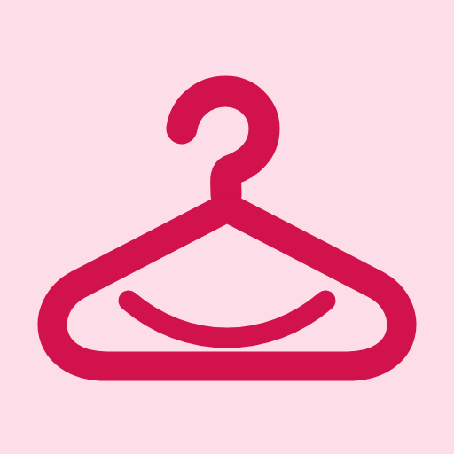
  <h1>심청이 · 패션 에이전트</h1>
  
<strong>말로 묻고, 카메라로 확인하는 시각장애인용 AI 옷 코디 에이전트</strong>

  
"설명해 주는 앱은 있었지만, 골라 주는 앱은 없었습니다."

  
📅 <b>개발 기간</b> : 2026.10.27 ~ 2026.11.20 &nbsp;·&nbsp; 👥 <b>팀 심청이</b>

## 📖 어떤 앱인가요?

시각장애인이 아침에 옷을 고를 때 가장 어려운 건 **"이 옷이 오늘 맞는지, 얼룩은 없는지"를 혼자 확인하는 일**입니다.
**심청이**는 말로 대화하는 AI 에이전트예요. 오늘 날씨와 일정을 보고 먼저 말로 옷을 추천하고, 꺼낸 옷을 카메라에 비추면 맞는지, 얼룩이나 찢어진 곳은 없는지 알려 줍니다.

- **옷을 따로 등록하지 않아요.** 평소 옷장 정리 방식은 그대로 두고, 꺼낸 옷을 확인만 해요.
- **사진 찍기 버튼이 없어요.** 폰이 구도를 소리로 안내하고, 옷이 잘 들어오면 알아서 한 장을 찍어요.
- **쓸수록 내 옷이 기록돼요.** 확인한 옷과 입은 날이 쌓여 다음 추천은 내 옷 중에서 골라요.

## 👥 누가 무엇을 했나요

<table align="center">
  <tr>
    <td align="center" valign="top" width="33%">
      
      <h3>이진행</h3>
      <a href="https://github.com/ehgo508">@ehgo508</a>
      
<b>기획 · 앱과 대화의 뼈대</b> 방향·로그인·음성·대화 흐름·응답 속도

      
fashion-agent(앱) · gateway · agent

      
     

    </td>
    <td align="center" valign="top" width="33%">
      
      <h3>박창근</h3>
      <a href="https://github.com/chang0580">@chang0580</a>
      
<b>내 옷장 · 화장 확인 · 날씨</b> RAG·얼굴 모델·배포 정리

      
mcp-closet · mcp-face-check(화장) · mcp-weather

      
     

    </td>
    <td align="center" valign="top" width="33%">
      
      <h3>정지원</h3>
      <a href="https://github.com/jiwon934">@jiwon934</a>
      
<b>옷 상태 모델 · 치아 · 일정</b> 학습 모델·DB 정규화

      
mcp-clothes-state · mcp-face-check(치아) · mcp-schedule

      
     

    </td>
  </tr>
</table>

### &nbsp; 이진행: 기획, 앱과 대화의 뼈대
> 레포 **10곳** · 옷 추천 응답 **1.77 → 1.04초** · 시각장애인 관점 점검 **11가지** 반영 · 서버 목소리 대체 경로(Azure → 엣지)

- **방향 잡기**: "옷을 따로 등록하지 않고, 폰으로 비춰 확인하는 음성 AI 에이전트"라는 뼈대, 옷 추천 두 단계(말로 먼저 추천 → 카메라로 꺼낸 옷 확인), 첫 실행 흐름(인사 → 허용 → 구글 로그인 → 말 속도·목소리 → 이름 → 내 정보 → 호칭)
- **앱(Flutter)**: 음성 에이전트 기본 틀과 음성 온보딩, 오늘 날씨 음성 안내, 앱 대화를 agent `/turn`에 연결, 이름을 불러 말 걸기(서버 음성 인식으로 이름 짐작), 말로 이름·호칭·내 정보 바꾸기, 옷 보여 주는 방식 고르기(내려놓고 비추기 / 입고 한 바퀴), 카메라 구도 말 안내와 자동 촬영(ML Kit), 구글 로그인 → Firebase → gateway 연결, 첫 실행 흐름, 일정 폰 알림(전날 저녁·당일 아침, 일정마다 며칠 전·끄기), 색 설명 방식(짧게/자세히) 기억, 시각장애인 관점 점검 반영(기다림 진동·구도 소리·시리 단축어·잠깐 쉬기)
- **gateway**: 로그인(Firebase·개발용)과 JWT, 회원정보(호칭·말 빠르기 포함), 사용량 제한, 뒤쪽 서버 라우팅, agent에 옷 판단용 내 정보 넘기기. 말 받아 적기(`gpt-4o-mini-transcribe`), 서버 목소리(Azure 유진 → 막히거나 무료 한도 전이면 엣지 선희, 젯슨 edge-tts 사이드카, 빠르기 반영, 앞뒤 무음 없애기)
- **agent**: 옷 추천 두 단계와 MCP 클라이언트 뼈대, 판단 LLM을 Gemini에서 GPT로 바꾸기, GPT 도구 선택(일정 넣기·지우기, 넣은 뒤 알림 묻기), 얼굴 확인을 화장 대칭·치아 두 도구로 나누기, 날짜를 말하면 그날 일정·예보로 추천, "이거 무슨 색이야?" 빠른 색 확인, 색을 감각·느낌으로 설명하기, 입는 사람 정보를 GPT 판단에 넣기, GPT 확인은 동의한 사용자만(처음 애매한 얼룩 때 한 번 묻기), MCP 서버 재시작 뒤 첫 요청 실패 고치기
- **다른 서버에 더한 것**: mcp-weather `weather_forecast`(날짜별 예보)와 더운 날 일교차로 겉옷 권하지 않기, mcp-schedule `schedule_set_reminder`, mcp-clothes-state 색 어울림 점수(0~100과 까닭)
- **응답 속도**: 옷 추천 1.77초 → 1.04초, 옷 확인 1.95초 → 1.47초 (GPT priority 처리·짧은 답·연결 데우기, 켜질 때 모델 데우기·모델과 GPT 확인 동시에, 옷 사진 긴 변 960으로 줄여 보내기)
- **팀 공통**: 레포마다 PR 자동 테스트(CI), 서버 레포 README, 아키텍처·서비스 간 약속 문서(`docs/contracts/`), Spec Kit DB 통합 설계, 발표 버전 릴리스(9개 레포 `develop` → `main`), IT Festival 신청서·발표 자료

<b>자세히 보기: 쓴 기술·이론·작업 기록 (이진행)</b>

#### 1. 앱 (Flutter)

| 무엇 | 쓴 기술·내용 | 근거 |
| --- | --- | --- |
| 첫 뼈대 | 플랫폼 설정, 오늘 날씨·기온 음성 안내, 음성 AI 에이전트 베이스(온보딩 + 옷 검사 + 날씨) | 앱 #1·#2·#3 |
| 초기 옷 검사 | 일정·날씨·얼룩/찢어짐 확인으로 바꾸기, 배포된 Worker를 기본 비전 서버로, Gemini 오류 이유 담기, 옷 이름·notes 짧게 받기 | 앱 #4·#7·#8·#9 |
| 로그인 | 구글 로그인 → Firebase → gateway 로그인 연결 | 앱 #21 |
| 대화 연결 | 앱 대화를 agent `/turn`에 연결, 카메라 자동 촬영 | 앱 #25 |
| 이름 불러 말하기 | 에이전트 이름을 부르면 듣기, 카메라 중 계속 듣기, 못 듣던 문제·질문 뒤 말할 시간, 서버 음성 인식으로 이름 짐작 | 앱 #26·#40·#41 |
| 카메라 | ML Kit로 옷·몸이 잘 들어왔을 때만 찍기와 구도 말 안내, ML Kit 모델 묶음을 앱에 넣어 카메라 화면 꺼짐 고치기, 옷 사진 긴 변 960 | 앱 #33·#36·#85 |
| 옷 보여 주는 방식 | 내려놓고 비추기 / 입고 한 바퀴 고르기 | 앱 #27 |
| 첫 실행 | 동의 한 번에 받기, 인사 → 허용 → 구글 로그인 → 불러오기·말 속도 → 이름, 처음 안내 짧게 | 앱 #41·#43·#45 |
| 말로 바꾸기 | 말로 이름·호칭·정보 바꾸기, "첫 화면" 명령 | 앱 #35 |
| 일정 알림 | 일정 전날 저녁·당일 아침 폰 알림, 일정마다 정한 알림(며칠 전·끄기)대로 예약 | 앱 #46·#48 |
| 발표·리허설 | 리허설 버그(옷 검사 말, 위치 안내, 말 속도), 발표 피드백(빠른 대답, 추임새, 한 목소리, 친구 같은 말투) | 앱 #37·#38 |
| 서버 목소리 | 엣지 선희 + 젯슨 edge-tts 사이드카, Azure 키 넘기기, 문장 사이 텀 줄이기, "천천히/빠르게 말해 줘"로 빠르기 바꾸기, 아이폰 소리 키우기 | 앱 #24·#67·#69·#71·#75·#77·#78 |
| 색 설명 | 색 설명 방식(짧게/자세히) 기억해 보내기 | 앱 #83 |

#### 2. 시각장애인(VoiceOver) 관점 점검 반영 (앱 #82)

| 고친 것 | 내용 |
| --- | --- |
| 허용 창 안내 | "'허용 안 함'은 지나치고 '허용'이나 '확인'에서 두 번 탭" |
| 기다림 진동 | 서버를 기다리는 동안 2초 뒤부터 2.5초마다 짧은 진동, 6초 넘으면 "아직 보고 있어요" |
| 셀카 구도 안내 | 화장 확인 전 멀리/가까이/가운데로 실시간 안내, 8초 못 맞추면 멈추면 찍기 |
| 연결 오류 | 연결 오류는 0.8초 뒤 한 번 더, 서버 오류는 두 번 넣지 않게 다시 안 보냄, 하던 대화 남겨 두기 |
| VoiceOver 이름 | 말하기 영역을 상태별(듣는 중/알아보는 중/말하는 중/말하기)로 짧게 읽기 |
| 구도 삑 소리 | 가운데·알맞은 크기에 가까울수록 소리+진동 간격 1.1초 → 0.15초 |
| 그 밖 | 일정 알림을 누르면 그날 옷 추천으로 시작, 시리 단축어, 잠깐 쉬어, "나중에 할게"로 남은 질문 넘기기 |

점검 문서 12가지 중 11가지를 고쳤어요(9번 매직 탭은 빠짐).

#### 3. gateway (Spring Cloud Gateway)

| 무엇 | 쓴 기술·내용 | 근거 |
| --- | --- | --- |
| 뼈대 | Firebase·개발용 로그인, **JWT** 발급·검증, 회원정보, 사용량 제한, 뒤쪽 서버 라우팅 | gateway #2 |
| 회원정보 | 호칭(`callName`), 말 빠르기(`speechRate`), agent에 옷 판단용 내 정보 붙이기 | gateway #4·#7·#15 |
| 음성 | 구글 목소리 TTS `/api/v1/tts`, 서버 음성 인식 `/api/v1/stt`(OpenAI `gpt-4o-mini-transcribe`) | gateway #5·#6 |
| 서버 목소리 대체 | 엣지 선희(edge-tts 사이드카), Azure 유진이 실패하면 엣지로, Azure 무료 한도(1분 20번) 전에 엣지로, 앱이 보낸 빠르기로 읽기, Azure 소리 앞뒤 무음 없애기 | gateway #10·#11·#12·#13·#14 |

#### 4. agent (Spring AI · MCP · GPT)

| 무엇 | 쓴 기술·내용 | 근거 |
| --- | --- | --- |
| 뼈대 | 옷 추천 두 단계, **MCP 클라이언트**, Gemini/규칙 판단 | agent #2 |
| 판단 LLM | GPT 도구 선택(일정 등록·삭제), 판단 LLM을 GPT로 | agent #4 |
| 얼굴 확인 | 화장 대칭·치아 두 도구로 나누기(agent 코드), 이가 애매하면 혀로 먼저 확인하게 안내 | agent #5·#36 |
| 날씨·일정 | 못 불러왔을 때 지어내지 않기, 일정 시각을 말로 읽기, 날짜를 말하면 그날 일정·예보로 추천, 날씨·일정 캐시, 일정 넣은 뒤 알림 묻기 | agent #3·#11·#13·#21 |
| 옷 확인 대화 | 옷 보여 주는 방식 고르기, 한 벌 판단 뒤 "더 찍으실 옷이 있으면", 안 맞는 옷에 "잘 고르셨어요" 안 하기 | agent #7·#14·#46 |
| GPT 사용 동의 | 동의한 사용자만 GPT 확인, 처음 애매한 얼룩이 나올 때 한 번만 묻기 | agent #15·#17 |
| 색 | "이거 무슨 색이야?" 빠른 색 확인, 색을 감각·느낌으로 설명, 색 어울림 점수를 근거로 말하기 | agent #41·#45·#47 |
| 판단 입력 | 옷 추천·확인 GPT 입력에 내 정보(wearer) 넣기, 더운 날 일교차로 겉옷 권하지 않기 | agent #42·#53 |
| 안정성 | MCP 서버를 다시 켠 뒤 첫 요청 실패 고치기, 일정 지운 뒤 카메라가 켜지던 문제 | agent #16·#37 |

#### 5. 응답 속도

| 무엇 | 바꾼 것 | 전 → 후 | 근거 |
| --- | --- | --- | --- |
| 옷 추천 (/turn) | GPT priority 처리, 답 짧게, 연결 데우기(켜질 때 + 30분 동안 4분마다) | 1.77초 → **1.04초** | agent #49 |
| 옷 확인 (/turn, 두 벌) | 위와 같음 | 1.95초 → **1.47초** | agent #49 |
| 옷 상태 첫 사진 | 켜질 때 모델 데우기, 모델과 GPT 확인 동시에 | 711ms → **335ms** | clothes-state #28 |
| 옷 사진 올리기 | 긴 변 960으로 줄여 보내기 | 보낼 크기 약 45% 줄임 | 앱 #85 |

#### 6. 다른 서버·팀 공통

| 무엇 | 내용 | 근거 |
| --- | --- | --- |
| mcp-weather | `weather_forecast`(날짜 하루 예보), 더운 날은 일교차가 커도 겉옷 필요로 보지 않기 | weather #5·#9 |
| mcp-schedule | 일정마다 알림 받기·며칠 전 미리 알림 저장(`schedule_set_reminder`) | schedule #7 |
| mcp-clothes-state | 색 조합 어울림 점수(0~100)와 까닭, 옷 종류 모델이 없을 때 옷 색 잡기 | clothes-state #11·#27 |
| CI | 9개 레포에 PR마다 자동 테스트 | 각 레포 ci PR |
| 문서 | 레포마다 README(역할·약속·할 일), 아키텍처·기술 스택 결정과 서비스 간 약속, Spec Kit DB 통합 설계, 판단 LLM을 GPT로 | 각 레포 #1, 앱 #12·#15·#17·#18 |
| 발표 버전 릴리스 | 8개 레포 `develop` → `main` (11-19) | 각 레포 release PR |

### &nbsp; 박창근: 내 옷장, 화장 확인, 날씨, 대화 품질, 배포·문서
> 모델 학습 **109시간 이상** · 눈화장 학습 **396판** · 화장 측정 방식 **35가지** 비교

- **mcp-closet (서버 전체, PR 14)**: e5 글 벡터 RAG 검색, 최근 입은 옷 감점과 입은 조합(`closet_outfits`), 옷장 읽기·지우기(`closet_list`·`closet_remove`), FashionSigLIP 사진 벡터로 같은 옷 합치기와 이름 고르기, 애매하면 GPT가 작은 사진 두 장으로 확인(`closet_merge`), 같은 옷 기준값 일상 사진 실측(0.68 → 0.60), 이미지 모델 **12개 비교**(같은 옷 찾기 58% → 85%, 착각 3.0% → 0.4%)
- **mcp-face-check 화장 대칭 (PR 20)**: 윤곽점·픽셀 측정 서버, CelebA 2,832장·FFHQ 실사진으로 기준값, 얼굴 분할 모델 비교 후 BiSeNet ResNet34, 직접 학습한 좌우 비교 모델(눈썹 길이 22 → 84%, 눈썹 두께 51 → 92%, 입술 너비 20 → 82%, 볼 터치 58 → 77%), 흐린 사진 잘못 알림 16 → 5%, 실사진 잘못 알림 63 → 31%
- **눈화장 모델 (젯슨 GPU 101.6시간, 396판)**: 픽셀 비교 → 직접 설계한 망 → 넓은 망 + TTA → 안경 거르기 → ResNet18 앙상블. 실사진 검출 약 10% → 78.6%, 처음 보는 사람 56.0 → 63.8%
- **mcp-weather (서버 전체)**: Open-Meteo 서버, 끊기면 재시도, 학교 망 시간 초과면 MET Norway로, 날짜 바뀌면 캐시 새로
- **mcp-clothes-state 정확도 보강 (PR 9)**: 글 벡터로 애매한 옷 종류 다시 보기(입은 옷 66 → 75.5%, 빈 벽 오인 60 → 0장), 학습 벡터 probe(폰 사진 세부 13종 78.2 → 81.3%), 애매한 옷만 SigLIP2 So400m(81.4 → 83.1%), So400m 색 분류
- **agent 대화 품질 (PR 95)**: 앱 시뮬레이션을 여러 회차 돌려 찾은 대화 오류를 고친 PR 95개(날짜 이어 받기 "모레는?"·"다음주 화요일", 면접·결혼식·장례식 자리별 차림, "비 온대"·"영하야?" 날씨 후속 질문, 카메라 중 "그만"·"끝" 등), 옷장·날씨 대화 흐름, 체감 온도를 실제 값으로 바로잡기, 열린 PR 10개 한꺼번에 합치기
- **목소리·앱·도우미**: Azure 목소리 4가지(유진·지민·서현·순복) 도입과 기본값, TTS 교착(문장마다 9초) 고치기, 앱 화면 개편 "인당수의 밤"과 심청이 그림, 화장 확인이 얼굴을 못 찾던 실기기 버그 고치기, 날씨 30분 캐시, 아이폰 설치 스크립트, mcp-helper 서버 구현
- **배포·품질·문서**: 젯슨 두 대 배포 설정(서버마다 메모리 상한·스왑 금지), 8개 레포 테스트 커버리지 80% 기준 CI(앱 72 → 81.6%), 아키텍처 그림·ERD, 이 README(역할·Tech Stack·앱 화면 26장·학습 그래프)

<b>자세히 보기: 쓴 기술·이론·학습 기록 (박창근)</b>

#### 1. 내 옷장 (mcp-closet) · 같은 옷 찾기

| 무엇 | 쓴 기술·이론 | 데이터 | 결과 (전 → 후) | 근거 |
| --- | --- | --- | --- | --- |
| RAG 검색 | 상황 문장을 multilingual-e5-small(ONNX) 글 벡터로 바꿔 PostgreSQL **pgvector**에서 가까운 옷·코디 지식을 찾고, 추천 문장은 agent의 GPT가 생성 | 내 옷장 + 코디 지식 문서 | `closet_search` 후보 + 지식 | closet #2 |
| 같은 옷 합치기 | clothes_inspect가 준 **FashionSigLIP 768차원** 사진 벡터의 코사인 유사도, 본 사진들 평균 벡터 | 옷 30벌 옷장 흉내(DeepFashion In-shop 표본) | 글 설명 규칙 36% → 사진 한 장 58% → 평균 73% | closet #8, DEVELOPMENT.md |
| 보정 행렬 | **WCCN**(같은 옷 안의 흔들림을 줄이는 선형 변환)을 CC0 사진으로 만들어 비교 전에 곱함 | CC0 clothing-dataset | 73% → **78%**, 착각 2.2 → **1.4%** (DeepFashion 행렬은 85%·0.4%, 시연용) | DEVELOPMENT.md |
| 이미지 모델 고르기 | FashionSigLIP·SigLIP·SigLIP2·FashionCLIP·Jina CLIP·DINOv2·CLIP 등 **12개** 같은 조건 비교 | 같은 옷 표본 | FashionSigLIP 1등 (DINOv2·CLIP B 계열 26~45%) | DEVELOPMENT.md |
| 기준값 | "새 옷 잘못 합침 5%"에 맞춰 기준을 정하고 일상 사진으로 다시 잼 | DeepFashion2 일반인 사진 1,500벌 6,343행 | 0.68 → **0.60** | closet #10 |
| 애매하면 GPT | 기준 아래 일정 구간은 새 옷으로 저장하고 `maybeSameAs`로 가장 가까운 옷 작은 사진을 알려 GPT가 두 장을 비교해 `closet_merge` | – | 섞임 없이 중복만 줄이기 | closet #11 · agent #23 |
| 서버 두 개 이어 실측 | clothes_inspect → closet_save를 MCP로 이어 30벌 × 5명 | 같은 옷 75번·새 옷 75번 | 맞게 합침 61% → 71%(CC0 보정), 저장 16~20ms | DEVELOPMENT.md |

#### 2. 화장 좌우 비교 (mcp-face-check)

| 무엇 | 쓴 기술·이론 | 데이터 | 학습 | 결과 (전 → 후) | 근거 |
| --- | --- | --- | --- | --- | --- |
| 측정 서버 | ML Kit 윤곽점 + 픽셀 측정, 여러 장 **중간값** | – | – | 첫 판 | face-check #2 |
| 얼굴 분할 | **BiSeNet** ResNet18 → ResNet34(CelebAMask-HQ 19분류), SegFormer·FaRL·MediaPipe 비교 | FFHQ 실사진 | – | 4항목 평균 51.4 → **53.3%**, 같은 사진 짝 비교 **p = 0.019** | face-check #7·#11, face-parsing-models.md |
| 분할 미세조정 (시도) | 서버 구도(두 눈 기준 512×512)로 다시 학습, 눈썹·입술 손실 2배 | CelebAMask-HQ 26,087장 | 맥북 M2 **1시간 47분** | 분할은 좋아졌지만 검출은 그대로(p = 0.42) → 안 바꿈 | face-check #12 |
| 좌우 비교 CNN | 왼쪽·오른쪽 같은 자리 조각을 **같은 가중치의 작은 CNN**에 넣어 점수 차이로 판단(좌우를 바꾸면 부호만 바뀜), 0.8MB·약 2ms | CelebA 5,371장 × 편집 4가지 = 항목마다 12,598쌍 | 항목마다 CPU 약 25분 × 4개 | 눈썹 길이 22 → **84%**, 두께 51 → **92%**, 입술 너비 20 → **82%**, 볼 58 → **77%** | face-check #14·#15 |
| 흐린 사진 거르기 | 흐린 사진에선 눈썹 길이 모델을 건너뜀 | – | – | 흐린 사진 잘못 알림 16 → **5%** | face-check #16 |
| 기준값 | 손대지 않은 실사진 점수의 **p95**(상위 5%)를 기준선으로 | CelebA 2,832장 → FFHQ 실사진 590장 | – | 멀쩡한 사진에서 하나라도 잘못 알림 63 → **31%** | face-check #17 |
| 측정 방식 비교 | 재는 방식 약 35가지(분할 모델 4, 좌우 비교 모델 5, 기준값 3벌 포함) | – | – | 항목마다 가장 나은 방식 채택 | face-check docs/lab.md |

#### 3. 눈화장 모델 (젯슨 GPU 101.6시간, 396판)

| 단계 | 쓴 기술·이론 | 데이터 | 학습 | 실사진 검출 | 근거 |
| --- | --- | --- | --- | --- | --- |
| 1 | 눈꺼풀·눈 밑 밝기 비교(규칙) | – | – | 약 10% | face-check #18 |
| 2 | 직접 설계한 작은 CNN, 양쪽 특징을 같이 보는 머리 `h(왼,오) − h(오,왼)` | CelebA 한쪽 섀도·아이라인 합성 1.5만 → 5.9만 쌍 | CPU | 43 → **50%** | face-check #21 |
| 3 | 넓은 망 4판 + **TTA**(7가지로 옮겨 잘라 평균) | 8.5만 쌍(FFHQ 401장, 머리카락·그늘 덧씌운 쌍 포함) | 8에폭, CPU 4코어 **약 4시간** | **61%** | face-check #22 |
| 4 | 안경이 눈 조각 2%를 넘으면 건너뛰고 기준 0.31 → 0.26 | FFHQ 346장 | – | **72%** | face-check #25 |
| 5 | ImageNet ResNet18 몸통 + **앙상블**(서버 모델 + 하나씩 점수 상위 3개, 미리 정한 규칙) | 9.2만 쌍 | 젯슨 GPU 에폭당 약 4분, **396판 · 101.6시간**(시간이 남은 287판 합) | **78.6%**, 잘못 알림 4.1% | face-check #26 |
| 6 | 다양한 얼굴로 학습한 ResNet18 3개로 교체 | – | – | 처음 보는 사람 56.0 → **63.8%** | face-check #34 |

- 몸통 비교(판마다 최고): ResNet18 79.6%(381판) · ResNet50 71.6 · ConvNeXt-T 71.2 · RegNet 70.5 · ResNet34 70.0 · EfficientNet-B0 68.5 · 작은 망 63.3
- 서버 부담 실측: 한 번 판단 0.32 → 0.47초, 메모리 619 → 814MB → 젯슨 컨테이너 한도 768 → 1024MiB

#### 4. 날씨 (mcp-weather)

| 무엇 | 내용 | 근거 |
| --- | --- | --- |
| 출처 비교 | Open-Meteo·기상청 단기예보·OpenWeatherMap을 5개 도시 × 3번 실제로 불러 비교: 응답 중앙값 0.90초 / 3.46초(최대 15.3초) / 0.71초(키 필요) | mcp-weather-compare |
| 대체 경로 | Open-Meteo가 안 되면 MET Norway, 시간 초과는 다시 묻지 않고 바로 넘어가기 | weather #7·#8 |
| 캐시 | 날짜가 바뀌면 다시 부르기(캐시 키에 서울 날짜), 앱은 30분 캐시·마지막 위치 먼저·켤 때 미리 받기 | weather #11 · agent #67 · 앱 #39 |

#### 5. 옷 종류 정확도 보강 (mcp-clothes-state, PR 9)

| 무엇 | 쓴 기술·이론 | 평가 | 결과 (전 → 후) | 근거 |
| --- | --- | --- | --- | --- |
| 글 벡터로 다시 보기 | 옷 조각 사진 벡터를 미리 계산한 글 벡터 35개(12종 + 벽·바닥 등 "none")와 비교, 모델이 애매할 때만 바꿈 | DeepFashion2 일반인 사진·CC0 | 입은 옷 66.0 → **75.5%**, 내려놓은 옷 92.7 → 95.3%, 빈 벽 60장 → **0장** | clothes-state #23 |
| 모델 쪽 가산점 | 모델이 고른 큰 분류에 `0.01 + 확신도 × 0.005` | 폰 사진 364장 | 81.6 → **83.2%** | clothes-state #30 |
| 학습 벡터 probe_v4 | 글 벡터에서 출발해 서버 박스 벡터로 다듬은 **linear probe** | DF2 train 4,000장 포함, 평가 폰 사진 1,841장 | 큰 분류 80.2 → **81.9%**, 세부 13종 78.2 → **81.3%** | clothes-state #32 |
| 큰 모델은 애매할 때만 | SigLIP2 **So400m**(fp16, GPU) 벡터 서버, 조건을 만족하는 옷만 다시 고름 | – | 81.4 → **83.1%** | clothes-state #35 |
| So400m 색 | 무채색·어두운 색일 때만 큰 모델 색 분류로 바꿈 | – | 주황→초록 오답 막기 | clothes-state #44·#46 |

#### 6. agent 대화 품질 (PR 95)

앱 시뮬레이션을 회차마다 돌려 실제 대화에서 틀린 답을 찾아 고쳤어요. 한 PR은 한 주제에만 셌어요.

| 주제 | PR 수 | 예 |
| --- | ---: | --- |
| 날짜 이어 받기·날짜 읽기 | 25 | "모레는?", "다음주 월요일" 뒤 "화요일은?", "다음달 3일", 크리스마스 |
| 날씨 후속 질문 | 24 | "비 온대", "영하야?", "운동화 젖어?", "뭐 신지?", 지금 맑아도 오늘 비면 알려 주기 |
| 자리별 차림 | 16 | 면접·결혼식·장례식에 청바지·운동화, 데이트·소개팅은 더 깔끔하게, 넥타이·가방 |
| 카메라 중 말 | 8 | "그만", "끝", 본 옷 없이 그만이면 카메라 끄기 |
| 옷장·옷 종류·색 | 8 | 샌들·부츠·후드티 추가, "이 두 개 어울려?"에 어울림 점수 |
| 그 밖 | 14 | 시뮬 회차별 오류 7가지, 한 사진 여러 벌, 열린 PR 10개 합치기, 커버리지 CI |

#### 7. 목소리·앱·배포·품질

| 무엇 | 내용 | 근거 |
| --- | --- | --- |
| 서버 목소리 | Azure Speech 유진·지민·서현·순복 도입, 기본 유진, 엣지 3명과 함께 고르기, 32kbps(16kHz)로 파일 줄이기 | gateway #9·#16, 앱 #57·#64·#70 |
| TTS 고치기 | 새 문장마다 9초 기다리던 TtsCache 교착, 긴 답이 폰 목소리로 넘어가지 않게 조각 나누기 | 앱 #60·#84 |
| 화장 실기기 버그 | release 빌드의 FAKE_CAMERA가 얼굴을 못 찾게 하던 원인, ML Kit 윤곽점 같이 보내기, 못 찾으면 폰에서 바로 다시 비추기, 사진 긴 변 1080 | 앱 #58·#63·#66·#88 |
| 화면 | 앱 화면 개편 "인당수의 밤"(쪽빛 바탕·노랑 큰 글씨), 심청이 그림 | 앱 #51·#53 |
| 설치·도우미 | 아이폰 설치 스크립트, mcp-helper 서버(helper_contacts·helper_ask·helper_answer) | 앱 #68·#74, helper #2 |
| 배포 | 젯슨 두 대 compose: 서버마다 메모리 상한, 스왑 금지, 포트는 Tailscale IP에만 | 앱 #99 |
| 테스트 | 8개 레포 커버리지 80% 기준 CI(JaCoCo·pytest-cov), 앱 72 → **81.6%** | 앱 #106, agent #144 등 |
| 문서 | 아키텍처를 실제 배포 기준으로, 이 README의 역할·Tech Stack·앱 화면 26장·그래프 10장 | 앱 #98, .github PR 14개 |

### &nbsp; 정지원: 옷 상태 모델, 치아, 일정, DB
> 모델 학습 **67시간 이상** · 옷 상태 실험 **56가지** · 치아 실험 **18가지** · 레포 **9곳**

- **mcp-clothes-state (서버 전체, PR 32)**: Java MCP 서버, 얼룩·찢어짐 YOLO v1 ~ v7 학습·비교(v6 채택, 애매하면 GPT → 사진 단위 정답률 98.1%, 장당 14ms), 옷 종류 12종 모델(80.3 → 86.7%), K-Fashion 2.5만 벌로 시험한 색 모델(45.3 → 76.8%)과 색 조합 판단, 무늬 8종(FashionSigLIP LoRA 섞기 + GPT high, 입은 옷 84.5 → 90.0%, 교체 준비), 입은 옷 실수 모델(단추 79.7 → 93.7%, 뒤집힘·택), GPT에 보낼 때 얼굴 가리기, 젯슨 성능 측정
- **mcp-face-check 치아 (직접 학습)**: `teeth_check` ONNX 모델, 앞니 사이 고춧가루 실제 사진 0.03 → 0.96(v4), 6번 보고 평균으로 잘못 알림 3.1 → 1.1%
- **mcp-schedule (서버 전체)**: 카카오 로컬 장소 분류, 격식 일정 드라이클리닝 안내, 아침 브리핑, 일정별 알림 시각(`remind_time`)
- **DB 설계·정규화**: 전체 DB 설계와 Spec Kit 기능 spec, V4 정규화(account `user_identities`, schedule `places`, closet `garment_defects`), spec 시나리오 통합 테스트
- **보안·구조 정리**: `X-User-Id` 헤더 없애고 로그인 토큰 직접 확인, 로그인 없는 경로 횟수 제한, 레포 패키지 구조 정리, 테스트 보강
- **앱·배포**: 서버를 기능별 레포로 나누기, 젯슨 상시 배포(Docker Compose·Nginx·Funnel) 처음 구성, 치아·화장 촬영 안내와 입 주변만 잘라 보내기, 앱 켤 때 미리 준비(`/agent/warm`), 조직 프로필 README·ERD 처음 작성

<b>자세히 보기: 쓴 기술·이론·학습 기록 (정지원)</b>

#### 1. 얼룩·찢어짐 모델 (YOLO26n 검출, v1 ~ v7)

모두 Ultralytics YOLO 미세조정이고, 시험 사진 114장(얼룩 박스 212, 찢어짐 박스 32)과 깨끗한 옷 200장으로 쟀어요.

| 판 | 바꾼 것 | 데이터 | 학습 | mAP50 | 깨끗한 옷 오탐(0.5↑) |
| --- | --- | --- | --- | --- | --- |
| v1 | Roboflow 공개 데이터 합치기 | 2,604장(찢어짐 63장) | 30에폭 · 27분 | 0.485 | – |
| v2 | 찢어짐 사진 2,071장 추가 | 5,239장 | 60에폭 · 103분 | 0.610 | 20장 |
| v3 | 옷 전체 사진 365장(자동 라벨 후 검토) + 얼룩 합성 411장, 입력 1024 | – | 20에폭 · 155분 | 0.613 | – |
| v4 | 쇼핑몰 깨끗한 옷 1,592장으로 오탐 줄이기, v2와 같이 씀 | – | v2에서 이어서 | 0.620 | 7장 |
| v5 | 기본 모델에서 처음부터 한 모델로, 찢어짐 사진 2배 | – | 60에폭 | 0.602 | 1장 |
| **v6 (채택)** | 하이퍼파라미터 **자동 조정(tune) 30회**, 밝기·크기 변화 줄임 | 8,663장(얼룩 박스 9,527·찢어짐 7,998) | 조정 약 12시간 + 2시간 25분 | **0.636** | **1장** |
| v7 (안 씀) | 실사진 12 + 입은 사진 합성 330 | – | 53에폭 | 0.693 | 3장(의심 10 → 32장) |
| v6ft (탈락) | v6에서 낮은 학습률로 이어서 | + 실사진 12×5, 깨끗한 옷 400 | 2시간 28분 | 0.626 | 4장 |

| 같이 한 실험 | 내용 | 결과 |
| --- | --- | --- |
| 모델 크기 비교 | YOLO11n·11s·26n·26s를 같은 v2 데이터 60에폭(81·122·103·151분) | 26n: 점수 비슷, 11s보다 1.4배 빠름 |
| 큰 공개 모델 | OWLv2·Grounding DINO 그대로(zero-shot), OWLv2 + **LoRA**(r 8, 2시간 22분) | AP50 0.081·0.058 → LoRA 0.487, 우리 v6 0.555 |
| 판단 기준 | 0.5 이상 바로 알림, 0.2~0.5는 동의한 사용자만 gpt-4.1-mini로 확인 | 사진 단위 91.9 → **98.1%** |
| 젯슨 실행 방식 | PyTorch / TensorRT FP32·FP16·INT8 비교 | FP16: 점수 그대로 계산 약 4배 빠름, INT8은 점수 약 0.1 하락 |

#### 2. 옷 종류·색·무늬·입은 옷 실수

| 모델 | 쓴 기술 | 데이터 | 학습 | 결과 (전 → 후) |
| --- | --- | --- | --- | --- |
| 옷 종류 5종 | YOLO26n 검출 | Fashionpedia | 30에폭 · 7시간 20분 | 시험 mAP50 0.901 |
| 옷 종류 12종 2차 | 12종으로 다시, Clothing dataset 4,104장 추가 | – | 30에폭 · 약 8시간 | 바닥에 펼친 옷 80.3% |
| fashion12c | 중고 의류 5,809장(가디건·조끼·니트·재킷·코트) | – | 15에폭 · 4시간 40분 | 82.8%, 중고 시험 0.719 → 0.860 |
| fashion12d | 바닥에 놓인 신발 410장 | – | 8에폭 · 2시간 21분 | 85.2%, 놓인 신발 0.015 → 0.986 |
| **fashion12e (채택)** | 학습률 1/5로 다듬기 | – | 8에폭 · 2시간 19분 | **86.7%**, 큰 분류 91.6% |
| 코트·재킷 애매 | 1·2등 점수 비율이 0.1 이상이면 "겉옷" | 652장 | – | 잘못 부름 23 → 14장 |
| 옷 색 | 작은 CNN 64×64(0.8MB), 히스토그램 + MLP와 비교 | AI Hub K-Fashion 17만 벌 20색, 시험 25,626벌 | 18에폭 · 약 40분 | 색 계열 45.3 → **76.8%**, 흰 옷 15 → 87% |
| 무늬 8종 (지금 서버) | YOLO26n-cls + 모르면 GPT | Fashionpedia + 중고 의류 무늬 | 25에폭 · 47분 | 바닥에 펼친 옷 86.5 → **90.5%** |
| 무늬 (교체 준비) | FashionSigLIP + **LoRA**(r 8), linear probe 비교, K-Fashion 76,182장 이어 학습, **가중 확률 섞기**(0.7 : 0.3), 확신 낮은 옷만 GPT high | Fashionpedia 7,465 시험 | 89분 + 2시간 7분 (+ 384px 5시간 36분, r16 2시간 59분은 탈락) | 입은 옷 84.5 → **90.02%** |
| 입은 옷 실수 | YOLO26n-cls 두 클래스, 택·단추·뒤집힘을 합성 | 택 10,792 · 단추 8,284 · 뒤집힘 9,012장 | 1차 → 2차, 실제 사진으로 이어 학습(단추 6판) | 택 87.8 → 90.9, 단추 79.7 → **93.7**, 뒤집힘 87.0 → 90.0% |

#### 3. 치아 이물질 (teeth_check)

| 판 | 바꾼 것 | 학습 | 결과 |
| --- | --- | --- | --- |
| v1 | 바깥 입술 + 25%로 자르기 | – | 앱에서 같은 구도를 못 만들어 바꿈 |
| v2 | ML Kit 입술 안쪽 점 × 1.36으로 자르기 | 최고 6에폭 | 합성 시험 87.2%, 고춧가루 실사진 0.03 |
| v3 (탈락) | 320px, 고춧가루 2배·립스틱·저화질 | CPU 약 33분 | 실사진 점수가 0.21~0.97로 흔들림 |
| **v4 (채택)** | 384px, 고춧가루 3배 | CPU 약 38분 + 합성 4분 | 합성 시험 **91.2%**, 고춧가루 실사진 **0.96~1.0** |
| 보는 방식 | 여백 3가지 × 좌우 뒤집기 **6번 평균** | – | 깨끗한 이 잘못 알림 3.1 → **1.1%** |
| 이어 학습·LoRA 7판 | full·LoRA r4·r8·r16 등 | 젯슨 GPU 판당 약 5분 | AUC 0.958 ~ 0.967, 실제 깨끗한 이 오알림이 늘어 v4 유지 |

- 데이터: FFHQ 얼굴에서 이가 보이는 1,310명을 학습, 262명은 시험에만, 깨끗한 이 사진에 고춧가루·깨·밥알을 그려 넣은 합성
- 얼굴·치아 사진은 외부 AI(GPT)로 보내지 않기로 정함

#### 4. 일정·DB·보안·배포

| 무엇 | 내용 | 근거 |
| --- | --- | --- |
| mcp-schedule | 서버 처음 구현(Spring AI `@McpTool` + 카카오 로컬 + PostgreSQL), 장소 종류, 격식 일정 드라이클리닝 안내, 아침 브리핑, 며칠 전 알림을 아침(또는 정한 시각)으로 | schedule #3·#5·#6·#12, 앱 #95 |
| DB 설계 | 전체 DB 설계·ERD와 Spec Kit 기능 spec | 앱 #14 |
| V4 정규화 | 로그인 수단을 `user_identities`로, 장소를 `places`로, 옷 결함을 `garment_defects`로 나누기 | gateway #22, 앱 #96 |
| 보안 | `X-User-Id` 헤더 없애고 로그인 토큰 직접 확인, 내 정보를 헤더 대신 본문으로, 로그인 없는 `/api/v1/auth/*` 횟수 제한 | agent #60·#130, schedule #17, gateway #24·#25·#30, 앱 #104 |
| 테스트·구조 | 컨트롤러 슬라이스 / 진짜 DB 통합 테스트 나누기, spec 시나리오 테스트, 패키지 나누기 | gateway #21·#23·#33, schedule #9·#11·#20, weather #17 |
| 촬영·배포 | 치아·화장 촬영 위치 안내·입 주변만 잘라 보내기·화면 조명, 사진 긴 변 1280(치아 1600), 젯슨 상시 배포 처음 구성 | 앱 #52·#73·#89 |

#### 5. 옷 상태 서버에서 더 한 일

| 무엇 | 내용 | 근거 |
| --- | --- | --- |
| 무늬 옷 이름 | 무늬 옷의 두 번째 색(`subColorName`), 색이 한 가지뿐인 옷의 가짜 무늬 버리기, 모를 때 `patternGuess`("~무늬 같아요") | clothes-state #21·#22, agent #34·#35 |
| 무늬 기준 | 무늬 이름은 0.9 이상일 때만, 덜 확실하면 "무늬 있는", 호피는 GPT로 다시 확인 | clothes-state #25 |
| GPT에게 배우기 | 모르면 GPT 확인 후 재학습 후보로 저장, GPT 답으로 배우며 점점 덜 묻기, 후보는 30일 뒤 매일 지우기 | clothes-state #20·#29·#45 |
| 속도·메모리 | GPT 얼룩 확인 제한 3초 → 1.5초, ONNX Runtime 메모리 설정(`OrtSupport`), 사진 처리 시간 줄이기 | clothes-state #10·#26·#34 |
| 옷 사진 벡터 | 옷마다 FashionSigLIP 이미지 벡터를 돌려줘서 옷장 같은 옷 찾기에 씀 | clothes-state #16 |
| 개인정보 | GPT에 보낼 때 얼굴 쪽 가리기, 동의 질문에 "보낸 옷 조각은 학습에 쓰일 수 있어요" | clothes-state #37, agent #52 |
| 기록 | 학습 데이터 출처·학습/평가 스크립트, 실험 비교표(`lab.md`), 학습 기록 | clothes-state #6·#8·#14 |

#### 6. 대화(agent)·옷장·치아 흐름

| 무엇 | 내용 | 근거 |
| --- | --- | --- |
| 입고 한 바퀴 | 검사를 앞·뒤 두 장으로 줄이고, 옷 실수(뒤집어 입음·앞뒤·단추·택)를 읽어 주기 | agent #26·#40, 앱 #56 |
| 치아 | 치아가 애매하면 가족에게 물어볼지 제안, 앱이 ML Kit 입술로 입 박스(`mouthBox`) 보내기, 아주 큰 사진은 줄여 읽어 메모리 터짐 막기 | agent #9, 앱 #31, face-check #35 |
| 대화 버그 | GPT 확인 동의 질문이 한 번도 안 나오던 문제, MCP 시간 초과면 다시 부르지 않기, 같은 대화에서 다시 고른 코디도 기록 | agent #39·#57·#61 |
| 첫 추천 빠르게 | 앱이 켜지거나 다시 앞으로 올 때 날씨·일정 미리 불러 두기(`/agent/warm`, 분당 6회 제한) | agent #51, 앱 #86, gateway #18 |
| 옷장 | 앞날 코디도 366일 뒤까지 기록하되 입은 날·횟수에는 안 세기, V4 정규화 | closet #17·#19 |
| 일정 | 긴 제목·지난 날짜 막기, 운동 수업 분류, 8시 뒤 등록한 오늘 일정 알림 막기 | schedule #11·#17 |

#### 7. 앱·테스트·문서

| 무엇 | 내용 | 근거 |
| --- | --- | --- |
| 앱 | 앱 아이콘·이름을 심청이로, 결과 화면·카메라 진행 막대·듣는 중 소리 막대, 시리 단축어 한국어 등록, 온보딩 키·몸무게 범위, 서버가 안 될 때 "준비 중"이라 말하지 않기 | 앱 #50·#55·#92·#94·#97·#65 |
| 아이폰 설치 | `ios-install.sh` 서명 충돌이면 멈추기, 서명 값이 빠지면 다시 넣기 | 앱 #80·#81 |
| 처음 뼈대 | 서버 코드를 기능별 레포로 나누기, Gemini 비전 프록시 서버 | 앱 #5·#10 |
| 테스트 | 화면 위젯 테스트, spec 001 온보딩 Given/When/Then, spec 003 옷장 통합 테스트, spec 005 대화 상태 30분, MCP 도구 Mock 테스트(face·clothes·closet), edge-tts 사이드카 테스트 | 앱 #93·#101, closet #18, agent #59·#63, face-check #29·#31, clothes-state #41, gateway #27 |
| 코드 정리 | 엄격 정적 검사 경고 정리, 컴파일 경고 정리, `test/` 폴더를 `lib/` 구조로, MCP SDK builder로 바꾸기 | 앱 #102·#107, clothes-state #42, agent #69 |
| 배포 | develop → main 릴리스 머지 **28번**(레포 9곳) | 각 레포 |
| 문서·그림 | 조직 프로필 README 처음 작성, ERD 그림·V4 ERD, 데이터 흐름이 보이는 아키텍처 그림, 발표 자료·영상 링크 | .github #1·#2·#5·#6·#25 |

- 머지한 PR은 레포 **9곳**, **18일** 동안 159개예요(가장 많은 날 11-23 하루 54개).

머지된 PR 제목과 각 레포 실험 기록(docs/lab.md·training-log.md)으로 확인되는 것만 적었어요(2026-11-24 기준).

## 🏗 아키텍처

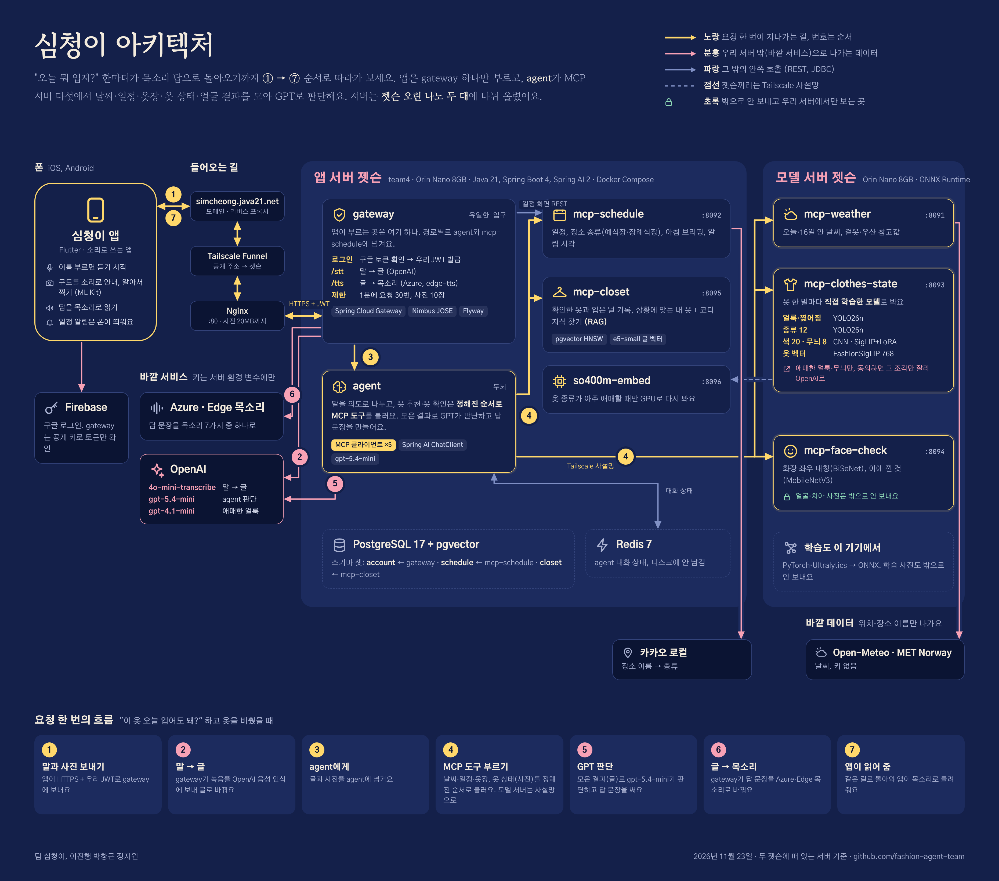

- **MCP 서버는 데이터만 돌려주고**, "이 옷이 오늘 맞는가" 같은 판단은 agent가 맡아요
- agent는 말을 의도로 나눠 옷 추천·옷 확인·날씨·얼굴·옷장은 정해진 순서(코드)로 도구를 부르고, 일정 넣기·지우기 같은 나머지만 GPT가 도구를 골라요
- 안내 목소리는 gateway가 만들어요. Azure Speech 4가지(유진·지민·서현·순복)와 Edge 3가지(선희·인준·현수) 중 고르고, 안 되면 폰 TTS로 읽어요
- 서버는 **젯슨 오린 나노 8GB 두 대**에 나눠 Docker Compose로 상시 띄워요. 한 대는 gateway·agent·일정·옷장·DB(앱 서버), 다른 한 대는 옷 상태·얼굴·날씨 MCP와 모델 학습(모델 서버)을 맡고, 둘은 Tailscale 사설망으로 이어져요. 8GB 한 대에 다 안 들어가서 나눴고, MCP라 agent는 주소만 바꾸면 됐어요
- 바깥에서는 `simcheong.java21.net` → Tailscale Funnel → Nginx → gateway 순서로 들어와요
- 그림 원본은 [`profile/images/src/architecture.html`](images/src/architecture.html)이에요. 고친 뒤 Chrome으로 2배 크기 캡처해서 새 이름(예: `architecture-v10.png`)으로 저장하고 위 그림 주소도 바꿔요. 같은 이름으로 덮으면 GitHub 캐시 때문에 옛 그림이 한동안 보여요
- 서비스 사이 약속은 앱 레포의 [OpenAPI](https://github.com/fashion-agent-team/fashion-agent/blob/develop/docs/contracts/openapi.yaml)와 [MCP 도구 입출력](https://github.com/fashion-agent-team/fashion-agent/blob/develop/docs/contracts/mcp-tools.md) 하나로 맞춰요

## 🗂 ERD

> 각 서비스 레포의 Flyway 마이그레이션(2026-11-21 `develop`, account·closet V4, schedule V5) 그대로이고, 젯슨 배포 DB와 대조했어요. 스키마 3개, 표 11개(배포 DB에 남아 있는 helper 스키마 2개 표는 서버가 배포에서 빠져 제외).

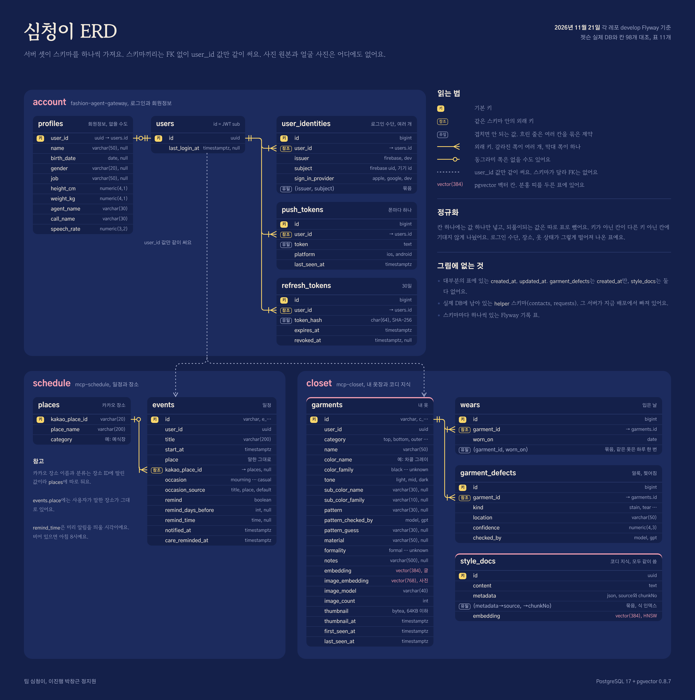

- **서비스마다 스키마 하나**: account(gateway) · schedule · closet. 스키마끼리는 FK 없이 `user_id`(= JWT sub) 값만 같이 써요
- **BCNF까지 정규화**했어요. 한 칸에는 값 하나만 두고(JSON 묶음 없음), 키가 아닌 칸이 다른 칸을 정하지 않게 표를 나눴어요
- 로그인 수단은 `user_identities`에 따로 두고 (issuer, subject)에 복합 UNIQUE를 걸어, 한 사람이 Apple·Google 로그인을 여러 개 가질 수 있어요
- 장소 이름·분류는 `places`(카카오 장소 ID가 키)에 한 번만 저장하고 일정은 장소 ID만 참조해요
- 옷의 무늬·소재·보조 색은 `garments` 칸으로, 얼룩·보풀 같은 상태는 `garment_defects`에 한 줄씩 저장해요
- `wears`는 옷 ID만 참조하고 (garment_id, worn_on)에 복합 UNIQUE를 걸어, 같은 옷을 같은 날 두 번 기록하지 않아요
- **사진은 옷 부분 작은 사진 하나뿐이에요.** 같은 옷 확인용으로 옷 부분만 자른 48KB 이하 사진만 남겨요(옷을 지우면 같이 지워져요)
- 옷 벡터는 한 사람의 옷(100벌 안팎)만 정확한 거리로 훑고, 공용 코디 지식(`style_docs`)만 HNSW 인덱스를 써요

## ✨ 주요 기능

### 1. 날씨·일정 맞춤 추천 (말로)

"오늘 뭐 입지?" 한마디면 agent가 **날씨·일정·내 옷장**을 동시에 불러 GPT로 판단하고 말로 추천해요.

- 날씨: 기온·체감·일교차·강수 확률 (`weather_today`, 날짜별 `weather_forecast`)
- 일정: 말로 넣은 일정마다 **자리 종류(면접·결혼식·운동 등)와 장소 종류**를 붙여 돌려줘요 (`schedule_list`). 장소는 카카오 로컬로 찾아요
- 격식 있는 일정은 등록할 때와 3일 전 아침에 **드라이클리닝**을 미리 챙겨 줘요
- 앱을 열면 오늘 일정과 3일 안의 중요한 일정을 먼저 알려 줘요 (`schedule_briefing`)
- 일정을 넣으면 알림을 받을지, 며칠 전에 미리 알릴지 물어 저장하고(`schedule_set_reminder`) 그에 맞춰 폰 알림을 띄워요

### 2. 카메라로 옷 확인

꺼낸 옷을 비추면 사진마다 `clothes_inspect`가 **옷 한 벌마다 종류·색·무늬·얼룩·찢어짐**을 찾고, agent가 오늘 날씨와 자리에 맞는지 판단해요.

- 옷 종류 12종·무늬 8종·얼룩·찢어짐은 **우리가 직접 학습한 YOLO 모델**, 옷 색 20가지는 K-Fashion으로 학습한 **작은 CNN**(ONNX)으로 서버에서 봐요
- 고른 옷끼리 색이 어울리는지는 색 이론 규칙으로 따로 판단해요 (`outfit_color_check`)
- 얼룩이나 무늬가 애매할 때만 (사용자가 동의한 경우) **그 부분만 잘라** GPT에 한 번 더 물어봐요
- 코트인지 재킷인지 애매하면 틀린 이름 대신 "겉옷"이라고 말해요
- 두 벌을 나란히 비추면 "왼쪽 흰 셔츠가 더 나아요"처럼 비교해 줘요
- 입은 모습은 앞·뒤 두 장으로 한 바퀴 확인해요

### 3. 얼굴 확인

셀카로 **화장이 좌우 고르게 되었는지**(`face_makeup_check`), **이 사이에 뭐가 끼지 않았는지**(`teeth_check`) 확인해요.

- 앱이 ML Kit로 얼굴을 실시간으로 잡아 구도를 안내하고, 멈춘 순간 여러 장을 보내 중간값으로 판단해요
- 서버가 얼굴 분할 모델(BiSeNet ResNet34)로 눈썹·입술·볼 칸을 나누고, 눈썹 길이·두께, 입술 너비, 볼 터치는 공개 얼굴 데이터(CelebA)로 학습한 **좌우 비교 모델**로 판단해요. 알림 기준은 고화질 실사진(FFHQ)에 맞췄어요
- 얼굴·치아 사진은 **GPT 같은 외부 AI로 보내지 않고** 서버의 자체 모델로만 봐요

### 4. 내 옷장 (RAG)

확인한 옷과 입은 날을 기록하고(`closet_save`, `closet_wear`), 다음 추천 때 상황에 맞는 내 옷을 찾아요(`closet_search`). "지난번 면접 때 뭐 입었지?"(`closet_outfits`), "내 옷장에 뭐 있어?"(`closet_list`)에도 답해요.

- 같은 옷인지는 `clothes_inspect`가 준 **옷 사진 벡터**(FashionSigLIP 768차원)로 판단해 한 벌로 합쳐요. 애매하면 agent의 GPT가 옷 부분 작은 사진끼리 비교해 합쳐요(`closet_merge`)
- "옷장 확인해 줘"라고 하면 옷장 옷을 읽어 주고, 말로 옷을 지울 수도 있어요
- 상황 문장(글 임베딩, multilingual-e5-small)과 영어 검색어(사진 벡터)로 내 옷과 코디 지식을 함께 찾고, 추천 문장은 agent의 GPT가 만들어요

---

## 📱 앱 화면

> **인당수의 밤**: 쪽빛 바탕에 노란 큰 글씨, 버튼은 한 화면에 하나만 두었어요. 화면 어디를 눌러도 "말하기"이고, 아래 큰 버튼은 "다시 듣기"예요. 모든 안내는 소리로 읽어 줘요.

### 🌊 처음 만나는 순간

처음 켜면 버튼을 누르지 않아도 심청이가 먼저 말을 걸어요. 인사 → 개인정보 안내 → 허용 창 찾는 법 → 구글 로그인 → 이름·호칭 → 기능 소개까지 **모두 말로** 이어져요. 허용 창과 로그인 창은 VoiceOver로 어디를 두 번 탭하면 되는지 소리로 알려 줘요.

⚙️ 앱(Flutter) · 구글 로그인 → Firebase → gateway(JWT) · 목소리는 Azure Speech(서버가 안 되면 엣지·폰 목소리)

<table align="center">
  <tr>
    <td align="center" valign="top" width="25%"> <b>먼저 인사</b> 설치하고 처음 켜면 바로 말을 걸어요</td>
    <td align="center" valign="top" width="25%"> <b>개인정보 안내</b> 말과 사진을 어디에 쓰는지 먼저 알려요</td>
    <td align="center" valign="top" width="25%">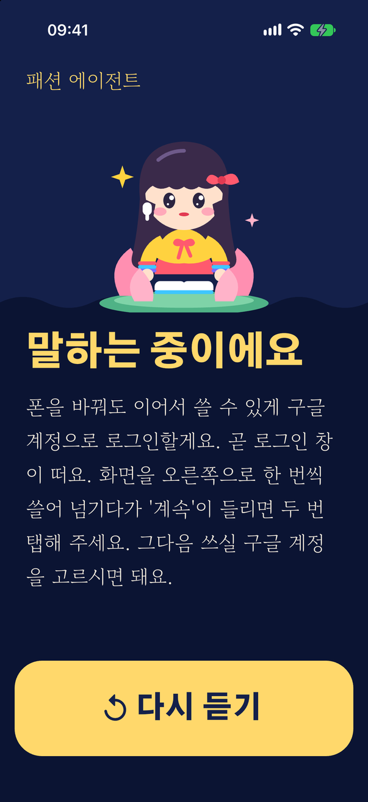 <b>말로 하는 로그인</b> 로그인 창에서 누를 곳을 소리로 안내</td>
    <td align="center" valign="top" width="25%"> <b>할 줄 아는 일</b> 처음 한 번 기능을 쭉 소개해요</td>
  </tr>
</table>

### 🗣 이름만 부르면 대답

폰을 세워 두고 **"심청아"** 하고 부르면 그 뒤에 한 말을 알아들어요. 듣는 동안에는 아래 물이 **다홍**으로 차올라 저시력 사용자도 멀리서 알아봐요. 서버를 기다릴 때는 들은 말을 되짚는 추임새를 먼저 해서 불안하지 않게 했어요.

⚙️ 이름 듣기는 폰 음성 인식, 부른 뒤 명령은 gateway의 `gpt-4o-mini-transcribe`로 다시 받아 적기 · agent가 Spring AI 도구 호출로 기능을 골라요

<table align="center">
  <tr>
    <td align="center" valign="top" width="25%">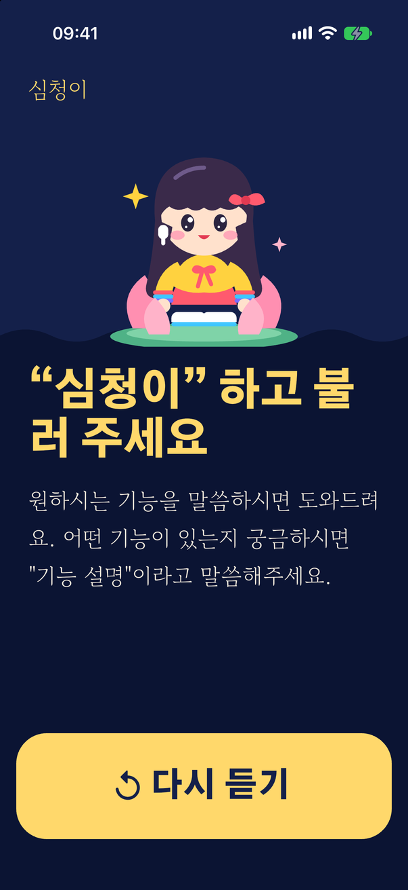 <b>부르기를 기다려요</b> “심청아” 하고 부르면 대답</td>
    <td align="center" valign="top" width="25%"> <b>듣는 중엔 다홍</b> 들은 말을 크게 보여 줘요</td>
    <td align="center" valign="top" width="25%">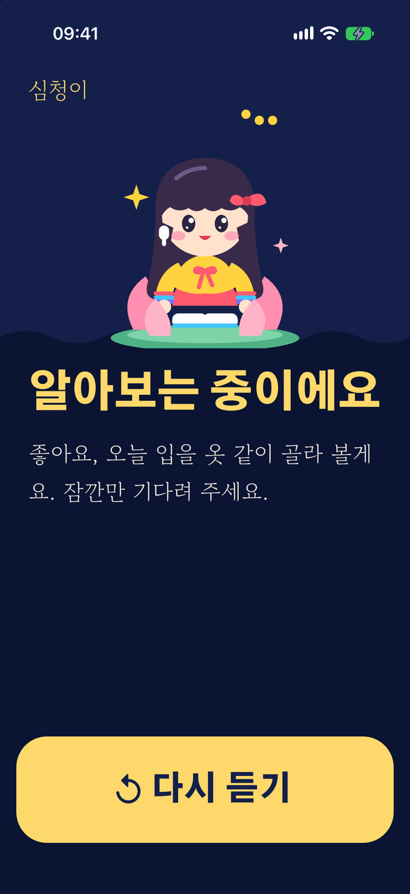 <b>알아보는 중</b> "잠깐만 기다려 주세요" 추임새 먼저</td>
  </tr>
</table>

### ☀️ 오늘 뭐 입지?

**"오늘 뭐 입지?"** 한마디에 날씨·일정·내 옷장을 한꺼번에 보고 겉옷·상의·하의를 말로 추천해요. 날씨만 따로 물어도, 날짜를 말해도 돼요.

⚙️ agent(GPT) ← mcp-weather(Open-Meteo, 안 되면 MET Norway) · mcp-schedule · mcp-closet(RAG)

<table align="center">
  <tr>
    <td align="center" valign="top" width="25%"> <b>오늘의 추천</b> 기온·체감에 맞춰 겉옷부터 목도리·장갑까지</td>
    <td align="center" valign="top" width="25%"> <b>오늘 날씨</b> 지금·최저·최고, 체감 온도까지</td>
    <td align="center" valign="top" width="25%"> <b>내일 날씨</b> 비 올 확률이 높으면 우산 챙기기</td>
  </tr>
</table>

### 🎚 목소리 고르기 · 잠깐 쉬기

목소리가 마음에 안 들면 **"목소리 바꿔 줘"**라고 해요. 7가지 목소리를 하나씩 들려주고 "이 목소리 좋아"로 골라요. 회의 중이나 TV 소리가 클 때는 **"잠깐 쉬어"**로 이름 듣기를 멈춰요.

⚙️ 서버 목소리: Azure Speech 유진·지민·서현·순복, 엣지 선희·인준·현수(gateway가 문장을 받아 음성으로) · 서버가 안 되면 폰 목소리

<table align="center">
  <tr>
    <td align="center" valign="top" width="25%">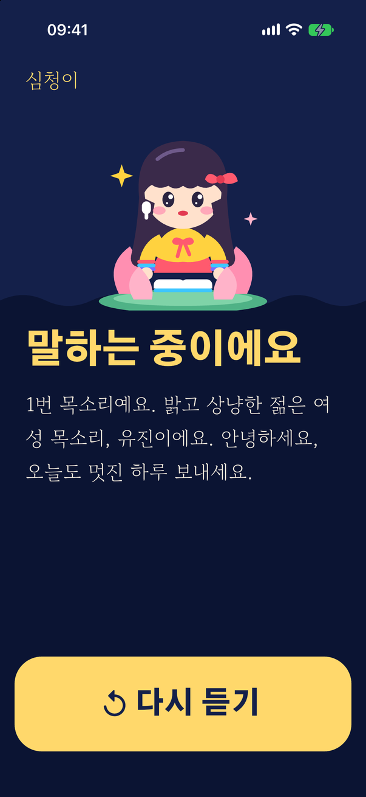 <b>목소리 고르기</b> "다음", "이 목소리 좋아"로 골라요</td>
    <td align="center" valign="top" width="25%">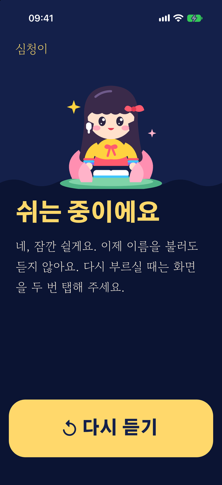 <b>잠깐 쉬기</b> 다시 부를 땐 화면을 두 번 탭</td>
  </tr>
</table>

### 📅 일정과 그날의 옷

말로 일정을 넣으면 **자리 종류(결혼식·면접 등)**를 알아보고, 격식 있는 자리면 드라이클리닝을 미리 챙겨 줘요. 날짜를 말하면 그날 날씨 예보와 일정에 맞춰 내 옷장 옷으로 추천해요. 일정 며칠 전·당일 아침에는 폰 알림도 와요.

⚙️ mcp-schedule(카카오 로컬로 장소 종류, 일정별 알림 시각) · 폰 로컬 알림 · agent가 `weather_forecast`와 `closet_search`를 함께 불러요

<table align="center">
  <tr>
    <td align="center" valign="top" width="25%">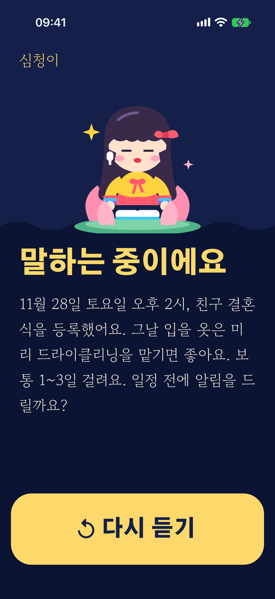 <b>일정 넣기</b> 결혼식이면 드라이클리닝 안내</td>
    <td align="center" valign="top" width="25%">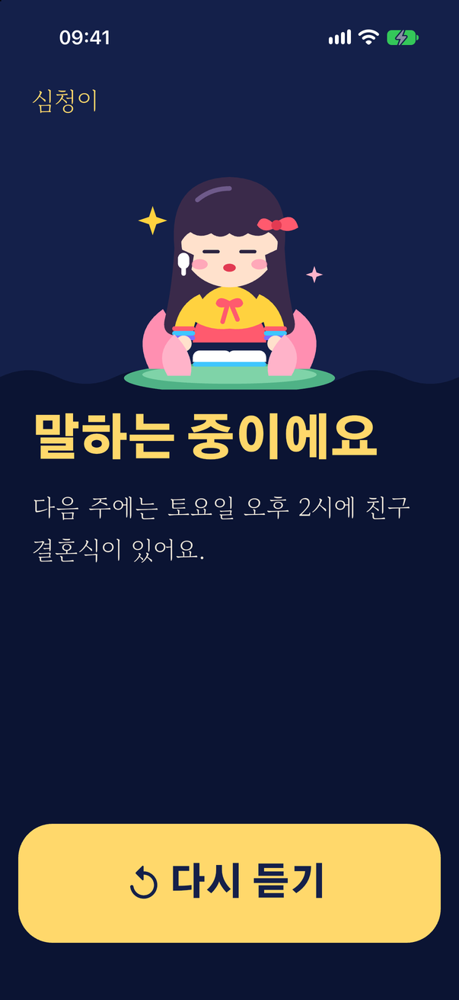 <b>일정 읽기</b> "다음 주 일정 알려 줘"</td>
    <td align="center" valign="top" width="25%"> <b>그날 입을 옷</b> 예보 + 일정 + 내 옷장으로 추천</td>
  </tr>
</table>

### 📷 카메라로 옷 확인

꺼낸 옷을 바닥에 펼쳐 비추면 **멈춘 순간 알아서 찍어요**(찍기 버튼 없음). 옷마다 종류·색·무늬·얼룩·찢어짐을 보고 오늘 날씨에 맞는지, 색이 어떤 느낌인지까지 말로 풀어 줘요. 위쪽 미리 보기는 옆에서 돕는 분을 위한 칸이에요.

⚙️ 앱 ML Kit로 구도 안내·자동 촬영 → mcp-clothes-state(직접 학습한 YOLO 종류·얼룩·찢어짐, K-Fashion 색 CNN, FashionSigLIP 무늬) → agent가 날씨와 맞춰 판단

<table align="center">
  <tr>
    <td align="center" valign="top" width="25%">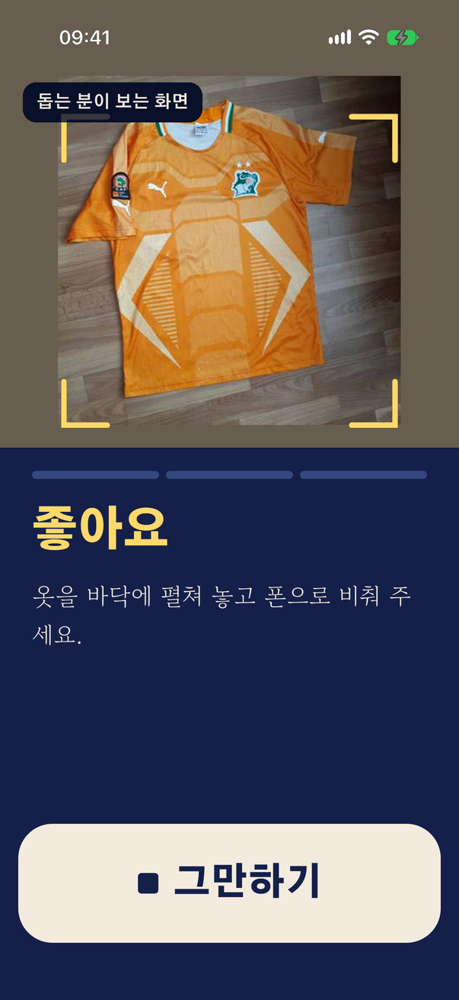 <b>바닥에 펼쳐 비추기</b> 멈추면 자동으로 찍어요</td>
    <td align="center" valign="top" width="25%">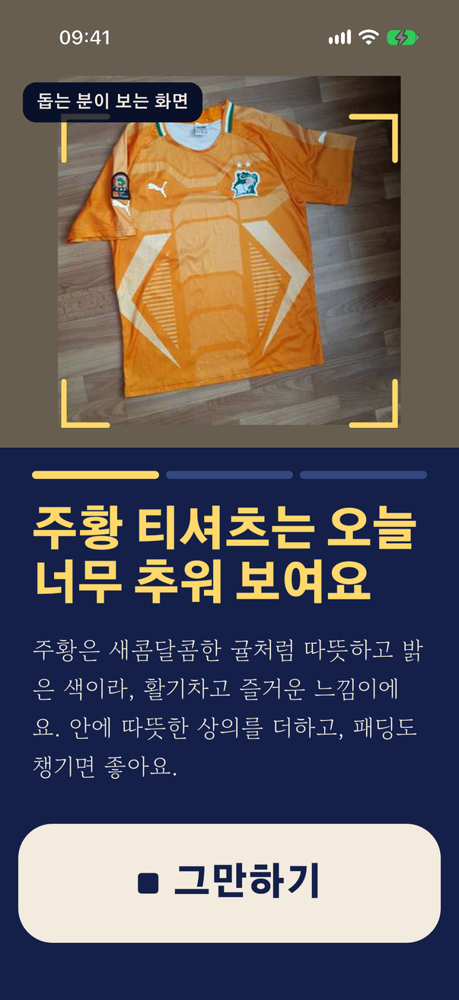 <b>주황 티셔츠</b> 오늘 입기엔 추워요 + 색 느낌</td>
    <td align="center" valign="top" width="25%">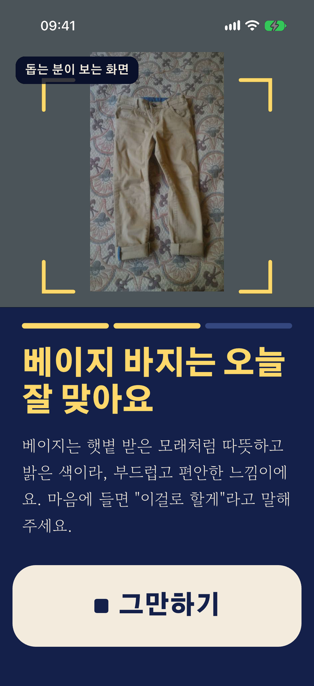 <b>베이지 바지</b> 잘 맞아요, 진행 막대 두 칸째</td>
    <td align="center" valign="top" width="25%"> <b>갈색 자켓</b> 추운 날 겉옷으로 좋아요</td>
  </tr>
</table>

### 👚 옷 색 묻기 · 입은 모습 · 내 옷장

옷을 비추며 **"이거 무슨 색이야?"**라고 물으면 바로 색을 알려 줘요. 고른 옷은 옷장에 저장되고, 입은 날도 기록돼 "오늘 뭐 입었지?"에 답해요. 다 입은 뒤에는 폰을 세워 두고 한 바퀴 도는 모습도 확인해요.

⚙️ mcp-clothes-state 색 모델 · mcp-closet(pgvector: 옷 사진 벡터 FashionSigLIP로 같은 옷 합치기, 글 벡터 e5로 검색)

<table align="center">
  <tr>
    <td align="center" valign="top" width="25%"> <b>무슨 색이야?</b> 비춘 옷 색을 바로 알려 줘요</td>
    <td align="center" valign="top" width="25%"> <b>입은 모습 확인</b> 가슴 높이에 세우고 두세 걸음 뒤로</td>
    <td align="center" valign="top" width="25%"> <b>내 옷장</b> 종류별로 몇 벌인지 읽어 줘요</td>
    <td align="center" valign="top" width="25%"> <b>오늘 입은 옷</b> 입은 날 기록으로 답해요</td>
  </tr>
</table>

### 💄 얼굴 확인

셀카로 **화장이 좌우 고르게 됐는지**, **이 사이에 뭐가 끼었는지** 봐 줘요. 어두우면 화면을 하얗게 밝혀 조명처럼 비춰요. 얼굴·치아 사진은 GPT 같은 외부 AI로 보내지 않고 우리 서버 모델로만 봐요.

⚙️ 앱 ML Kit로 얼굴 윤곽점·입 위치 → mcp-face-check(BiSeNet 얼굴 분할 + CelebA로 학습한 좌우 비교 모델, 직접 학습한 치아 모델 ONNX)

<table align="center">
  <tr>
    <td align="center" valign="top" width="25%">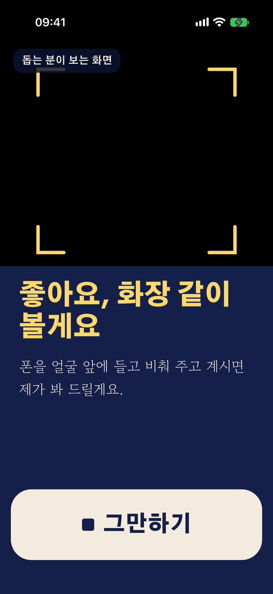 <b>화장 확인</b> 앞 카메라로 얼굴을 비춰요</td>
    <td align="center" valign="top" width="25%">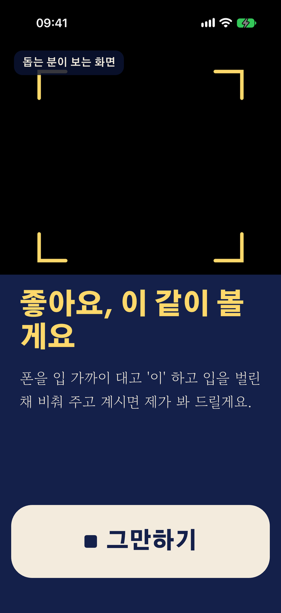 <b>이 확인</b> "이" 하고 입을 벌린 채</td>
    <td align="center" valign="top" width="25%"> <b>화면 조명</b> 어두우면 화면을 밝게 켜요</td>
  </tr>
</table>

`develop` 앱을 iPhone 17 시뮬레이터에서 띄워 찍었어요(2026-11-22). 화면 문장은 실제 서버(simcheong.java21.net)에 개발용 계정으로 같은 말을 보내 받은 답 그대로예요. 시뮬레이터에는 카메라가 없어서, 옷 화면의 미리 보기 칸에는 서버에 보낸 옷 사진(CC0 clothing-dataset)을 합성했어요. 얼굴 화면은 실제 사람 얼굴을 쓰지 않으려고 미리 보기 칸을 비워 두었어요.

## 🔥 25일 동안 남긴 흔적

개발 기간은 2026.10.27 ~ 11.20이고, 아래 숫자는 2026-11-22 기준으로 센 값이에요.

> 가장 오래 걸린 일은 **모델 학습**이었어요. 화장·옷장·날씨는 박창근, 옷 상태·치아는 정지원 파트에서 모델을 학습하고 비교했고, 앱 뼈대·gateway·agent는 이진행 파트에서 만들었어요.

| 파트 | 모델 학습 시간 | 학습·비교한 횟수 |
| --- | ---: | --- |
| 박창근 파트 (화장·옷장·날씨) | **109시간 이상** | 눈 화장 젯슨 학습 **396판**, 화장 재는 방식 약 35가지, 같은 옷 찾기 사진 모델 12개, 날씨 출처 3개 |
| 정지원 파트 (옷 상태·치아) | **67시간 이상** | 옷 상태 실험 **56가지**(얼룩·찢어짐 7판, 옷 종류 6판, 무늬 7단계, 입은 옷 실수 단추 6판 등), 치아 18가지 |

이진행 파트(앱·gateway·agent)는 모델 학습 대신 **모든 기능을 말 한마디로 이어 붙이는 일**이었어요. 8개 레포에서 PR **102개**를 머지했고(앱 40, agent 26, gateway 15, 나머지 서버 21), 실제 폰 리허설과 발표 피드백을 받은 날마다 말투·말 속도·목소리·카메라 안내를 고쳤어요. 응답 시간은 옷 추천 **1.77초 → 1.04초**, 옷 확인 **1.95초 → 1.47초**로 줄였어요.

기능 하나도 바로 `develop`에 넣지 않고 **브랜치 → PR → CI 테스트 → 리뷰 → 머지**를 거쳤어요.

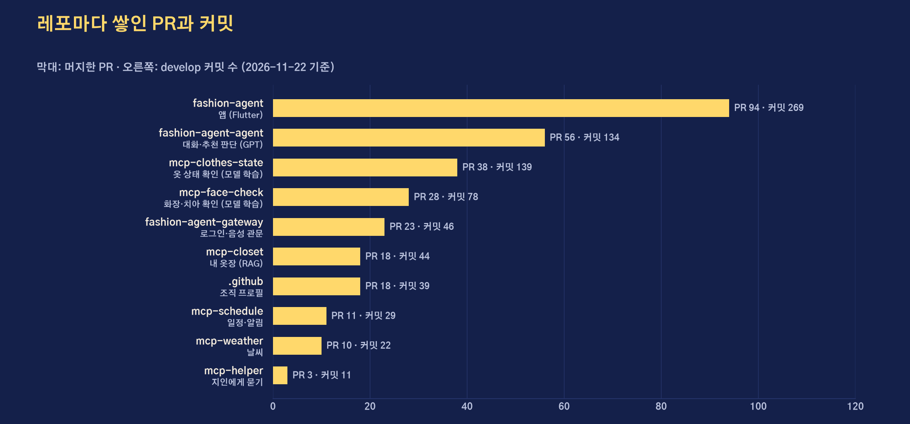

2026-11-22 기준이에요. 학습 시간은 로그·실험표에 시간이 남은 것만 더했어요: 눈 화장은 젯슨 학습 로그(`loop.log` 시작 시각 ~ 판마다 `eval.json`)로 잰 287판의 합(멈춘 시간이 섞일 수 있음), 옷 상태는 [clothes-state 실험표](https://github.com/fashion-agent-team/mcp-clothes-state/blob/develop/docs/lab.md)의 합, 얼굴 분할·좌우 비교 CNN과 치아는 [face-check 실험표](https://github.com/fashion-agent-team/mcp-face-check/blob/develop/docs/lab.md)에 적힌 시간이에요. PR·커밋 수는 GitHub에서 셌고 커밋은 각 레포 `develop`(.github는 `main`) 기준이에요.

## 🎤 발표 자료 (2026 IT Festival)

조선대학교 2026 IT Festival · AI·SW 캡스톤디자인 프로젝트 경진대회 발표에 쓴 자료입니다.

| 자료 | 내용 | 받기 |
| --- | --- | --- |
| 📊 발표 슬라이드 (15장, PPTX 29MB) | 문제와 아이디어 → 기능 한눈에 → 접근성 → 구성과 구조 → 상황별 예시 → MCP 서버 5개(날씨·일정·옷 상태·얼굴 확인·내 옷장) → 시연 → 요약 | [심청이_발표_슬라이드.pptx](https://github.com/fashion-agent-team/.github/releases/download/presentation-2026-11/simcheong-presentation.pptx) |
| 🎬 발표 영상 (5분, MP4 11MB) | 발표 슬라이드를 따라 설명하는 영상 | [심청이_발표_영상.mp4](https://github.com/fashion-agent-team/.github/releases/download/presentation-2026-11/simcheong-presentation-video.mp4) |
| 📱 시연 영상 (3분, 아이폰 화면 MP4 22MB) | 실제 앱으로 옷 고르고 입어 보기, 약속 있는 날 두 상황을 보여 주는 영상 | [심청이_시연_영상.mp4](https://github.com/fashion-agent-team/.github/releases/download/presentation-2026-11/simcheong-demo-video.mp4) |

세 파일은 이 저장소의 [릴리스 presentation-2026-11](https://github.com/fashion-agent-team/.github/releases/tag/presentation-2026-11)에 있습니다.

---

## 📦 레포지토리

| 레포 | 역할 | 주요 기술 |
| --- | --- | --- |
| [fashion-agent](https://github.com/fashion-agent-team/fashion-agent) | 모바일 앱, 아키텍처·서비스 간 약속 문서, 배포 설정 | Flutter, ML Kit(얼굴·포즈·물체), speech_to_text, flutter_tts, Firebase Auth |
| [fashion-agent-gateway](https://github.com/fashion-agent-team/fashion-agent-gateway) | API 게이트웨이, 로그인, 회원정보, 음성 인식·읽기 | Spring Cloud Gateway(Web MVC, 가상 스레드), Nimbus JOSE(JWT), JdbcClient + Flyway, OpenAI 음성 인식, Azure Speech, edge-tts |
| [fashion-agent-agent](https://github.com/fashion-agent-team/fashion-agent-agent) | 대화와 옷 추천을 이끄는 두뇌 | Spring AI(ChatClient + MCP 클라이언트), OpenAI GPT, Redis |
| [mcp-weather](https://github.com/fashion-agent-team/mcp-weather) | 오늘·날짜별 날씨 | Spring AI MCP Server, Open-Meteo, Caffeine 캐시 |
| [mcp-schedule](https://github.com/fashion-agent-team/mcp-schedule) | 일정, 자리·장소 종류, 드라이클리닝 안내, 아침 브리핑 | Spring AI MCP Server(`@McpTool`), Spring Data JPA + Flyway, 카카오 로컬 API |
| [mcp-clothes-state](https://github.com/fashion-agent-team/mcp-clothes-state) | 옷 종류·색·무늬·얼룩·찢어짐, 입은 모습(뒤집힘·단추·택), 색 조합 | 직접 학습한 YOLO26n·색 CNN, FashionSigLIP + LoRA 무늬, ONNX Runtime, FashionSigLIP 옷 벡터, SigLIP2 So400m 종류 보조, (선택) GPT 얼룩·무늬 확인 |
| [mcp-face-check](https://github.com/fashion-agent-team/mcp-face-check) | 화장 대칭(눈썹·입술·볼·눈화장), 치아 확인 | ML Kit 윤곽점, BiSeNet 얼굴 분할, 좌우 비교 모델, ResNet18 눈화장 앙상블, MobileNetV3 치아 분류(ONNX) |
| [mcp-closet](https://github.com/fashion-agent-team/mcp-closet) | 내 옷장 기록과 검색(RAG), 같은 옷 합치기 | Spring AI VectorStore, pgvector, multilingual-e5-small, FashionSigLIP 사진 벡터 |

---

## 💻 Tech Stacks

| 구분 | 기술 스택 |
| :--- | :--- |
| **App** |      |
| **Backend** |      -000000?style=flat&logo=jsonwebtokens&logoColor=white)  |
| **AI · Agent** | -6DB33F?style=flat&logo=spring&logoColor=white)   |
| **Vision · ML** |   -EE4C2C?style=flat&logo=pytorch&logoColor=white)   |
| **Voice** |    -02569B?style=flat&logo=flutter&logoColor=white) |
| **Database** |     |
| **External API** |  -00205B?style=flat)  |
| **Infra · 협업** |       |

### 🧭 "오늘 뭐 입지?" 한마디가 지나가는 길

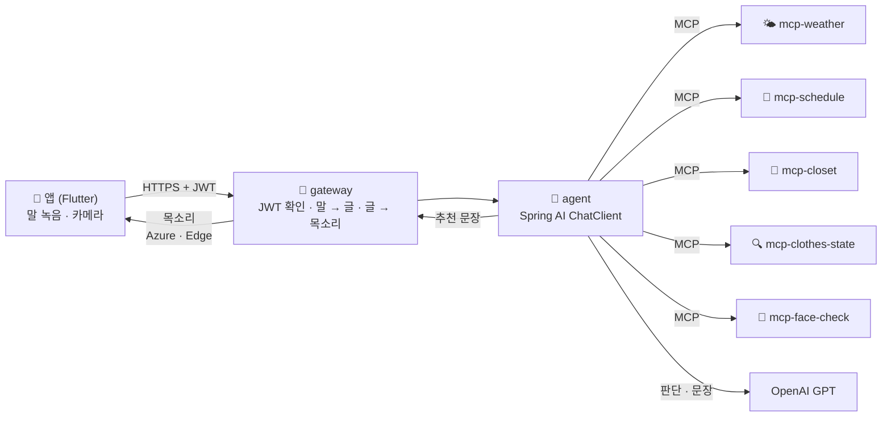

1. **앱**이 말을 녹음해 gateway로 보내요. 카메라를 쓸 때는 ML Kit가 폰 안에서 구도를 먼저 잡아 줘요
2. **gateway**가 JWT를 확인하고, 말을 글로 바꾼 뒤 agent에 넘겨요
3. **agent**가 의도를 나누고, 필요한 MCP 서버(날씨·일정·옷장·옷 상태·얼굴)에서 데이터만 받아 와요
4. 모은 데이터로 **GPT**가 판단하고 추천 문장을 만들어요
5. gateway가 문장을 **Azure Speech** 목소리로 바꿔 앱에 돌려주고, 앱이 읽어 줘요

### 🔧 어디에 어떻게 썼나요

<b>📱 App: Flutter · ML Kit · Firebase</b>

 

| 기술 | 어디에 | 어떻게 |
| --- | --- | --- |
| **Flutter** (Dart 3) | 앱 전체 | iOS·Android를 한 코드로 만들어요. 화면을 거의 보지 않는 사용자를 생각해 모든 흐름을 말과 소리, 진동으로 이어요 |
| **ML Kit** 얼굴·포즈·물체 인식 | 카메라 구도 안내, 자동 촬영 | 폰 안에서 실시간으로 얼굴·몸·옷을 잡아 "조금 왼쪽으로" 같은 말과 소리로 구도를 맞춰요. 멈춘 순간 자동으로 찍어서, 셔터 버튼을 찾을 필요가 없어요 |
| **speech_to_text · record** | 말 걸기 | 이름을 불러 말을 걸면 녹음해 gateway로 보내요 |
| **flutter_tts · audioplayers** | 읽어 주기 | 서버 목소리(Azure·Edge)를 재생하고, 서버가 안 되면 폰 TTS로 대신 읽어요 |
| **Firebase Auth · Google Sign-In** | 로그인 | 구글로 로그인하면 Firebase 토큰을 gateway가 확인해 우리 JWT로 바꿔 줘요 |
| **flutter_secure_storage** | 토큰 보관 | JWT와 갱신 토큰을 폰의 안전한 저장소에 둬요 |
| **flutter_local_notifications** | 일정 알림 | 일정마다 정한 시각에 폰 알림을 띄워요 |
| **geolocator** | 내 위치 날씨 | 지금 위치로 날씨를 물어요 |

<b>🚪 gateway: Spring Cloud Gateway · JWT · 음성</b>

 

| 기술 | 어디에 | 어떻게 |
| --- | --- | --- |
| **Spring Cloud Gateway** (Web MVC, 가상 스레드) | 들어오는 문 | 앱 요청을 한곳에서 받아 agent로 보내고, 사용자별 사용량을 제한해요. 가상 스레드라 음성처럼 오래 걸리는 요청이 쌓여도 버텨요 |
| **Nimbus JOSE (JWT)** | 인증 | Firebase 토큰을 확인한 뒤 우리 서비스용 JWT를 발급해요. 뒤쪽 서비스는 JWT의 `sub`(= `user_id`)만 보고 사람을 구분해요 |
| **JdbcClient + Flyway** | 회원정보 (account 스키마) | `users`·`profiles`·`user_identities`·`push_tokens`·`refresh_tokens`를 마이그레이션으로 관리해요 |
| **OpenAI gpt-4o-mini-transcribe** | 말 → 글 | 녹음한 말을 글로 받아 적어요 |
| **Azure Speech · edge-tts** | 글 → 목소리 | Azure 목소리 4가지(유진·지민·서현·순복)와 Edge 목소리 3가지 중 사용자가 고르고, Azure가 막히면 edge-tts 사이드카로 넘겨요 |

<b>🧠 agent: Spring AI · MCP · GPT · Redis</b>

 

| 기술 | 어디에 | 어떻게 |
| --- | --- | --- |
| **Spring AI ChatClient** | 대화 두뇌 | 말을 의도로 나눠요. 옷 추천·옷 확인·날씨·얼굴·옷장은 정해진 순서(코드)로 도구를 부르고, 일정 넣기·지우기처럼 자유로운 말만 GPT가 도구를 골라요 |
| **Spring AI MCP Client** | 서비스 연결 | MCP 서버 5개를 도구로 붙여요. 서버가 다른 젯슨으로 옮겨가도 주소만 바꾸면 돼요 |
| **OpenAI GPT** | 판단과 문장 | 날씨·일정·옷장·옷 상태를 모아 "오늘 이 옷이 맞는지" 판단하고, 색을 느낌으로 풀어 말해요 |
| **Redis** | 대화 기억 | 대화 세션(30분)을 저장해서 "그거 말고 다른 거"처럼 앞 말을 이어받아요 |

<b>🔌 MCP 서버: Spring AI MCP Server</b>

 

모든 MCP 서버는 **Spring Boot 4 + Spring AI MCP Server(Web MVC)** 로 만들었고, 판단 없이 **데이터만** 돌려줘요.

| 서버 | 핵심 기술 | 어떻게 |
| --- | --- | --- |
| 🌤 **mcp-weather** | Open-Meteo, MET Norway, Caffeine | 오늘·날짜별 기온·체감·일교차·강수를 줘요. Open-Meteo가 끊기면 두 번 더 묻고, 그래도 안 되면 MET Norway로 넘겨요. 같은 질문은 Caffeine 캐시로 바로 답해요 |
| 📅 **mcp-schedule** | Spring Data JPA, Flyway, 카카오 로컬 | 일정에 자리 종류(면접·결혼식 등)와 장소 종류를 붙여요. 장소는 카카오 로컬로 찾아 `places`에 한 번만 저장해요. 격식 있는 일정은 드라이클리닝을 미리 알려 줘요 |
| 🔍 **mcp-clothes-state** | ONNX Runtime, YOLO26n, 색 CNN, FashionSigLIP + LoRA | 옷 한 벌마다 종류 12종·색 20가지·무늬 8종·얼룩·찢어짐을 찾아요. 모델은 Java에서 ONNX Runtime으로 바로 돌려서 파이썬 서버가 따로 필요 없어요. 애매할 때만 옷 부분을 잘라 GPT에 한 번 더 물어요 |
| 💄 **mcp-face-check** | ONNX Runtime, BiSeNet, ResNet18, MobileNetV3 | BiSeNet으로 눈썹·입술·볼을 나누고, 직접 학습한 좌우 비교 모델로 화장 대칭을 봐요. 치아는 MobileNetV3 분류 모델로 봐요. 얼굴 사진은 외부로 보내지 않아요 |
| 👕 **mcp-closet** | Spring AI VectorStore, pgvector, multilingual-e5-small, DJL 토크나이저 | 옷과 코디 지식을 벡터로 저장하고 상황 문장으로 찾아요(RAG). 글 임베딩(e5)은 ONNX로 서버 안에서 직접 만들어서 외부 임베딩 API가 필요 없어요 |

<b>🧬 모델 · 벡터: YOLO · SigLIP · e5 · pgvector</b>

 

| 기술 | 어디에 | 어떻게 |
| --- | --- | --- |
| **YOLO26n** (Ultralytics, 직접 학습) | 얼룩·찢어짐, 옷 종류, 무늬 | 젯슨·맥북에서 PyTorch로 학습하고 ONNX로 내보내 서버에 넣었어요. 결과는 [🧠 직접 학습한 모델](#-직접-학습한-모델)에 있어요 |
| **FashionSigLIP** (768차원) | 같은 옷 찾기, 무늬 보조 | 옷 사진을 벡터로 바꿔, 전에 본 옷과 같은지 거리(기준 0.60)로 판단해요 |
| **SigLIP2 So400m** | 옷 종류 보조 | 종류가 애매할 때만 큰 모델에 다시 물어서 젯슨 부담을 줄여요 |
| **multilingual-e5-small** (384차원) | 옷장·코디 지식 검색 | "내일 면접" 같은 한국어 상황 문장을 벡터로 바꿔요 |
| **pgvector** (PostgreSQL 17) | 벡터 저장 | 한 사람의 옷(100벌 안팎)은 정확한 거리로 훑고, 공용 코디 지식(`style_docs`)만 HNSW 인덱스를 써요 |

<b>🖥 Infra: Jetson · Docker · Tailscale</b>

 

| 기술 | 어디에 | 어떻게 |
| --- | --- | --- |
| **Jetson Orin Nano 8GB × 2** | 서버 전체 | 앱 서버(gateway·agent·일정·옷장·DB)와 모델 서버(옷 상태·얼굴·날씨, 학습)로 나눴어요. 8GB 한 대에 다 안 들어가서 나눴어요 |
| **Docker Compose** | 상시 배포 | 레포마다 Dockerfile을 두고, 각 젯슨에서 arm64 이미지를 직접 빌드해 띄워요 |
| **Tailscale (사설망 · Funnel)** | 젯슨 연결, 외부 공개 | 두 젯슨을 사설망으로 잇고, Funnel로 공유기 설정 없이 HTTPS 주소를 열어요 |
| **Nginx** | 앞단 | `simcheong.java21.net` → Funnel → Nginx → gateway 순서로 받아요 |
| **GitHub Actions** | PR 검사 | 모든 레포에서 PR마다 빌드·테스트를 돌려요 |

### 💡 이렇게 고른 이유

- **MCP로 나눈 이유**: 날씨·일정·옷·얼굴을 각자 맡아 따로 만들고, agent는 도구로만 붙였어요. 서버를 다른 젯슨으로 옮겨도 agent는 주소만 바꾸면 됐어요
- **Java + ONNX Runtime**: 학습은 파이썬(PyTorch)으로 하고, 서비스는 Spring 하나로 맞췄어요. 모델을 ONNX로 내보내 Java 서버 안에서 바로 돌려요
- **사진은 먼저 우리 모델이**: 옷과 얼굴 사진은 직접 학습한 모델이 먼저 보고, GPT는 그 결과로 판단해요. 옷이 애매할 때만 옷 부분을 잘라 GPT에 물어보고, 얼굴·치아 사진은 외부 AI로 보내지 않아요
- **작은 장비에 맞추기**: 젯슨 8GB에 맞게 작은 모델(YOLO26n, e5-small)을 기본으로 쓰고, 큰 모델(SigLIP2 So400m)은 애매할 때만 불러요

---

## 🧠 직접 학습한 모델

| 모델 | 쓰는 곳 | 결과 (학습에 안 쓴 사진) |
| --- | --- | --- |
| 얼룩·찢어짐 `yolo26n_v6` | mcp-clothes-state | 사진 단위 정답률 91.9% (346장), 애매한 것만 GPT 확인 시 98.1% (314장). 깨끗한 옷 200장 중 오탐 1장 |
| 옷 종류 12종 `yolo26n_fashion12` (fashion12e) | mcp-clothes-state | 내려놓은 옷 203장 종류 86.7% (큰 분류 91.6%), 바닥 신발 mAP50 0.991 |
| 옷 색 20가지 `color20_cnn` | mcp-clothes-state | 시험 옷 25,626벌 색 계열 76.8% (예전 픽셀 규칙 45.3%), 흰 옷 87% (예전 15%) |
| 무늬 8종 `yolo26n_pattern8` | mcp-clothes-state | 내려놓은 옷 1,959장 정확도 88.4%, 무지/무늬 구분 91.9% |
| 화장 좌우 비교 (눈썹 길이·두께, 입술 너비, 볼 터치) | mcp-face-check | CelebA에서 비대칭 찾는 비율 눈썹 길이 22→84%, 두께 51→92%, 입술 너비 20→82%, 볼 58→77%. 실사진 기준으로 맞춘 뒤 멀쩡한 사진 잘못 알림 63→31% |
| 치아 분류 MobileNetV3-Small | mcp-face-check | 합성 데이터로 학습, 실제 사진 평가 진행 중 |

- 학습은 우리 장비(팀 **Jetson Orin**·맥북)에서 했고, 학습 사진은 외부 AI로 보내지 않았어요
- 데이터 출처와 라이선스(AI Hub K-Fashion, CelebA, FFHQ 등)는 각 레포 README에 적어 두었어요. 학습 사진은 레포에 올리지 않아요
- 실험 과정과 비교표는 [clothes-state 학습 기록](https://github.com/fashion-agent-team/mcp-clothes-state/blob/develop/docs/training-log.md)에 있어요

## 🧪 이 모델을 고른 이유

> 처음 떠오른 모델을 그냥 쓰지 않았어요. **같은 시험 사진, 같은 채점 코드**로 후보를 나란히 재고 점수·속도·잘못 알림·크기·라이선스까지 본 뒤 골랐어요. 옷 쪽에서 56가지, 얼굴 쪽에서 53가지, 모두 **109가지 방식**을 비교했어요.

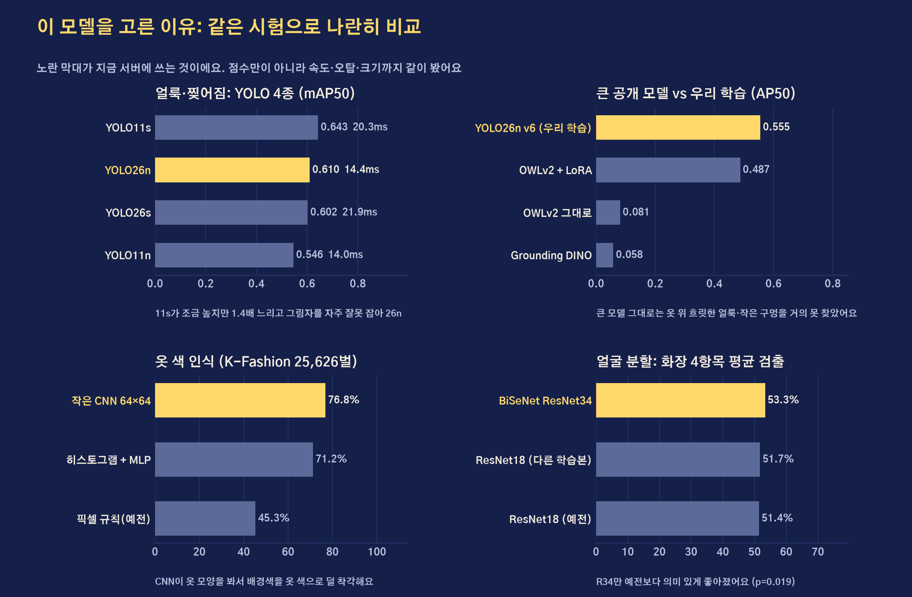

> 그림 아래 **용어 풀이**에 mAP50(결함 상자를 맞게 찾은 정도, 1에 가까울수록 좋음), 오탐, 몸통(백본), 앙상블, p값을 풀어 두었어요. 칸마다 속도·크기·잘못 알림을 같이 적었어요.

<table>
  <tr><th>무엇을</th><th>비교한 후보</th><th>고른 것과 이유</th></tr>
  <tr><td>얼룩·찢어짐</td><td>YOLO11n·11s·26n·26s, OWLv2, Grounding DINO</td><td><b>YOLO26n</b>: 11s와 점수는 비슷한데 1.4배 빠르고(젯슨 장당 14ms) 그림자를 덜 잘못 잡아요. 큰 공개 모델은 그대로 쓰면 AP50 0.08 이하라 우리 데이터로 학습했어요</td></tr>
  <tr><td>옷 사진 벡터 (같은 옷 찾기)</td><td>FashionSigLIP, SigLIP, SigLIP2, FashionCLIP, Jina CLIP, DINOv2, CLIP 등 <b>12개</b></td><td><b>Marqo FashionSigLIP</b>: 같은 옷을 가장 잘 찾았어요. DINOv2·CLIP B 계열은 26~45%에 그쳤어요</td></tr>
  <tr><td>옷 색</td><td>픽셀 규칙, 색 히스토그램 + MLP, 작은 CNN</td><td><b>작은 CNN(0.8MB)</b>: 색 계열 76.8%, 흰 옷 15% → 87%. 옷 모양을 봐서 배경색에 덜 속아요</td></tr>
  <tr><td>무늬</td><td>YOLO 분류, FashionSigLIP LoRA·분류 층만·입력 384, GPT low/high</td><td><b>LoRA + YOLO 섞기 + 애매할 때만 GPT</b>: 입은 옷 90.02%로 목표 달성 (교체 준비: 서버 코드 반영, 젯슨 미반영). 지금 젯슨은 YOLO 무늬 + 모르면 GPT</td></tr>
  <tr><td>얼굴 분할</td><td>BiSeNet R18 두 학습본·R34, SegFormer, FaRL, MediaPipe</td><td><b>BiSeNet ResNet34</b>: 유일하게 통계적으로 나아졌어요(p=0.019). SegFormer는 3.6배 크고 느리고, FaRL은 646MB라 탈락</td></tr>
  <tr><td>눈 화장 좌우 비교</td><td>밝기 규칙, 작은 CNN, 넓은 망, ImageNet ResNet18·EfficientNet·ConvNeXt 등 젯슨 GPU로 <b>396판</b></td><td><b>서버 모델 + ResNet18 3개 앙상블</b>: 실사진 검출 70.7% → 78.6%, 잘못 알림 4.1%. 같은 평가 사진에서 조합을 뒤지면 점수가 부풀어서, 미리 정한 규칙(하나씩 점수 상위 3개)으로 골랐어요</td></tr>
  <tr><td>치아</td><td>모델 4, 이어 학습 3, LoRA 4, 색 규칙 4, GPT</td><td><b>직접 학습한 v4 + 6번 평균</b>: 깨끗한 이 잘못 알림 1.1%. 얼굴·치아 사진은 GPT로 보내지 않기로 해서 GPT는 탈락</td></tr>
  <tr><td>날씨 데이터</td><td>Open-Meteo, 기상청 단기예보, OpenWeatherMap (5개 도시 × 3번)</td><td><b>Open-Meteo</b>: 응답 0.9초(기상청 3.5초, 가장 느릴 때 15초)에 키 없이 써요. 안 되면 MET Norway로 넘어가요</td></tr>
</table>

## 📈 학습할수록 올라간 정확도

> 한 번 학습하고 끝내지 않았어요. 틀린 사진을 보고 **데이터를 보태고, 다시 학습하고, 다시 쟀어요.** 점수가 올라도 깨끗한 옷을 잘못 알리면 쓰지 않았어요.

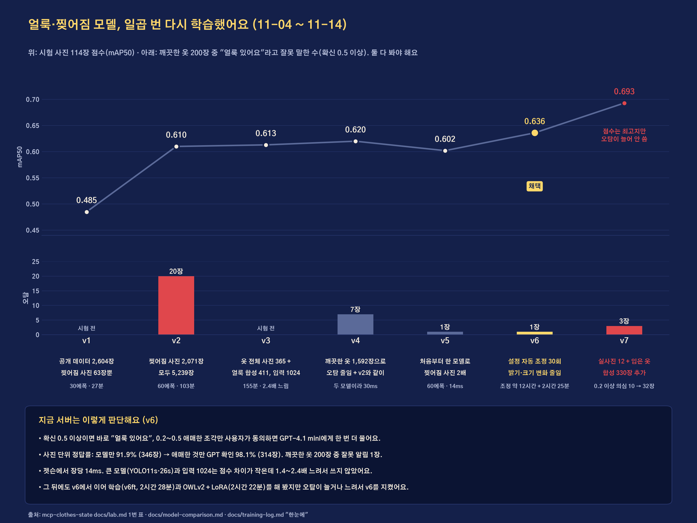

> **얼룩·찢어짐:** v1에서는 찢어짐 사진이 63장뿐이라 찢어짐을 거의 못 찾았어요. 데이터를 5,239장으로 늘리고(v2), 깨끗한 옷 1,592장으로 오탐을 줄이고(v4·v5), 설정을 30번 자동 조정해(v6, 약 12시간) 오탐 1장에 mAP50 0.636을 만들었어요. v7은 점수가 더 높았지만 깨끗한 옷을 의심하는 일이 3배라 쓰지 않았어요. 지금 서버는 v6 + "애매하면 GPT 확인"으로 사진 단위 정답률 98.1%예요.

> **옷 종류**는 공개 옷 사진 → 중고 의류 → 바닥에 놓인 신발을 차례로 보태고 학습률을 낮춰 다듬었어요(약 17시간). **같은 옷 찾기**는 글 설명 대신 옷 사진 벡터를 쓰자 36% → 78%로 올랐고 엉뚱한 옷에 합치는 착각은 39% → 1.4%로 줄었어요. **치아**의 "합성 시험"은 깨끗한 이 사진에 고춧가루·깨·밥알을 그려 넣은 시험이에요. **옷 색**의 예전 픽셀 규칙은 그림자·배경이 섞여 흰 옷을 15%만 맞혔어요.

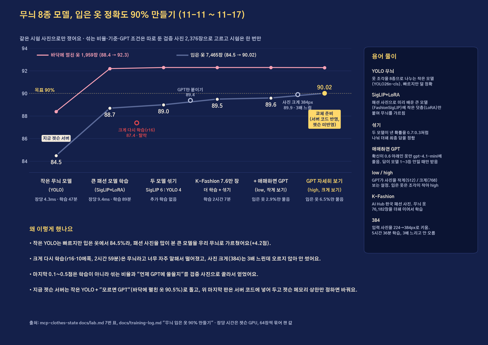

> **무늬 모델은 이렇게 90%를 넘겼어요.** 빠른 작은 모델(YOLO)이 입은 옷에서 84.5%에 머물러, 패션 사진을 많이 본 큰 모델(FashionSigLIP)에 무늬를 가르쳤어요(88.7%). 그다음 두 모델의 답을 섞고, K-Fashion 7.6만 장을 더 배우고, 애매한 옷 6.5%만 GPT에게 크게 보여 물어 **90.02%**가 됐어요.
> 크게 다시 학습(87.4%)과 사진 크게(384px, 3배 느림)는 시험해 보고 뺐어요. 지금 젯슨 서버는 작은 모델 + "모르면 GPT"(바닥에 펼친 옷 90.5%)로 돌고, 마지막 판은 서버 코드에 넣어 둔 **교체 준비** 상태예요.

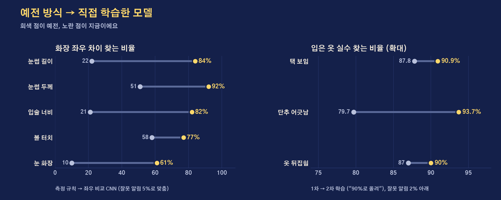

> **화장:** 재는 규칙으로는 눈썹 꼬리를 지워도 22%밖에 못 찾아서, 왼쪽·오른쪽 조각을 같은 작은 CNN에 넣어 비교하는 모델로 바꿨어요. "잘못 알림 5%로 맞춤"은 화장 안 한 얼굴 100장 중 5장만 "좌우가 달라요"라고 하도록 기준을 정하고 잰다는 뜻이에요. **눈 화장**은 망을 넓히고, 안경 사진을 건너뛰고, 젯슨에서 396판을 학습해 10% → 78.6%까지 올렸어요. 오른쪽 아래 그림은 눈금을 75~98로 확대했어요.

<b>숫자로 보는 학습 기록</b>

| 모델 | 다시 학습한 횟수 | 처음 → 지금 |
| --- | ---: | --- |
| 얼룩·찢어짐 | 7판 + 이어 학습·OWLv2 LoRA | mAP50 0.485 → **0.636**, 깨끗한 옷 200장 오탐 20장 → **1장** |
| 옷 종류 | 5종 → 12종, 6판 | 바닥에 펼친 옷 80.3% → **86.7%**, 바닥 신발 0.015 → **0.991** |
| 무늬 8종 | 7단계 (탈락 2판 포함) | 입은 옷 84.5% → **90.02%**(교체 준비), 바닥에 펼친 옷 88.4% → **92.3%** |
| 옷 색 | 3가지 방식 | 색 계열 45.3% → **76.8%**, 흰 옷 15% → **87%** |
| 같은 옷 찾기 | 사진 모델 12개 비교 + 보정 행렬 | 맞게 합침 36% → **78%**, 엉뚱한 옷에 합침 39% → **1.4%** |
| 입은 옷 실수(택·단추·뒤집힘) | 단추 모델 6판 (실제 사진으로 이어 학습) | 단추 79.7% → **93.7%** |
| 화장 좌우 비교 | 약 35가지 방식 | 눈썹 길이 22% → **84%**, 멀쩡한 사진 잘못 알림 63% → **31%** |
| 눈 화장 | 젯슨 GPU 396판 | 실사진 검출 약 10% → 50% → 61% → 72% → **78.6%** |
| 치아 이물질 | v1 → v4, LoRA·이어 학습 7가지 (시간이 남은 9판 2.5시간) | 합성 시험 87.2% → **91.2%**, 고춧가루 실사진 0.03 → **0.96** |

자세한 표: [clothes-state 실험 비교표](https://github.com/fashion-agent-team/mcp-clothes-state/blob/develop/docs/lab.md) · [학습 기록](https://github.com/fashion-agent-team/mcp-clothes-state/blob/develop/docs/training-log.md) · [face-check 실험 비교표](https://github.com/fashion-agent-team/mcp-face-check/blob/develop/docs/lab.md)

## 🔒 개인정보 원칙

- **사진은 저장하지 않아요.** 예외는 같은 옷 확인용 옷 부분 작은 사진(얼굴 없음, 옷을 지우면 삭제)과, 동의한 경우 재학습용 얼룩·무늬 조각(30일)뿐이에요
- **얼굴·치아 사진은 외부 AI로 보내지 않아요.** 서버의 자체 모델로만 판단해요
- 회원정보는 모든 항목을 건너뛸 수 있어요
- 키와 비밀값은 레포에 올리지 않고 환경 변수로만 받아요

---

## 🚀 협업 방식

| 단계 | 내용 |
| --- | --- |
| **브랜치** | Git Flow: `feature/*` → `develop` → `main`(릴리스 때만). PR은 항상 `develop` 대상 |
| **PR 검사** | 모든 레포 GitHub Actions(`ci.yml`)로 빌드·테스트, 팀원 리뷰 후 머지 |
| **이미지** | 레포마다 Dockerfile. 배포는 각 젯슨에서 arm64 이미지를 직접 빌드해 Docker Compose로 띄워요 ([젯슨 배포 문서](https://github.com/fashion-agent-team/fashion-agent/blob/develop/docs/infra/jetson/README.md)) |
| **약속 문서** | API·MCP 입출력은 앱 레포 `docs/contracts/`가 기준. 바꿀 땐 약속 문서부터 |

## ✅ 테스트

> 2026-11-12 각 레포 `develop` 기준 테스트 메서드 수(`@Test`·`test()` 개수)예요.

| 레포 | 테스트 |
| --- | ---: |
| fashion-agent (앱) | 215 |
| fashion-agent-agent | 98 |
| mcp-clothes-state | 84 |
| mcp-face-check | 64 |
| mcp-closet | 40 |
| mcp-schedule | 27 |
| mcp-weather | 28 |
| fashion-agent-gateway | 22 |
| **합계** | **578** |

---

## 👥 팀

<table align="center">
  <tbody>
    <tr>
      <td align="center">
        <a href="https://github.com/ehgo508">
          
           <b>이진행</b>
        </a>
         <b>기획 · 앱 · gateway · agent</b>
      </td>
      <td align="center">
        <a href="https://github.com/chang0580">
          
           <b>박창근</b>
        </a>
         <b>옷장 · 화장 확인 · 날씨</b>
      </td>
      <td align="center">
        <a href="https://github.com/jiwon934">
          
           <b>정지원</b>
        </a>
         <b>옷 상태 · 치아 확인 · 일정</b>
      </td>
    </tr>
  </tbody>
</table>

  팀 심청이

