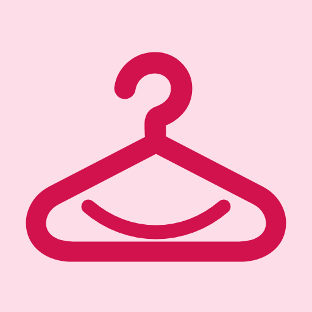
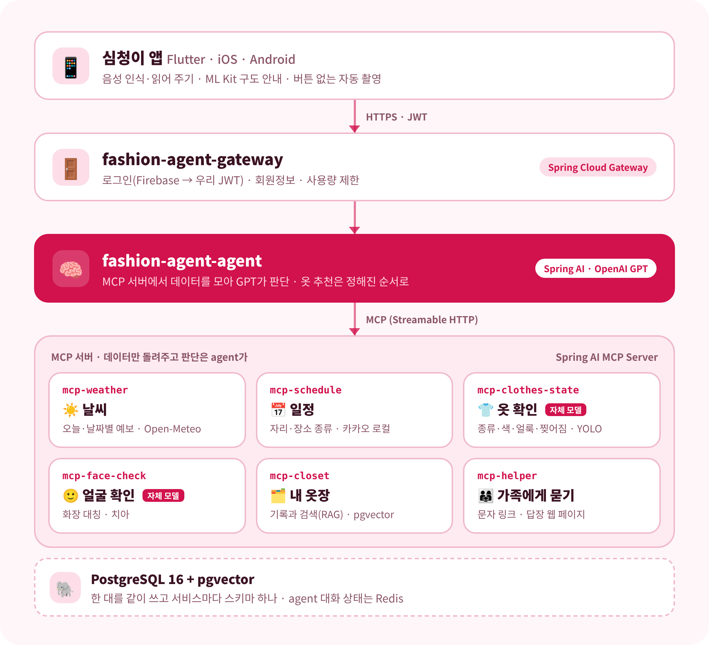

  
  <h1>심청이 · 패션 에이전트</h1>
  
<strong>말로 묻고, 카메라로 확인하는 시각장애인용 AI 옷 코디 에이전트</strong>

  
"설명해 주는 앱은 있었지만, 골라 주는 앱은 없었습니다."

  
📅 <b>개발 기간</b> : 2026.10.27 ~ 2026.11.20 &nbsp;·&nbsp; 👥 <b>팀 심청이</b>

## 📖 어떤 앱인가요?

시각장애인이 아침에 옷을 고를 때 가장 어려운 건 **"이 옷이 오늘 맞는지, 얼룩은 없는지"를 혼자 확인하는 일**입니다.
**심청이**는 말로 대화하는 AI 에이전트예요. 오늘 날씨와 일정을 보고 먼저 말로 옷을 추천하고, 꺼낸 옷을 카메라에 비추면 맞는지, 얼룩이나 찢어진 곳은 없는지 알려 줍니다.

- **옷을 따로 등록하지 않아요.** 평소 옷장 정리 방식은 그대로 두고, 꺼낸 옷을 확인만 해요.
- **사진 찍기 버튼이 없어요.** 폰이 구도를 소리로 안내하고, 옷이 잘 들어오면 알아서 한 장을 찍어요.
- **쓸수록 내 옷이 기록돼요.** 확인한 옷과 입은 날이 쌓여 다음 추천은 내 옷 중에서 골라요.

## ✨ 주요 기능

### 1. 날씨·일정 맞춤 추천 (말로)

"오늘 뭐 입지?" 한마디면 agent가 **날씨·일정·내 옷장**을 동시에 불러 GPT로 판단하고 말로 추천해요.

- 날씨: 기온·체감·일교차·강수 확률 (`weather_today`, 날짜별 `weather_forecast`)
- 일정: 말로 넣은 일정마다 **자리 종류(면접·결혼식·운동 등)와 장소 종류**를 붙여 돌려줘요 (`schedule_list`). 장소는 카카오 로컬로 찾아요
- 격식 있는 일정은 등록할 때와 3일 전 아침에 **드라이클리닝**을 미리 챙겨 줘요
- 앱을 열면 오늘 일정과 3일 안의 중요한 일정을 먼저 알려 줘요 (`schedule_briefing`)

### 2. 카메라로 옷 확인

꺼낸 옷을 비추면 사진마다 `clothes_inspect`가 **옷 한 벌마다 종류·색·얼룩·찢어짐**을 찾고, agent가 오늘 날씨와 자리에 맞는지 판단해요.

- 옷 종류 12종과 얼룩·찢어짐은 **우리가 직접 학습한 YOLO 모델**(ONNX)로 서버에서 봐요
- 얼룩이 애매할 때만 (사용자가 동의한 경우) **얼룩 부분만 잘라** GPT에 한 번 더 물어봐요
- 코트인지 재킷인지 애매하면 틀린 이름 대신 "겉옷"이라고 말해요
- 두 벌을 나란히 비추면 "왼쪽 흰 셔츠가 더 나아요"처럼 비교해 줘요

### 3. 얼굴 확인

셀카로 **화장이 좌우 고르게 되었는지**(`face_makeup_check`), **이 사이에 뭐가 끼지 않았는지**(`teeth_check`) 확인해요.

- 앱이 ML Kit로 얼굴을 실시간으로 잡아 구도를 안내하고, 멈춘 순간 여러 장을 보내 중간값으로 판단해요
- 얼굴·치아 사진은 **GPT 같은 외부 AI로 보내지 않고** 서버의 자체 모델로만 봐요

### 4. 가족·친구에게 물어보기

"엄마한테 물어봐 줘"라고 하면 사진과 질문을 **문자 링크**로 보내요. 가족은 앱 없이 웹 페이지에서 "괜찮아 / 얼룩 있어 / 직접 쓰기"로 답해요 (`helper_ask`, `helper_answer`).

### 5. 내 옷장 (RAG)

확인한 옷과 입은 날을 기록하고(`closet_save`, `closet_wear`), 다음 추천 때 상황에 맞는 내 옷을 찾아요(`closet_search`). "지난번 면접 때 뭐 입었지?"도 답해요(`closet_outfits`).

---

## 🏗 아키텍처

- **MCP 서버는 데이터만 돌려주고**, "이 옷이 오늘 맞는가" 같은 판단은 agent가 맡아요
- 옷 추천은 정해진 순서(코드)로 도구를 부르고, GPT가 도구를 고르는 건 날씨 묻기·일정 등록·얼굴 확인·가족에게 묻기 같은 개별 기능뿐이에요
- 서비스 사이 약속은 앱 레포의 [OpenAPI](https://github.com/fashion-agent-team/fashion-agent/blob/develop/docs/contracts/openapi.yaml)와 [MCP 도구 입출력](https://github.com/fashion-agent-team/fashion-agent/blob/develop/docs/contracts/mcp-tools.md) 하나로 맞춰요

## 🗂 레포지토리

| 레포 | 역할 | 주요 기술 |
| --- | --- | --- |
| [fashion-agent](https://github.com/fashion-agent-team/fashion-agent) | 모바일 앱, 아키텍처·서비스 간 약속 문서 | Flutter, ML Kit(얼굴·포즈·물체), speech_to_text, flutter_tts, Firebase Auth |
| [fashion-agent-gateway](https://github.com/fashion-agent-team/fashion-agent-gateway) | API 게이트웨이, 로그인, 회원정보 | Spring Cloud Gateway(Web MVC, 가상 스레드), Nimbus JOSE(JWT), JdbcClient + Flyway |
| [fashion-agent-agent](https://github.com/fashion-agent-team/fashion-agent-agent) | 대화와 옷 추천을 이끄는 두뇌 | Spring AI(ChatClient + MCP 클라이언트), OpenAI GPT, Redis |
| [mcp-weather](https://github.com/fashion-agent-team/mcp-weather) | 오늘·날짜별 날씨 | Spring AI MCP Server, Open-Meteo, Caffeine 캐시 |
| [mcp-schedule](https://github.com/fashion-agent-team/mcp-schedule) | 일정, 자리·장소 종류, 드라이클리닝 안내, 아침 브리핑 | Spring AI MCP Server(`@McpTool`), Spring Data JPA + Flyway, 카카오 로컬 API |
| [mcp-clothes-state](https://github.com/fashion-agent-team/mcp-clothes-state) | 옷 종류·색·얼룩·찢어짐 | 직접 학습한 YOLO26n, ONNX Runtime, (선택) GPT 얼룩 확인 |
| [mcp-face-check](https://github.com/fashion-agent-team/mcp-face-check) | 화장 대칭, 치아 확인 | ML Kit 윤곽점, MobileNetV3 분류 모델(ONNX) |
| [mcp-closet](https://github.com/fashion-agent-team/mcp-closet) | 내 옷장 기록과 검색(RAG) | Spring AI VectorStore, pgvector, multilingual-e5-small |
| [mcp-helper](https://github.com/fashion-agent-team/mcp-helper) | 가족·친구에게 확인 요청 | 문자 링크, 답장 웹 페이지, Cloudflare R2(사진 24시간) |

---

## 💻 Tech Stacks

| 구분 | 기술 스택 |
| :--- | :--- |
| **App** |     |
| **Backend** |       |
| **AI** | -6DB33F?style=flat&logo=spring&logoColor=white)    -76B900?style=flat&logo=nvidia&logoColor=white) |
| **Database** |    |
| **External API** |   |
| **Infra · 협업** |     |

---

## 🧠 직접 학습한 모델

| 모델 | 쓰는 곳 | 결과 (학습에 안 쓴 사진) |
| --- | --- | --- |
| 얼룩·찢어짐 `yolo26n_v6` | mcp-clothes-state | 사진 단위 정답률 91.9% (346장), 애매한 것만 GPT 확인 시 98.1% (314장). 깨끗한 옷 200장 중 오탐 1장 |
| 옷 종류 12종 `yolo26n_fashion12` | mcp-clothes-state | 내려놓은 옷 203장 종류 86.7% (큰 분류 91.6%), 바닥 신발 mAP50 0.991 |
| 치아 분류 MobileNetV3-Small | mcp-face-check | 합성 데이터로 학습, 실제 사진 평가 진행 중 |

- 학습은 팀 **Jetson Orin**에서 했고, 학습 사진은 외부 AI로 보내지 않았어요
- 실험 과정과 비교표는 [clothes-state 학습 기록](https://github.com/fashion-agent-team/mcp-clothes-state/blob/develop/docs/training-log.md)에 있어요

## 🔒 개인정보 원칙

- **사진은 저장하지 않아요.** 예외는 가족에게 보내는 사진(24시간 뒤 자동 삭제)과, 동의한 경우 재학습용 얼룩 조각(30일)뿐이에요
- **얼굴·치아 사진은 외부 AI로 보내지 않아요.** 서버의 자체 모델로만 판단해요
- 회원정보는 모든 항목을 건너뛸 수 있어요
- 키와 비밀값은 레포에 올리지 않고 환경 변수로만 받아요

---

## 🚀 협업 방식

| 단계 | 내용 |
| --- | --- |
| **브랜치** | Git Flow: `feature/*` → `develop` → `main`(릴리스 때만). PR은 항상 `develop` 대상 |
| **PR 검사** | 모든 레포 GitHub Actions(`ci.yml`)로 빌드·테스트, 팀원 리뷰 후 머지 |
| **이미지** | 레포마다 Dockerfile, `ghcr.io/fashion-agent-team/<레포>`로 올려 Docker Compose 한 번에 실행 ([compose](https://github.com/fashion-agent-team/fashion-agent/blob/develop/docs/infra/docker-compose.yml)) |
| **약속 문서** | API·MCP 입출력은 앱 레포 `docs/contracts/`가 기준. 바꿀 땐 약속 문서부터 |

## ✅ 테스트

> 2026-11-11 각 레포 `develop` 기준 테스트 메서드 수(`@Test`·`test()` 개수)예요.

| 레포 | 테스트 |
| --- | ---: |
| fashion-agent (앱) | 195 |
| fashion-agent-agent | 71 |
| mcp-face-check | 58 |
| mcp-clothes-state | 53 |
| mcp-closet | 28 |
| mcp-schedule | 28 |
| mcp-weather | 25 |
| fashion-agent-gateway | 20 |
| mcp-helper | 20 |
| **합계** | **498** |

---

## 👥 팀

<table align="center">
  <tbody>
    <tr>
      <td align="center">
        <a href="https://github.com/ehgo508">
          
           <b>이진행</b>
        </a>
         <b>gateway, agent</b>
      </td>
      <td align="center">
        <a href="https://github.com/chang0580">
          
           <b>박창근</b>
        </a>
         <b>helper, weather, 화장 대칭 확인</b>
      </td>
      <td align="center">
        <a href="https://github.com/jiwon934">
          
           <b>정지원</b>
        </a>
         <b>schedule, clothes-state, 치아 확인</b>
      </td>
    </tr>
  </tbody>
</table>

  팀 심청이

