

  
  <h1>심청이 · 패션 에이전트</h1>
  
<strong>말로 묻고, 카메라로 확인하는 시각장애인용 AI 옷 코디 에이전트</strong>

  
"설명해 주는 앱은 있었지만, 골라 주는 앱은 없었습니다."

  
📅 <b>개발 기간</b> : 2026.10.27 ~ 2026.11.20 &nbsp;·&nbsp; 👥 <b>팀 심청이</b>

## 📖 어떤 앱인가요?

시각장애인이 아침에 옷을 고를 때 가장 어려운 건 **"이 옷이 오늘 맞는지, 얼룩은 없는지"를 혼자 확인하는 일**입니다.
**심청이**는 말로 대화하는 AI 에이전트예요. 오늘 날씨와 일정을 보고 먼저 말로 옷을 추천하고, 꺼낸 옷을 카메라에 비추면 맞는지, 얼룩이나 찢어진 곳은 없는지 알려 줍니다.

- **옷을 따로 등록하지 않아요.** 평소 옷장 정리 방식은 그대로 두고, 꺼낸 옷을 확인만 해요.
- **사진 찍기 버튼이 없어요.** 폰이 구도를 소리로 안내하고, 옷이 잘 들어오면 알아서 한 장을 찍어요.
- **쓸수록 내 옷이 기록돼요.** 확인한 옷과 입은 날이 쌓여 다음 추천은 내 옷 중에서 골라요.

## 👥 누가 무엇을 했나요

<table align="center">
  <tr>
    <td align="center" valign="top" width="33%">
      
      <h3>이진행</h3>
      <a href="https://github.com/ehgo508">@ehgo508</a>
      
<b>기획 · 앱과 대화의 뼈대</b> 방향·로그인·음성·대화 흐름·응답 속도

      
fashion-agent(앱) · gateway · agent

      
     

    </td>
    <td align="center" valign="top" width="33%">
      
      <h3>박창근</h3>
      <a href="https://github.com/chang0580">@chang0580</a>
      
<b>내 옷장 · 화장 확인 · 날씨</b> RAG·얼굴 모델·배포 정리

      
mcp-closet · mcp-face-check(화장) · mcp-weather

      
     

    </td>
    <td align="center" valign="top" width="33%">
      
      <h3>정지원</h3>
      <a href="https://github.com/jiwon934">@jiwon934</a>
      
<b>옷 상태 모델 · 치아 · 일정</b> 학습 모델·DB 정규화

      
mcp-clothes-state · mcp-face-check(치아) · mcp-schedule

      
     

    </td>
  </tr>
</table>

### &nbsp; 이진행: 기획, 앱과 대화의 뼈대
> 레포 **10곳** · 옷 추천 응답 **1.77 → 1.04초** · 시각장애인 관점 점검 **11가지** 반영 · 서버 목소리 대체 경로(Azure → 엣지)

- **방향 잡기**: "옷을 따로 등록하지 않고, 폰으로 비춰 확인하는 음성 AI 에이전트"라는 뼈대, 옷 추천 두 단계(말로 먼저 추천 → 카메라로 꺼낸 옷 확인), 첫 실행 흐름(인사 → 허용 → 구글 로그인 → 말 속도·목소리 → 이름 → 내 정보 → 호칭)
- **앱(Flutter)**: 음성 에이전트 기본 틀과 음성 온보딩, 오늘 날씨 음성 안내, 앱 대화를 agent `/turn`에 연결, 이름을 불러 말 걸기(서버 음성 인식으로 이름 짐작), 말로 이름·호칭·내 정보 바꾸기, 옷 보여 주는 방식 고르기(내려놓고 비추기 / 입고 한 바퀴), 카메라 구도 말 안내와 자동 촬영(ML Kit), 구글 로그인 → Firebase → gateway 연결, 첫 실행 흐름, 일정 폰 알림(전날 저녁·당일 아침, 일정마다 며칠 전·끄기), 색 설명 방식(짧게/자세히) 기억, 시각장애인 관점 점검 반영(기다림 진동·구도 소리·시리 단축어·잠깐 쉬기)
- **gateway**: 로그인(Firebase·개발용)과 JWT, 회원정보(호칭·말 빠르기 포함), 사용량 제한, 뒤쪽 서버 라우팅, agent에 옷 판단용 내 정보 넘기기. 말 받아 적기(`gpt-4o-mini-transcribe`), 서버 목소리(Azure 유진 → 막히거나 무료 한도 전이면 엣지 선희, 젯슨 edge-tts 사이드카, 빠르기 반영, 앞뒤 무음 없애기)
- **agent**: 옷 추천 두 단계와 MCP 클라이언트 뼈대, 판단 LLM을 Gemini에서 GPT로 바꾸기, GPT 도구 선택(일정 넣기·지우기, 넣은 뒤 알림 묻기), 얼굴 확인을 화장 대칭·치아 두 도구로 나누기, 날짜를 말하면 그날 일정·예보로 추천, "이거 무슨 색이야?" 빠른 색 확인, 색을 감각·느낌으로 설명하기, 입는 사람 정보를 GPT 판단에 넣기, GPT 확인은 동의한 사용자만(처음 애매한 얼룩 때 한 번 묻기), MCP 서버 재시작 뒤 첫 요청 실패 고치기
- **다른 서버에 더한 것**: mcp-weather `weather_forecast`(날짜별 예보)와 더운 날 일교차로 겉옷 권하지 않기, mcp-schedule `schedule_set_reminder`, mcp-clothes-state 색 어울림 점수(0~100과 까닭)
- **응답 속도**: 옷 추천 1.77초 → 1.04초, 옷 확인 1.95초 → 1.47초 (GPT priority 처리·짧은 답·연결 데우기, 켜질 때 모델 데우기·모델과 GPT 확인 동시에, 옷 사진 긴 변 960으로 줄여 보내기)
- **팀 공통**: 레포마다 PR 자동 테스트(CI), 서버 레포 README, 아키텍처·서비스 간 약속 문서(`docs/contracts/`), Spec Kit DB 통합 설계, 발표 버전 릴리스(8개 레포 `develop` → `main`), IT Festival 신청서·발표 자료

👉 [자세히 보기: 쓴 기술·이론·작업 기록 (이진행)](https://github.com/fashion-agent-team/.github/blob/main/profile/docs/team-details.md#이진행)

### &nbsp; 박창근: 내 옷장, 화장 확인, 날씨, 대화 품질, 배포·문서
> 모델 학습 **109시간 이상** · 눈화장 학습 **396판** · 화장 측정 방식 **35가지** 비교

- **mcp-closet (서버 전체, PR 14)**: e5 글 벡터 RAG 검색, 최근 입은 옷 감점과 입은 조합(`closet_outfits`), 옷장 읽기·지우기(`closet_list`·`closet_remove`), FashionSigLIP 사진 벡터로 같은 옷 합치기와 이름 고르기, 애매하면 GPT가 작은 사진 두 장으로 확인(`closet_merge`), 같은 옷 기준값 일상 사진 실측(0.68 → 0.60), 이미지 모델 **12개 비교**(같은 옷 찾기 58% → 85%, 착각 3.0% → 0.4%)
- **mcp-face-check 화장 대칭 (PR 20)**: 윤곽점·픽셀 측정 서버, CelebA 2,832장·FFHQ 실사진으로 기준값, 얼굴 분할 모델 비교 후 BiSeNet ResNet34, 직접 학습한 좌우 비교 모델(눈썹 길이 22 → 84%, 눈썹 두께 51 → 92%, 입술 너비 20 → 82%, 볼 터치 58 → 77%), 흐린 사진 잘못 알림 16 → 5%, 실사진 잘못 알림 63 → 31%
- **눈화장 모델 (젯슨 GPU 101.6시간, 396판)**: 픽셀 비교 → 직접 설계한 망 → 넓은 망 + TTA → 안경 거르기 → ResNet18 앙상블. 실사진 검출 약 10% → 78.6%, 처음 보는 사람 56.0 → 63.8%
- **mcp-weather (서버 전체)**: Open-Meteo 서버, 끊기면 재시도, 학교 망 시간 초과면 MET Norway로, 날짜 바뀌면 캐시 새로
- **mcp-clothes-state 정확도 보강 (PR 9)**: 글 벡터로 애매한 옷 종류 다시 보기(입은 옷 66 → 75.5%, 빈 벽 오인 60 → 0장), 학습 벡터 probe(폰 사진 세부 13종 78.2 → 81.3%), 애매한 옷만 SigLIP2 So400m(81.4 → 83.1%), So400m 색 분류
- **agent 대화 품질 (PR 95)**: 앱 시뮬레이션을 여러 회차 돌려 찾은 대화 오류를 고친 PR 95개(날짜 이어 받기 "모레는?"·"다음주 화요일", 면접·결혼식·장례식 자리별 차림, "비 온대"·"영하야?" 날씨 후속 질문, 카메라 중 "그만"·"끝" 등), 옷장·날씨 대화 흐름, 체감 온도를 실제 값으로 바로잡기, 열린 PR 10개 한꺼번에 합치기
- **목소리·앱·도우미**: Azure 목소리 4가지(유진·지민·서현·순복) 도입과 기본값, TTS 교착(문장마다 9초) 고치기, 앱 화면 개편 "인당수의 밤"과 심청이 그림, 화장 확인이 얼굴을 못 찾던 실기기 버그 고치기, 날씨 30분 캐시, 아이폰 설치 스크립트, mcp-helper 서버 구현
- **배포·품질·문서**: 젯슨 두 대 배포 설정(서버마다 메모리 상한·스왑 금지), 8개 레포 테스트 커버리지 80% 기준 CI(앱 72 → 81.6%), 아키텍처 그림·ERD, 이 README(역할·Tech Stack·앱 화면 26장·학습 그래프)

👉 [자세히 보기: 쓴 기술·이론·학습 기록 (박창근)](https://github.com/fashion-agent-team/.github/blob/main/profile/docs/team-details.md#박창근)

### &nbsp; 정지원: 옷 상태 모델, 치아, 일정, DB
> 모델 학습 **67시간 이상** · 옷 상태 실험 **56가지** · 치아 실험 **18가지** · 레포 **9곳**

- **mcp-clothes-state (서버 전체, PR 32)**: Java MCP 서버, 얼룩·찢어짐 YOLO v1 ~ v7 학습·비교(v6 채택, 애매하면 GPT → 사진 단위 정답률 98.1%, 장당 14ms), 옷 종류 12종 모델(80.3 → 86.7%), K-Fashion 2.5만 벌로 시험한 색 모델(45.3 → 76.8%)과 색 조합 판단, 무늬 8종(FashionSigLIP LoRA 섞기 + GPT high, 입은 옷 84.5 → 90.0%, 교체 준비), 입은 옷 실수 모델(단추 79.7 → 93.7%, 뒤집힘·택), GPT에 보낼 때 얼굴 가리기, 젯슨 성능 측정
- **mcp-face-check 치아 (직접 학습)**: `teeth_check` ONNX 모델, 앞니 사이 고춧가루 실제 사진 0.03 → 0.96(v4), 6번 보고 평균으로 잘못 알림 3.1 → 1.1%
- **mcp-schedule (서버 전체)**: 카카오 로컬 장소 분류, 격식 일정 드라이클리닝 안내, 아침 브리핑, 며칠 전 알림을 그날 아침으로·일정별 알림 시각(`remind_time`), 긴 제목·지난 날짜 막기, 일정을 바꿔도 알림 시각 유지
- **DB 설계·정규화**: 전체 DB 설계와 Spec Kit 기능 spec, V4 정규화(account `user_identities`, schedule `places`, closet `garment_defects`), spec 시나리오 통합 테스트
- **보안·구조 정리**: `X-User-Id` 헤더 없애고 로그인 토큰 직접 확인, 로그인 없는 경로 횟수 제한, 레포 패키지 구조 정리, 8개 레포 정적 검사 경고 정리, 빠진 테스트 채우기(앱 화면 위젯 테스트·spec 시나리오 테스트 포함)
- **앱·배포**: 서버를 기능별 레포로 나누기, 젯슨 상시 배포(Docker Compose·Nginx·Funnel) 처음 구성, 안 쓰는 mcp-helper 배포에서 빼기, 치아·화장 촬영 안내와 입 주변만 잘라 보내기, 앱 켤 때 미리 준비(`/agent/warm`), 시리 단축어 한국어 등록
- **문서·그림**: 조직 프로필 README 처음 작성, ERD를 V4 정규화 구조로 다시 그리기, 아키텍처 그림을 데이터 흐름이 보이게 다시 그리기, 설계 결정 문서(얼굴 사진은 외부 AI 없이, 옷 상태 판단 기준)

👉 [자세히 보기: 쓴 기술·이론·학습 기록 (정지원)](https://github.com/fashion-agent-team/.github/blob/main/profile/docs/team-details.md#정지원)

머지된 PR 제목과 각 레포 실험 기록(docs/lab.md·training-log.md)으로 확인되는 것만 적었어요(2026-11-24 기준).

## 🏗 아키텍처

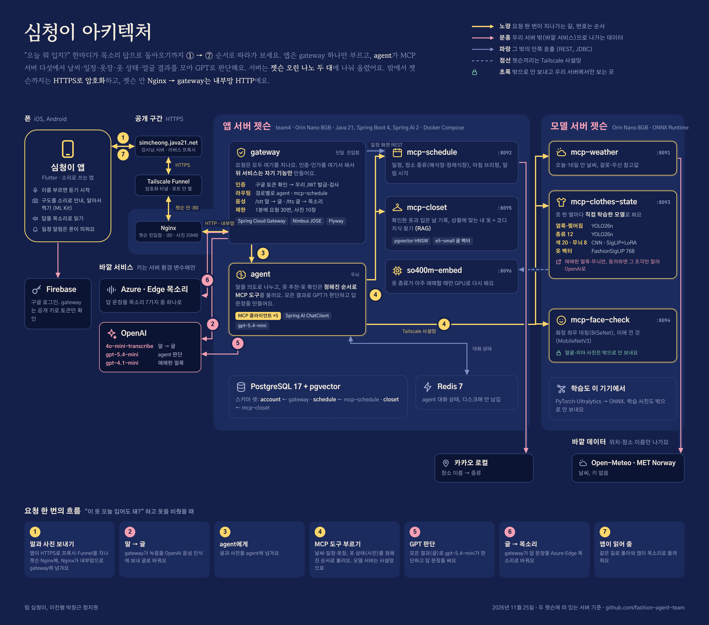

- **MCP 서버는 데이터만 돌려주고**, "이 옷이 오늘 맞는가" 같은 판단은 agent가 맡아요
- agent는 말을 의도로 나눠 옷 추천·옷 확인·날씨·얼굴·옷장은 정해진 순서(코드)로 도구를 부르고, 일정 넣기·지우기 같은 나머지만 GPT가 도구를 골라요
- 안내 목소리는 gateway가 만들어요. Azure Speech 4가지(유진·지민·서현·순복)와 Edge 3가지(선희·인준·현수) 중 고르고, 안 되면 폰 TTS로 읽어요
- 서버는 **젯슨 오린 나노 8GB 두 대**에 나눠 Docker Compose로 상시 띄워요. 한 대는 gateway·agent·일정·옷장·DB(앱 서버), 다른 한 대는 옷 상태·얼굴·날씨 MCP와 모델 학습(모델 서버)을 맡고, 둘은 Tailscale 사설망으로 이어져요. 8GB 한 대에 다 안 들어가서 나눴고, MCP라 agent는 주소만 바꾸면 됐어요
- 바깥에서는 `simcheong.java21.net` → Tailscale Funnel → Nginx → gateway 순서로 들어와요. 젯슨까지 공개 구간은 **HTTPS**로 암호화하고, Nginx는 앱 서버 젯슨 안에 있어서 Nginx → gateway는 **내부망 HTTP**예요(`proxy_pass http://gateway:8080`)
- **gateway는 단일 진입점**이에요. 인증(구글 토큰 확인 → JWT 발급·검사), 라우팅, 음성(STT·TTS), 사용량 제한을 여기서 해서 뒤 서비스는 자기 기능만 만들어요
- 그림 원본은 [`profile/images/src/architecture.html`](images/src/architecture.html)이에요. 고친 뒤 Chrome으로 2배 크기 캡처해서 새 이름(예: `architecture-v10.png`)으로 저장하고 위 그림 주소도 바꿔요. 같은 이름으로 덮으면 GitHub 캐시 때문에 옛 그림이 한동안 보여요
- 서비스 사이 약속은 앱 레포의 [OpenAPI](https://github.com/fashion-agent-team/fashion-agent/blob/develop/docs/contracts/openapi.yaml)와 [MCP 도구 입출력](https://github.com/fashion-agent-team/fashion-agent/blob/develop/docs/contracts/mcp-tools.md) 하나로 맞춰요

## 🗂 ERD

> [ERD Designer](https://github.com/kajitiluna/erd-designer)로 그렸어요. 각 서비스 레포 `develop`의 Flyway 마이그레이션(account·closet V4, schedule V5)이 만든 구조예요. 2026-11-26에 [DDL](https://github.com/fashion-agent-team/.github/blob/main/profile/images/src/simcheong-erd.sql)을 실제 배포 DB(앱 서버 젯슨)의 구조와 맞대 보니 칼럼 이름·타입·NULL·기본값, PK·FK(ON DELETE 포함)·UNIQUE, CHECK 20개, 인덱스 11개가 같았어요. 다른 점은 ERD Designer가 못 담는 두 가지뿐이에요. 벡터 칼럼 3개가 `real[]`로 보이고(실제는 pgvector `vector`), DDL의 FK에는 이름이 빠져요(실제 이름은 `.erd` 관계 이름과 같아요). 스키마 3개, 표 11개, FK 관계 7개와 FK 없는 참조 2개(`user_id`)예요. 원본 [`simcheong.erd`](https://github.com/fashion-agent-team/.github/blob/main/profile/images/src/simcheong.erd) · [DDL](https://github.com/fashion-agent-team/.github/blob/main/profile/images/src/simcheong-erd.sql)

<a href="https://raw.githubusercontent.com/fashion-agent-team/.github/main/profile/images/erd-v14-designer.png">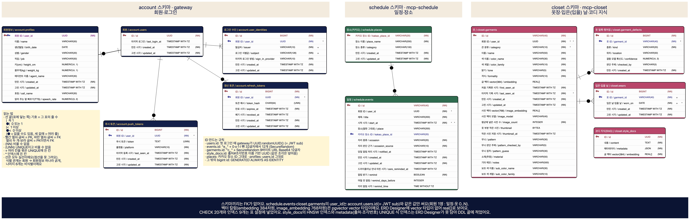</a>

그림을 누르면 원본 크기(2배)로 열려요. 선 끝 기호·열쇠 색·(NN)·+·* 뜻은 그림 왼쪽 아래 '읽는 법' 메모에 있어요

- **서비스마다 스키마 하나**: account(gateway) · schedule · closet. 스키마끼리는 FK 없이 `user_id`(= JWT sub) 값만 같이 써요. 회원 한 명에 일정·옷이 여러 개(0..N)인 관계지만 스키마가 달라 그림에 선을 긋지 않았어요
- **V4에서 정규화**했어요. 여러 값을 묶어 두던 옷 설명 JSON은 칸과 `garment_defects`로, 로그인 방법에 따라 비던 칸은 `user_identities`로, 일정마다 되풀이되던 장소 이름·분류는 `places`로 나눴어요
- 옷의 색 이름·색 계열·밝기는 mcp-clothes-state가 옷 조각마다 색을 한 번 보고 같이 정해요(색 인식 모델, 모델이 없으면 픽셀 규칙. GPT는 색을 정하지 않아요). 셋은 서로 하나로 정해지지 않아요. 예를 들어 연분홍은 계열이 pink일 때도 red일 때도 있고, 계열 gray·밝기 light는 '밝은 회색'일 때도 '은색'일 때도 있어요. 그래서 따로 표로 빼지 않고 `garments`에 같이 둬요
- 남은 JSON은 `style_docs.metadata`(json) 하나예요. Spring AI 벡터 저장소가 정한 형식이라 그대로 두었어요. 안에는 출처·조각번호(둘에 UNIQUE 인덱스, `id`도 이 둘로 만든 UUID), 임베딩 모델 이름, 문서 머리말 값(자리 `occasion`, 날씨 문서의 기온 구간 `minTemp`·`maxTemp`)이 들어 있어요. 머리말 값은 문서마다 하나라 조각마다 되풀이되지만, 코디 지식을 찾을 때 이 값으로 거르려고 조각마다 둬요
- 로그인 수단은 `user_identities`에 (issuer, subject) 한 줄씩 두고 복합 UNIQUE를 걸었어요. Apple·구글 로그인은 Firebase uid 하나(issuer=`firebase`)로 들어오고, 마지막에 쓴 방법만 `sign_in_provider`에 남아요(지금 앱에는 구글 로그인만 있어요). 계정은 처음 로그인할 때 수단 한 줄과 같이 만들어져서 관계는 1:1..N이에요. 표는 수단을 더 붙일 수 있게 만들었지만 지금 코드는 하나만 만들어요(배포 DB도 계정 5개에 수단 5개)
- 장소 이름·분류는 `places`(카카오 장소 ID가 키)에 한 번만 저장해요. 분류는 카카오 분류의 마지막 마디(예: 예식장)예요. 일정에는 사용자가 말한 장소(`place`)를 그대로 두고, 카카오에서 찾은 장소는 ID로만 가리켜요(못 찾으면 비어 있어요)
- **일정 알림 칸**: `remind`가 false면 알림이 없어요. `remind_days_before`가 비어 있으면 아직 안 정한 것이라 전날과 당일 아침에, 0이면 당일만, 1~14면 그만큼 전과 당일에 알려요. `remind_time`은 미리 알림 시각이에요(비면 아침 8시, 0일 전이면 당일 알림 시각). 폰 알림은 앱이 이 값으로 폰 안에 예약해요. `notified_at`·`care_reminded_at`은 서버가 같은 일정을 두 번 처리하지 않으려고 남기는 표시예요. 서버에서 폰으로 보내는 푸시는 아직 로그만 남기고, `push_tokens`도 지금은 비어 있어요
- 옷의 무늬·소재·보조 색은 `garments` 칸으로, 얼룩·찢어짐은 `garment_defects`에 한 줄씩 저장해요. 소재는 옷 종류로 짐작한 값이에요(니트·가디건이면 니트). 얼룩·찢어짐은 마지막으로 기록한 상태만 남아요(같은 옷을 다시 기록하면 지우고 새로 넣어요)
- `wears`는 옷 ID만 참조하고 (garment_id, worn_on)에 복합 UNIQUE를 걸어, 같은 옷을 같은 날 두 번 기록하지 않아요. 오늘 뒤 날짜는 미리 고른 코디이고, 입은 횟수·마지막으로 입은 날은 오늘까지만 세요. 옷과 입은 날은 옷 확인을 마치며 "이걸로 할게"처럼 고를 때(`closet_save`·`closet_wear`) 기록돼요. 카메라로 비추기만 해서는 바뀌지 않아요
- **ID 만드는 규칙** (각 서버 코드에서 확인, 그림 속 메모와 `.erd` 칼럼 설명에도 적었어요)

  | ID | 만드는 법 | 코드 |
  | --- | --- | --- |
  | `users.id` | uuid. 처음 로그인할 때 gateway가 `UUID.randomUUID()`로 만들어요. 이 값이 JWT `sub`이고, 다른 스키마도 `user_id`로 같이 써요 | gateway `AccountStore` |
  | `events.id` | `"e_"` + 임의 글자 12개. 헷갈리는 0·o·1·l을 뺀 소문자·숫자 32가지에서 `SecureRandom`으로 골라요. MCP 도구의 `eventId`예요 | mcp-schedule `ScheduleService.newId` |
  | `garments.id` | `"c_"` + `SecureRandom` 9바이트를 URL용 Base64(패딩 없음)로 바꾼 12글자. MCP 도구의 `garmentId`예요 | mcp-closet `Ids.garmentId` |
  | `style_docs.id` | `출처#조각번호`로 만든 이름 기반 UUID(`nameUUIDFromBytes`). 같은 조각을 다시 넣으면 덮어써요 | mcp-closet `StyleDoc.chunkId` |
  | `places.kakao_place_id` | 카카오 장소 ID를 그대로 키로 써요 | mcp-schedule |
  | `profiles.user_id` | `users.id`를 그대로 키로 써요(1:0..1) | gateway |
  | 그 밖의 bigint `id` | `GENERATED ALWAYS AS IDENTITY` (DB가 1씩 늘려 만들어요) | 마이그레이션 |

- **DB에 두는 사진은 옷마다 옷 부분 작은 사진 하나뿐이에요.** 같은 옷 확인용으로 agent가 옷 부분만 잘라 긴 변 256px·48KB 이하 JPEG로 줄여 보내고, mcp-closet도 48KB(49,152바이트)를 넘거나 JPEG가 아니면 사진 없이 저장해요. DB는 한 번 더 64KB(65,536바이트)를 넘으면 막아요(`garments_thumbnail_size`). 옷을 지우면 같이 지워져요
- 옷 벡터는 한 사람의 옷(보통 100벌 안팎, 많아야 500벌)만 정확한 거리로 훑어요. 공용 코디 지식(`style_docs`)에는 HNSW 인덱스를 만들어 두었어요
- 허용 값(옷 큰 분류 6가지, 색 계열 15가지, 일정 자리 6가지 등)은 CHECK 20개로 막아요. HNSW 인덱스와 `metadata` 안 출처·조각번호 UNIQUE 식 인덱스는 ERD Designer가 못 담아서 [DDL](https://github.com/fashion-agent-team/.github/blob/main/profile/images/src/simcheong-erd.sql) 끝에 따로 적었어요
- 배포 DB에는 지금 배포하지 않는 mcp-helper가 예전에 만든 `helper` 스키마(contacts·requests, 둘 다 0줄)가 남아 있어 ERD에서 뺐어요
- **DB를 쓰는 서버는 gateway·mcp-schedule·mcp-closet 셋뿐이에요.** 나머지는 요청마다 계산만 하고 표가 없어서 ERD에 없어요

  | 서버 | 데이터를 두는 곳 |
  | --- | --- |
  | agent | 대화 상태를 Redis에 30분(TTL). GPT 확인 동의를 묻는 동안의 옷 사진과 옷 부분 작은 사진도 그동안만 여기 있어요 |
  | mcp-weather | 날씨 결과를 메모리 캐시(Caffeine)에. 다시 켜면 사라져요 |
  | mcp-clothes-state | DB 없음. GPT 사용에 동의했을 때만, GPT가 확인한 옷 조각(얼룩·찢어짐, 무늬, 옷 실수)을 다시 학습할 후보 파일로 `data/train-candidates/날짜/`에 남겨요. 날짜 폴더는 30일이 지나면 매일 새벽 3시 30분과 서버를 켤 때 지워요. 옷 실수 판단 기록 `wear-trust.json`(사진 없이 모델 확률·GPT 답만, 종류마다 최근 200개)은 기간 없이 남아요 |
  | mcp-face-check | DB·파일 저장 없음 |

## 💻 Tech Stacks

| 구분 | 기술 스택 |
| :--- | :--- |
| **App** |      |
| **Backend** |      -000000?style=flat&logo=jsonwebtokens&logoColor=white)  |
| **AI · Agent** | -6DB33F?style=flat&logo=spring&logoColor=white)   |
| **Vision · ML** |   -EE4C2C?style=flat&logo=pytorch&logoColor=white)   |
| **Voice** |    -02569B?style=flat&logo=flutter&logoColor=white) |
| **Database** |     |
| **External API** |  -00205B?style=flat)  |
| **Infra · 협업** |       |

👉 [기술마다 어디에 어떻게 썼는지, 왜 골랐는지 자세히 보기](https://github.com/fashion-agent-team/.github/blob/main/profile/docs/tech-stack.md)

---

## ✨ 주요 기능

### 1. 날씨·일정 맞춤 추천 (말로)

"오늘 뭐 입지?" 한마디면 agent가 **날씨·일정·내 옷장**을 동시에 불러 GPT로 판단하고 말로 추천해요.

- 날씨: 기온·체감·일교차·강수 확률 (`weather_today`, 날짜별 `weather_forecast`)
- 일정: 말로 넣은 일정마다 **자리 종류(면접·결혼식·운동 등)와 장소 종류**를 붙여 돌려줘요 (`schedule_list`). 장소는 카카오 로컬로 찾아요
- 격식 있는 일정은 등록할 때와 3일 전 아침에 **드라이클리닝**을 미리 챙겨 줘요
- 앱을 열면 오늘 일정과 3일 안의 중요한 일정을 먼저 알려 줘요 (`schedule_briefing`)
- 일정을 넣으면 알림을 받을지, 며칠 전에 미리 알릴지 물어 저장하고(`schedule_set_reminder`) 그에 맞춰 폰 알림을 띄워요

### 2. 카메라로 옷 확인

꺼낸 옷을 비추면 사진마다 `clothes_inspect`가 **옷 한 벌마다 종류·색·무늬·얼룩·찢어짐**을 찾고, agent가 오늘 날씨와 자리에 맞는지 판단해요.

- 옷 종류 12종·무늬 8종·얼룩·찢어짐은 **우리가 직접 학습한 YOLO 모델**, 옷 색 20가지는 K-Fashion으로 학습한 **작은 CNN**(ONNX)으로 서버에서 봐요
- 고른 옷끼리 색이 어울리는지는 색 이론 규칙으로 따로 판단해요 (`outfit_color_check`)
- 얼룩이나 무늬가 애매할 때만 (사용자가 동의한 경우) **그 부분만 잘라** GPT에 한 번 더 물어봐요
- 코트인지 재킷인지 애매하면 틀린 이름 대신 "겉옷"이라고 말해요
- 두 벌을 나란히 비추면 "왼쪽 흰 셔츠가 더 나아요"처럼 비교해 줘요
- 입은 모습은 앞·뒤 두 장으로 한 바퀴 확인해요

### 3. 얼굴 확인

셀카로 **화장이 좌우 고르게 되었는지**(`face_makeup_check`), **이 사이에 뭐가 끼지 않았는지**(`teeth_check`) 확인해요.

- 앱이 ML Kit로 얼굴을 실시간으로 잡아 구도를 안내하고, 멈춘 순간 여러 장을 보내 중간값으로 판단해요
- 서버가 얼굴 분할 모델(BiSeNet ResNet34)로 눈썹·입술·볼 칸을 나누고, 눈썹 길이·두께, 입술 너비, 볼 터치는 공개 얼굴 데이터(CelebA)로 학습한 **좌우 비교 모델**로 판단해요. 알림 기준은 고화질 실사진(FFHQ)에 맞췄어요
- 얼굴·치아 사진은 **GPT 같은 외부 AI로 보내지 않고** 서버의 자체 모델로만 봐요

### 4. 내 옷장 (RAG)

확인한 옷과 입은 날을 기록하고(`closet_save`, `closet_wear`), 다음 추천 때 상황에 맞는 내 옷을 찾아요(`closet_search`). "지난번 면접 때 뭐 입었지?"(`closet_outfits`), "내 옷장에 뭐 있어?"(`closet_list`)에도 답해요.

- 같은 옷인지는 `clothes_inspect`가 준 **옷 사진 벡터**(FashionSigLIP 768차원)로 판단해 한 벌로 합쳐요. 애매하면 agent의 GPT가 옷 부분 작은 사진끼리 비교해 합쳐요(`closet_merge`)
- "옷장 확인해 줘"라고 하면 옷장 옷을 읽어 주고, 말로 옷을 지울 수도 있어요
- 상황 문장(글 임베딩, multilingual-e5-small)과 영어 검색어(사진 벡터)로 내 옷과 코디 지식을 함께 찾고, 추천 문장은 agent의 GPT가 만들어요

---

## 📱 앱 화면

> **인당수의 밤**: 쪽빛 바탕에 노란 큰 글씨, 버튼은 한 화면에 하나만 두었어요. 화면 어디를 눌러도 "말하기"이고, 아래 큰 버튼은 "다시 듣기"예요. 모든 안내는 소리로 읽어 줘요.

### 🌊 처음 만나는 순간

처음 켜면 버튼을 누르지 않아도 심청이가 먼저 말을 걸어요. 인사 → 개인정보 안내 → 허용 창 찾는 법 → 구글 로그인 → 이름·호칭 → 기능 소개까지 **모두 말로** 이어져요. 허용 창과 로그인 창은 VoiceOver로 어디를 두 번 탭하면 되는지 소리로 알려 줘요.

⚙️ 앱(Flutter) · 구글 로그인 → Firebase → gateway(JWT) · 목소리는 Azure Speech(서버가 안 되면 엣지·폰 목소리)

<table align="center">
  <tr>
    <td align="center" valign="top" width="25%"> <b>먼저 인사</b> 설치하고 처음 켜면 바로 말을 걸어요</td>
    <td align="center" valign="top" width="25%"> <b>개인정보 안내</b> 말과 사진을 어디에 쓰는지 먼저 알려요</td>
    <td align="center" valign="top" width="25%"> <b>말로 하는 로그인</b> 로그인 창에서 누를 곳을 소리로 안내</td>
    <td align="center" valign="top" width="25%">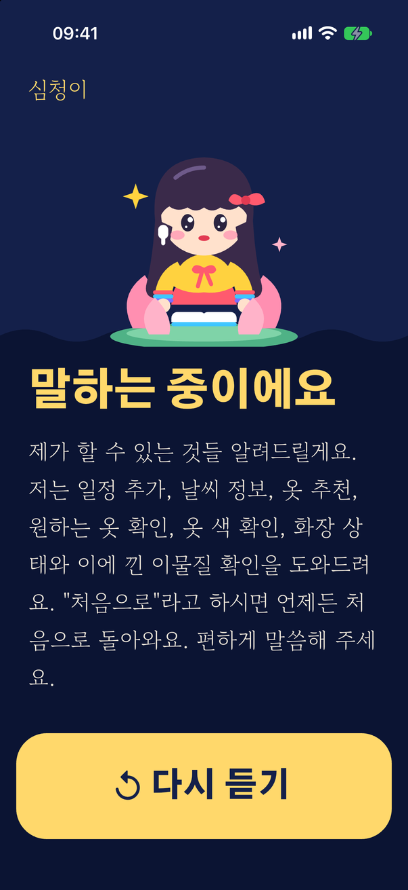 <b>할 줄 아는 일</b> 처음 한 번 기능을 쭉 소개해요</td>
  </tr>
</table>

### 🗣 이름만 부르면 대답

폰을 세워 두고 **"심청아"** 하고 부르면 그 뒤에 한 말을 알아들어요. 듣는 동안에는 아래 물이 **다홍**으로 차올라 저시력 사용자도 멀리서 알아봐요. 서버를 기다릴 때는 들은 말을 되짚는 추임새를 먼저 해서 불안하지 않게 했어요.

⚙️ 이름 듣기는 폰 음성 인식, 부른 뒤 명령은 gateway의 `gpt-4o-mini-transcribe`로 다시 받아 적기 · agent가 Spring AI 도구 호출로 기능을 골라요

<table align="center">
  <tr>
    <td align="center" valign="top" width="25%"> <b>부르기를 기다려요</b> “심청아” 하고 부르면 대답</td>
    <td align="center" valign="top" width="25%">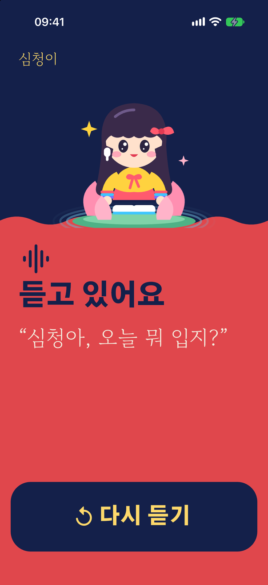 <b>듣는 중엔 다홍</b> 들은 말을 크게 보여 줘요</td>
    <td align="center" valign="top" width="25%"> <b>알아보는 중</b> "잠깐만 기다려 주세요" 추임새 먼저</td>
  </tr>
</table>

### ☀️ 오늘 뭐 입지?

**"오늘 뭐 입지?"** 한마디에 날씨·일정·내 옷장을 한꺼번에 보고 겉옷·상의·하의를 말로 추천해요. 날씨만 따로 물어도, 날짜를 말해도 돼요.

⚙️ agent(GPT) ← mcp-weather(Open-Meteo, 안 되면 MET Norway) · mcp-schedule · mcp-closet(RAG)

<table align="center">
  <tr>
    <td align="center" valign="top" width="25%"> <b>오늘의 추천</b> 기온·체감에 맞춰 겉옷부터 목도리·장갑까지</td>
    <td align="center" valign="top" width="25%"> <b>오늘 날씨</b> 지금·최저·최고, 체감 온도까지</td>
    <td align="center" valign="top" width="25%"> <b>내일 날씨</b> 비 올 확률이 높으면 우산 챙기기</td>
  </tr>
</table>

### 🎚 목소리 고르기 · 잠깐 쉬기

목소리가 마음에 안 들면 **"목소리 바꿔 줘"**라고 해요. 7가지 목소리를 하나씩 들려주고 "이 목소리 좋아"로 골라요. 회의 중이나 TV 소리가 클 때는 **"잠깐 쉬어"**로 이름 듣기를 멈춰요.

⚙️ 서버 목소리: Azure Speech 유진·지민·서현·순복, 엣지 선희·인준·현수(gateway가 문장을 받아 음성으로) · 서버가 안 되면 폰 목소리

<table align="center">
  <tr>
    <td align="center" valign="top" width="25%"> <b>목소리 고르기</b> "다음", "이 목소리 좋아"로 골라요</td>
    <td align="center" valign="top" width="25%"> <b>잠깐 쉬기</b> 다시 부를 땐 화면을 두 번 탭</td>
  </tr>
</table>

### 📅 일정과 그날의 옷

말로 일정을 넣으면 **자리 종류(결혼식·면접 등)**를 알아보고, 격식 있는 자리면 드라이클리닝을 미리 챙겨 줘요. 날짜를 말하면 그날 날씨 예보와 일정에 맞춰 내 옷장 옷으로 추천해요. 일정 며칠 전·당일 아침에는 폰 알림도 와요.

⚙️ mcp-schedule(카카오 로컬로 장소 종류, 일정별 알림 시각) · 폰 로컬 알림 · agent가 `weather_forecast`와 `closet_search`를 함께 불러요

<table align="center">
  <tr>
    <td align="center" valign="top" width="25%"> <b>일정 넣기</b> 결혼식이면 드라이클리닝 안내</td>
    <td align="center" valign="top" width="25%"> <b>일정 읽기</b> "다음 주 일정 알려 줘"</td>
    <td align="center" valign="top" width="25%"> <b>그날 입을 옷</b> 예보 + 일정 + 내 옷장으로 추천</td>
  </tr>
</table>

### 📷 카메라로 옷 확인

꺼낸 옷을 바닥에 펼쳐 비추면 **멈춘 순간 알아서 찍어요**(찍기 버튼 없음). 옷마다 종류·색·무늬·얼룩·찢어짐을 보고 오늘 날씨에 맞는지, 색이 어떤 느낌인지까지 말로 풀어 줘요. 위쪽 미리 보기는 옆에서 돕는 분을 위한 칸이에요.

⚙️ 앱 ML Kit로 구도 안내·자동 촬영 → mcp-clothes-state(직접 학습한 YOLO 종류·얼룩·찢어짐, K-Fashion 색 CNN, FashionSigLIP 무늬) → agent가 날씨와 맞춰 판단

<table align="center">
  <tr>
    <td align="center" valign="top" width="25%"> <b>바닥에 펼쳐 비추기</b> 멈추면 자동으로 찍어요</td>
    <td align="center" valign="top" width="25%"> <b>주황 티셔츠</b> 오늘 입기엔 추워요 + 색 느낌</td>
    <td align="center" valign="top" width="25%"> <b>베이지 바지</b> 잘 맞아요, 진행 막대 두 칸째</td>
    <td align="center" valign="top" width="25%">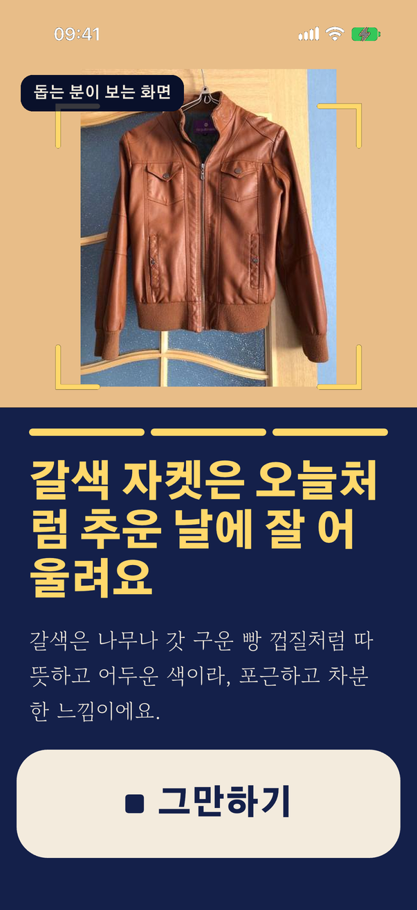 <b>갈색 자켓</b> 추운 날 겉옷으로 좋아요</td>
  </tr>
</table>

### 👚 옷 색 묻기 · 입은 모습 · 내 옷장

옷을 비추며 **"이거 무슨 색이야?"**라고 물으면 바로 색을 알려 줘요. 고른 옷은 옷장에 저장되고, 입은 날도 기록돼 "오늘 뭐 입었지?"에 답해요. 다 입은 뒤에는 폰을 세워 두고 한 바퀴 도는 모습도 확인해요.

⚙️ mcp-clothes-state 색 모델 · mcp-closet(pgvector: 옷 사진 벡터 FashionSigLIP로 같은 옷 합치기, 글 벡터 e5로 검색)

<table align="center">
  <tr>
    <td align="center" valign="top" width="25%">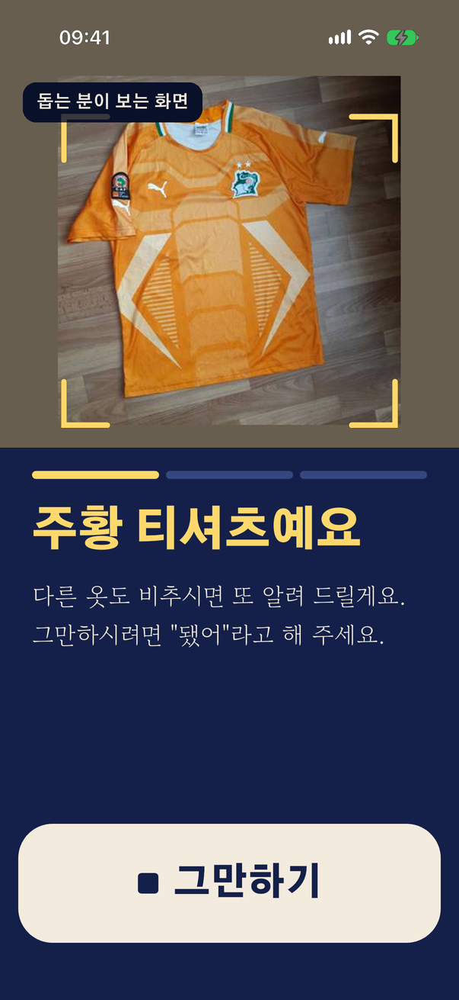 <b>무슨 색이야?</b> 비춘 옷 색을 바로 알려 줘요</td>
    <td align="center" valign="top" width="25%">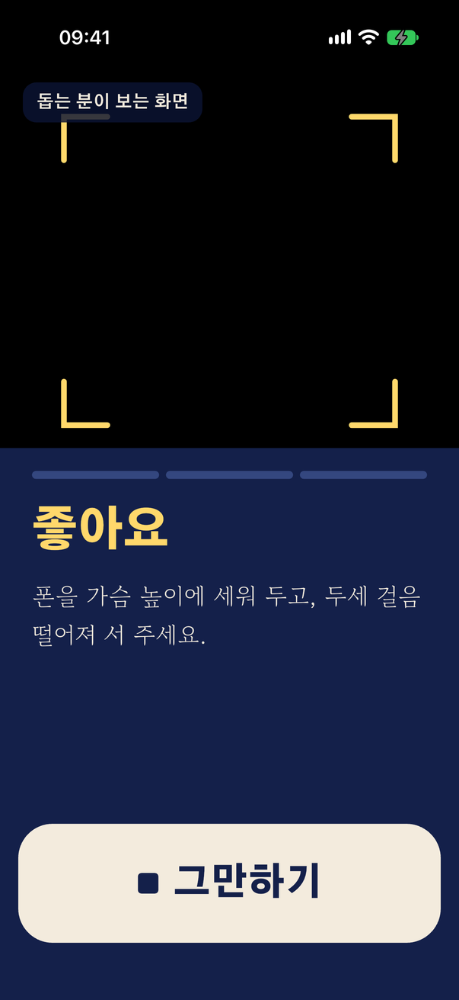 <b>입은 모습 확인</b> 가슴 높이에 세우고 두세 걸음 뒤로</td>
    <td align="center" valign="top" width="25%"> <b>내 옷장</b> 종류별로 몇 벌인지 읽어 줘요</td>
    <td align="center" valign="top" width="25%"> <b>오늘 입은 옷</b> 입은 날 기록으로 답해요</td>
  </tr>
</table>

### 💄 얼굴 확인

셀카로 **화장이 좌우 고르게 됐는지**, **이 사이에 뭐가 끼었는지** 봐 줘요. 어두우면 화면을 하얗게 밝혀 조명처럼 비춰요. 얼굴·치아 사진은 GPT 같은 외부 AI로 보내지 않고 우리 서버 모델로만 봐요.

⚙️ 앱 ML Kit로 얼굴 윤곽점·입 위치 → mcp-face-check(BiSeNet 얼굴 분할 + CelebA로 학습한 좌우 비교 모델, 직접 학습한 치아 모델 ONNX)

<table align="center">
  <tr>
    <td align="center" valign="top" width="25%"> <b>화장 확인</b> 앞 카메라로 얼굴을 비춰요</td>
    <td align="center" valign="top" width="25%"> <b>이 확인</b> "이" 하고 입을 벌린 채</td>
    <td align="center" valign="top" width="25%">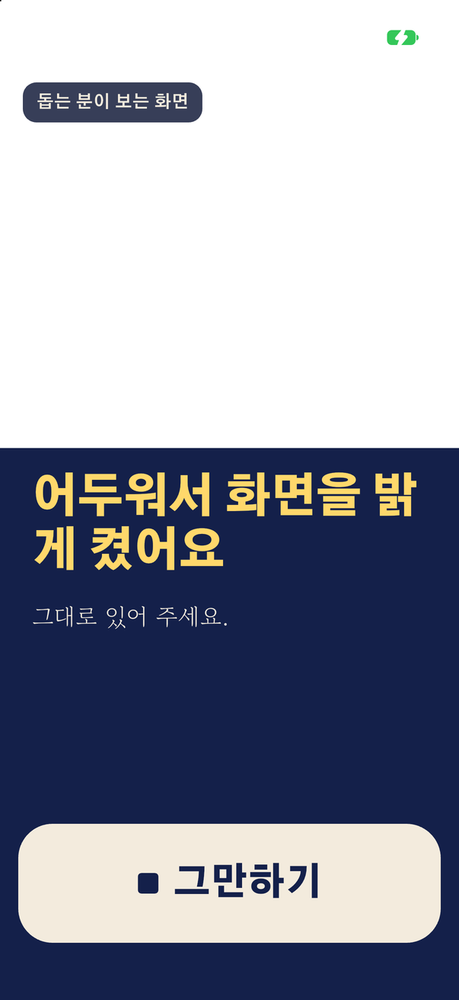 <b>화면 조명</b> 어두우면 화면을 밝게 켜요</td>
  </tr>
</table>

`develop` 앱을 iPhone 17 시뮬레이터에서 띄워 찍었어요(2026-11-22). 화면 문장은 실제 서버(simcheong.java21.net)에 개발용 계정으로 같은 말을 보내 받은 답 그대로예요. 시뮬레이터에는 카메라가 없어서, 옷 화면의 미리 보기 칸에는 서버에 보낸 옷 사진(CC0 clothing-dataset)을 합성했어요. 얼굴 화면은 실제 사람 얼굴을 쓰지 않으려고 미리 보기 칸을 비워 두었어요.

## 🔥 25일 동안 남긴 흔적

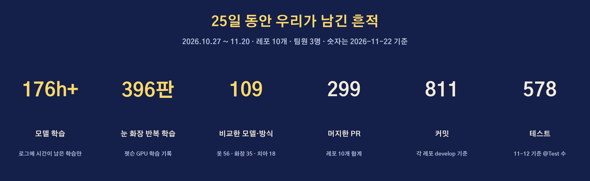

개발 기간은 2026.10.27 ~ 11.20이고, 아래 숫자는 2026-11-22 기준으로 센 값이에요.

> 가장 오래 걸린 일은 **모델 학습**이었어요. 화장·옷장·날씨는 박창근, 옷 상태·치아는 정지원 파트에서 모델을 학습하고 비교했고, 앱 뼈대·gateway·agent는 이진행 파트에서 만들었어요.

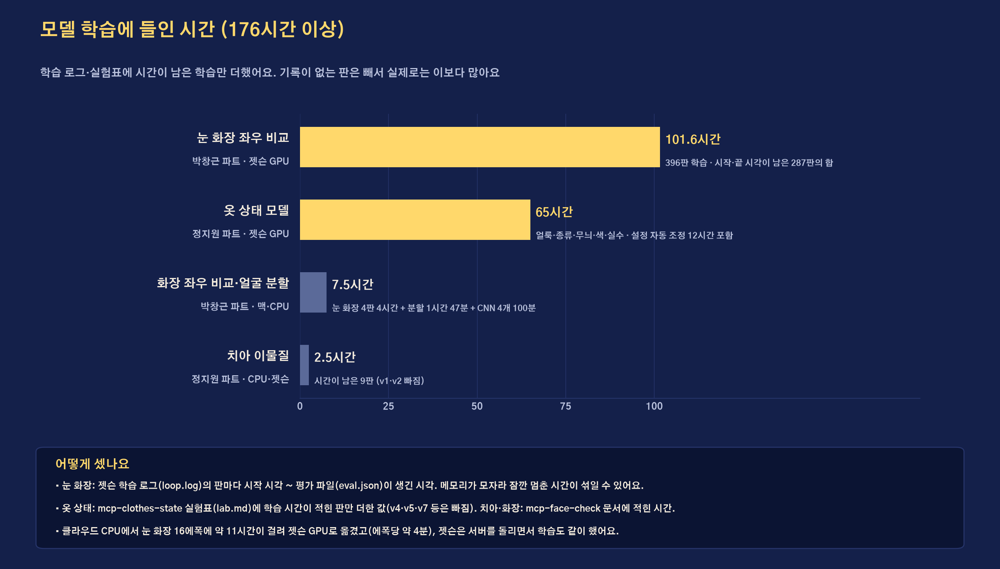

| 파트 | 모델 학습 시간 | 학습·비교한 횟수 |
| --- | ---: | --- |
| 박창근 파트 (화장·옷장·날씨) | **109시간 이상** | 눈 화장 젯슨 학습 **396판**, 화장 재는 방식 약 35가지, 같은 옷 찾기 사진 모델 12개, 날씨 출처 3개 |
| 정지원 파트 (옷 상태·치아) | **67시간 이상** | 옷 상태 실험 **56가지**(얼룩·찢어짐 7판, 옷 종류 6판, 무늬 7단계, 입은 옷 실수 단추 6판 등), 치아 18가지 |

이진행 파트(앱·gateway·agent)는 모델 학습 대신 **모든 기능을 말 한마디로 이어 붙이는 일**이었어요. 8개 레포에서 PR **102개**를 머지했고(앱 40, agent 26, gateway 15, 나머지 서버 21), 실제 폰 리허설과 발표 피드백을 받은 날마다 말투·말 속도·목소리·카메라 안내를 고쳤어요. 응답 시간은 옷 추천 **1.77초 → 1.04초**, 옷 확인 **1.95초 → 1.47초**로 줄였어요.

기능 하나도 바로 `develop`에 넣지 않고 **브랜치 → PR → CI 테스트 → 리뷰 → 머지**를 거쳤어요.

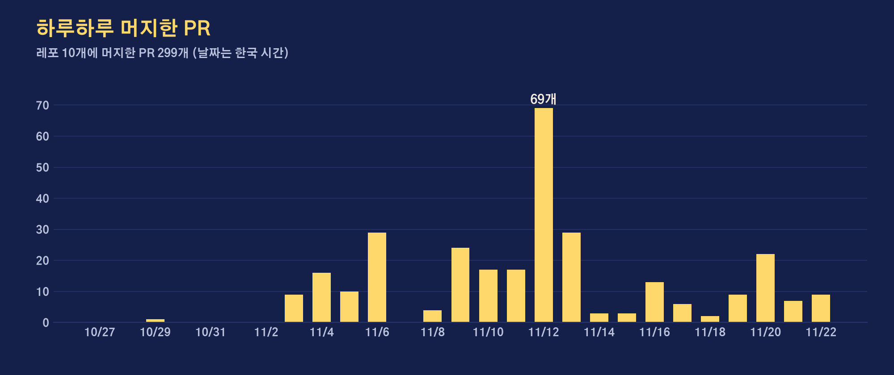

2026-11-22 기준이에요. 학습 시간은 로그·실험표에 시간이 남은 것만 더했어요: 눈 화장은 젯슨 학습 로그(`loop.log` 시작 시각 ~ 판마다 `eval.json`)로 잰 287판의 합(멈춘 시간이 섞일 수 있음), 옷 상태는 [clothes-state 실험표](https://github.com/fashion-agent-team/mcp-clothes-state/blob/develop/docs/lab.md)의 합, 얼굴 분할·좌우 비교 CNN과 치아는 [face-check 실험표](https://github.com/fashion-agent-team/mcp-face-check/blob/develop/docs/lab.md)에 적힌 시간이에요. PR·커밋 수는 GitHub에서 셌고 커밋은 각 레포 `develop`(.github는 `main`) 기준이에요.

## 🎤 발표 자료 (2026 IT Festival)

조선대학교 2026 IT Festival · AI·SW 캡스톤디자인 프로젝트 경진대회 발표에 쓴 자료입니다.

| 자료 | 내용 | 받기 |
| --- | --- | --- |
| 📊 발표 슬라이드 (15장, PPTX 29MB) | 문제와 아이디어 → 기능 한눈에 → 접근성 → 구성과 구조 → 상황별 예시 → MCP 서버 5개(날씨·일정·옷 상태·얼굴 확인·내 옷장) → 시연 → 요약 | [심청이_발표_슬라이드.pptx](https://github.com/fashion-agent-team/.github/releases/download/presentation-2026-11/simcheong-presentation.pptx) |
| 🎬 발표 영상 (5분, MP4 11MB) | 발표 슬라이드를 따라 설명하는 영상 | [심청이_발표_영상.mp4](https://github.com/fashion-agent-team/.github/releases/download/presentation-2026-11/simcheong-presentation-video.mp4) |
| 📱 시연 영상 (3분, 아이폰 화면 MP4 22MB) | 실제 앱으로 옷 고르고 입어 보기, 약속 있는 날 두 상황을 보여 주는 영상 | [심청이_시연_영상.mp4](https://github.com/fashion-agent-team/.github/releases/download/presentation-2026-11/simcheong-demo-video.mp4) |

세 파일은 이 저장소의 [릴리스 presentation-2026-11](https://github.com/fashion-agent-team/.github/releases/tag/presentation-2026-11)에 있습니다.

---

## 📦 레포지토리

| 레포 | 역할 | 주요 기술 |
| --- | --- | --- |
| [fashion-agent](https://github.com/fashion-agent-team/fashion-agent) | 모바일 앱, 아키텍처·서비스 간 약속 문서, 배포 설정 | Flutter, ML Kit(얼굴·포즈·물체), speech_to_text, flutter_tts, Firebase Auth |
| [fashion-agent-gateway](https://github.com/fashion-agent-team/fashion-agent-gateway) | API 게이트웨이, 로그인, 회원정보, 음성 인식·읽기 | Spring Cloud Gateway(Web MVC, 가상 스레드), Nimbus JOSE(JWT), JdbcClient + Flyway, OpenAI 음성 인식, Azure Speech, edge-tts |
| [fashion-agent-agent](https://github.com/fashion-agent-team/fashion-agent-agent) | 대화와 옷 추천을 이끄는 두뇌 | Spring AI(ChatClient + MCP 클라이언트), OpenAI GPT, Redis |
| [mcp-weather](https://github.com/fashion-agent-team/mcp-weather) | 오늘·날짜별 날씨 | Spring AI MCP Server, Open-Meteo, Caffeine 캐시 |
| [mcp-schedule](https://github.com/fashion-agent-team/mcp-schedule) | 일정, 자리·장소 종류, 드라이클리닝 안내, 아침 브리핑 | Spring AI MCP Server(`@McpTool`), Spring Data JPA + Flyway, 카카오 로컬 API |
| [mcp-clothes-state](https://github.com/fashion-agent-team/mcp-clothes-state) | 옷 종류·색·무늬·얼룩·찢어짐, 입은 모습(뒤집힘·단추·택), 색 조합 | 직접 학습한 YOLO26n·색 CNN, FashionSigLIP + LoRA 무늬, ONNX Runtime, FashionSigLIP 옷 벡터, SigLIP2 So400m 종류 보조, (선택) GPT 얼룩·무늬 확인 |
| [mcp-face-check](https://github.com/fashion-agent-team/mcp-face-check) | 화장 대칭(눈썹·입술·볼·눈화장), 치아 확인 | ML Kit 윤곽점, BiSeNet 얼굴 분할, 좌우 비교 모델, ResNet18 눈화장 앙상블, MobileNetV3 치아 분류(ONNX) |
| [mcp-closet](https://github.com/fashion-agent-team/mcp-closet) | 내 옷장 기록과 검색(RAG), 같은 옷 합치기 | Spring AI VectorStore, pgvector, multilingual-e5-small, FashionSigLIP 사진 벡터 |

---

## 🧠 직접 학습한 모델

| 모델 | 쓰는 곳 | 결과 (학습에 안 쓴 사진) |
| --- | --- | --- |
| 얼룩·찢어짐 `yolo26n_v6` | mcp-clothes-state | 사진 단위 정답률 91.9% (346장), 애매한 것만 GPT 확인 시 98.1% (314장). 깨끗한 옷 200장 중 오탐 1장 |
| 옷 종류 12종 `yolo26n_fashion12` (fashion12e) | mcp-clothes-state | 내려놓은 옷 203장 종류 86.7% (큰 분류 91.6%), 바닥 신발 mAP50 0.991 |
| 옷 색 20가지 `color20_cnn` | mcp-clothes-state | 시험 옷 25,626벌 색 계열 76.8% (예전 픽셀 규칙 45.3%), 흰 옷 87% (예전 15%) |
| 무늬 8종 `yolo26n_pattern8` | mcp-clothes-state | 내려놓은 옷 1,959장 정확도 88.4%, 무지/무늬 구분 91.9% |
| 화장 좌우 비교 (눈썹 길이·두께, 입술 너비, 볼 터치) | mcp-face-check | CelebA에서 비대칭 찾는 비율 눈썹 길이 22→84%, 두께 51→92%, 입술 너비 20→82%, 볼 58→77%. 실사진 기준으로 맞춘 뒤 멀쩡한 사진 잘못 알림 63→31% |
| 치아 분류 MobileNetV3-Small | mcp-face-check | 합성 데이터로 학습, 실제 사진 평가 진행 중 |

- 학습은 우리 장비(팀 **Jetson Orin**·맥북)에서 했고, 학습 사진은 외부 AI로 보내지 않았어요
- 데이터 출처와 라이선스(AI Hub K-Fashion, CelebA, FFHQ 등)는 각 레포 README에 적어 두었어요. 학습 사진은 레포에 올리지 않아요
- 실험 과정과 비교표는 [clothes-state 학습 기록](https://github.com/fashion-agent-team/mcp-clothes-state/blob/develop/docs/training-log.md)에 있어요

👉 [모델을 고른 이유(109가지 비교)와 학습할수록 올라간 정확도 그래프 보기](https://github.com/fashion-agent-team/.github/blob/main/profile/docs/models.md)

## 🔒 개인정보 원칙

- **사진은 저장하지 않아요.** 예외는 같은 옷 확인용 옷 부분 작은 사진(얼굴 없음, 옷을 지우면 삭제)과, 동의한 경우 재학습용 얼룩·무늬 조각(30일)뿐이에요
- **얼굴·치아 사진은 외부 AI로 보내지 않아요.** 서버의 자체 모델로만 판단해요
- 회원정보는 모든 항목을 건너뛸 수 있어요
- 키와 비밀값은 레포에 올리지 않고 환경 변수로만 받아요

---

## 🚀 협업 방식

| 단계 | 내용 |
| --- | --- |
| **브랜치** | Git Flow: `feature/*` → `develop` → `main`(릴리스 때만). PR은 항상 `develop` 대상 |
| **PR 검사** | 모든 레포 GitHub Actions(`ci.yml`)로 빌드·테스트, 팀원 리뷰 후 머지 |
| **이미지** | 레포마다 Dockerfile. 배포는 각 젯슨에서 arm64 이미지를 직접 빌드해 Docker Compose로 띄워요 ([젯슨 배포 문서](https://github.com/fashion-agent-team/fashion-agent/blob/develop/docs/infra/jetson/README.md)) |
| **약속 문서** | API·MCP 입출력은 앱 레포 `docs/contracts/`가 기준. 바꿀 땐 약속 문서부터 |

## ✅ 테스트

> 2026-11-12 각 레포 `develop` 기준 테스트 메서드 수(`@Test`·`test()` 개수)예요.

| 레포 | 테스트 |
| --- | ---: |
| fashion-agent (앱) | 215 |
| fashion-agent-agent | 98 |
| mcp-clothes-state | 84 |
| mcp-face-check | 64 |
| mcp-closet | 40 |
| mcp-schedule | 27 |
| mcp-weather | 28 |
| fashion-agent-gateway | 22 |
| **합계** | **578** |

---

## 👥 팀

<table align="center">
  <tbody>
    <tr>
      <td align="center">
        <a href="https://github.com/ehgo508">
          
           <b>이진행</b>
        </a>
         <b>기획 · 앱 · gateway · agent</b>
      </td>
      <td align="center">
        <a href="https://github.com/chang0580">
          
           <b>박창근</b>
        </a>
         <b>옷장 · 화장 확인 · 날씨</b>
      </td>
      <td align="center">
        <a href="https://github.com/jiwon934">
          
           <b>정지원</b>
        </a>
         <b>옷 상태 · 치아 확인 · 일정</b>
      </td>
    </tr>
  </tbody>
</table>

  팀 심청이

