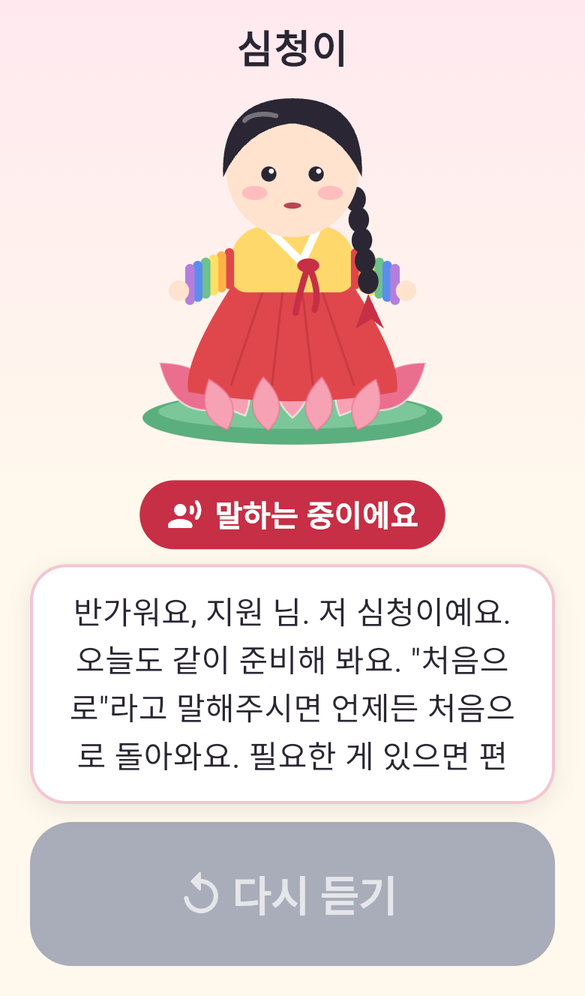
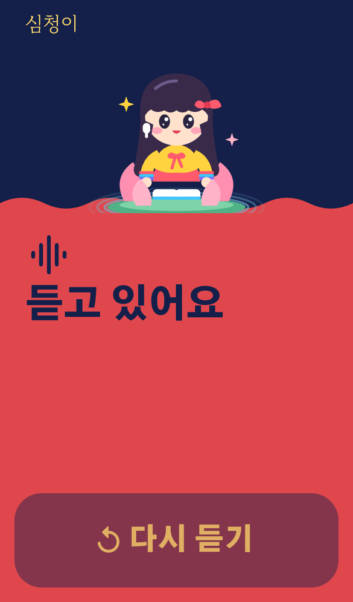
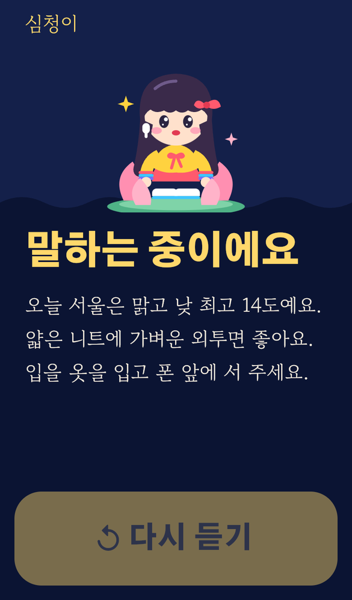
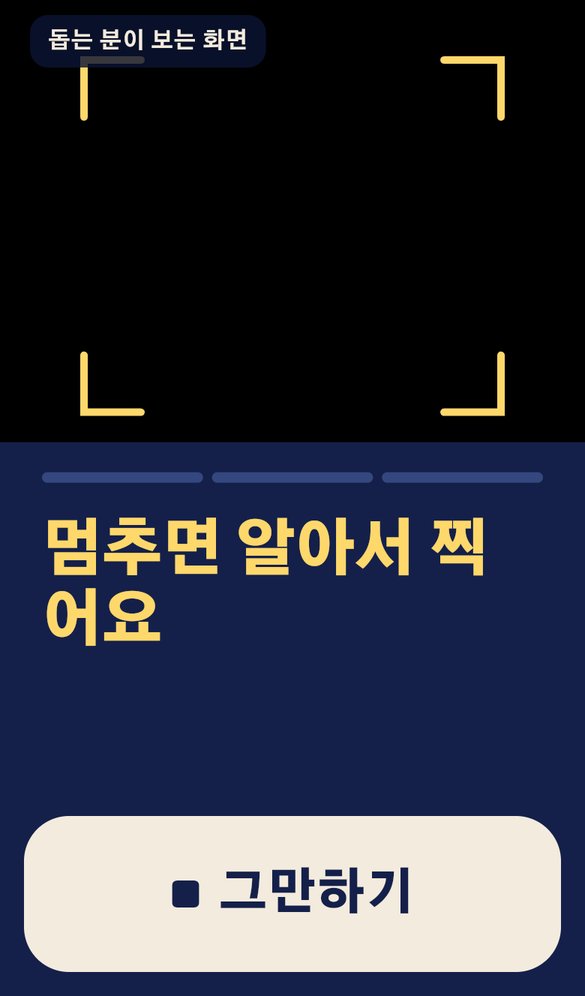
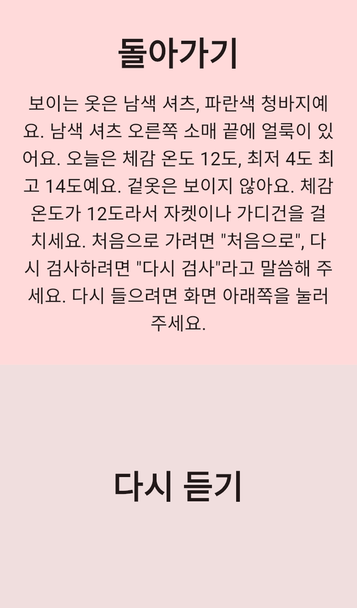
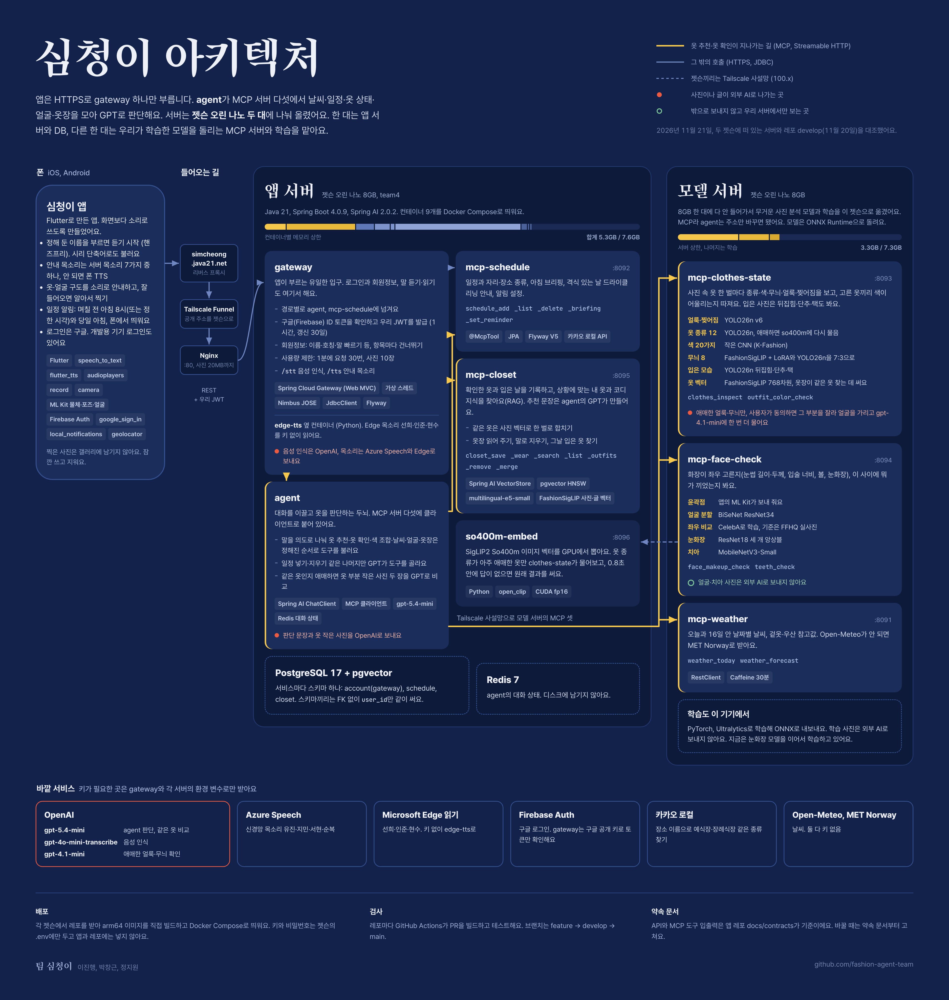
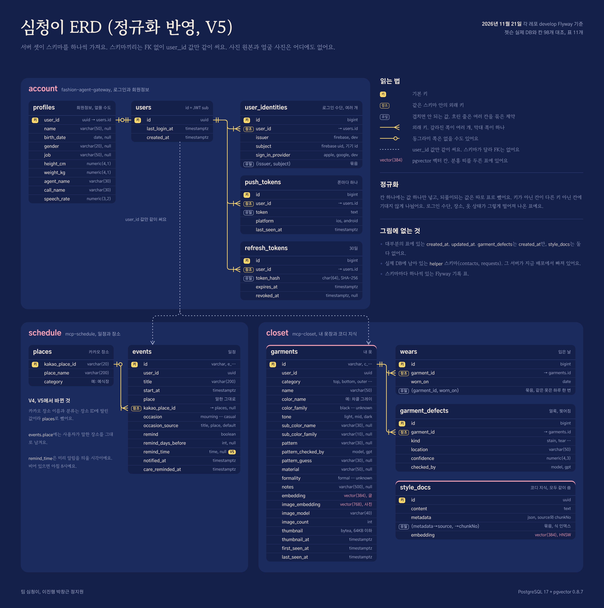
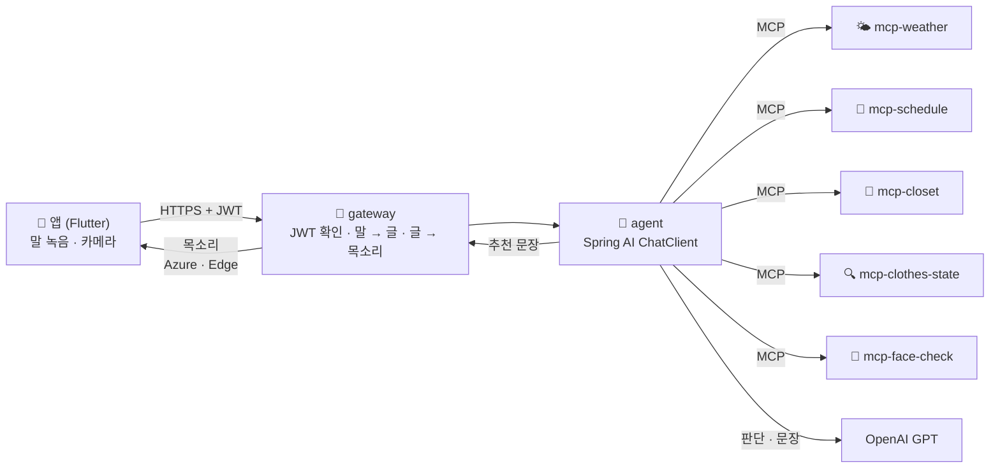

  
  <h1>심청이 · 패션 에이전트</h1>
  
<strong>말로 묻고, 카메라로 확인하는 시각장애인용 AI 옷 코디 에이전트</strong>

  
"설명해 주는 앱은 있었지만, 골라 주는 앱은 없었습니다."

  
📅 <b>개발 기간</b> : 2026.10.27 ~ 2026.11.20 &nbsp;·&nbsp; 👥 <b>팀 심청이</b>

## 👥 누가 무엇을 했나요

<table align="center">
  <tr>
    <td align="center" valign="top" width="33%">
      
      <h3>이진행</h3>
      <a href="https://github.com/ehgo508">@ehgo508</a>
      
<b>앱과 대화의 뼈대</b> 로그인·음성·대화 흐름

      
fashion-agent(앱) · gateway · agent

      
     

    </td>
    <td align="center" valign="top" width="33%">
      
      <h3>박창근</h3>
      <a href="https://github.com/chang0580">@chang0580</a>
      
<b>내 옷장 · 화장 확인 · 날씨</b> RAG·얼굴 모델·배포 정리

      
mcp-closet · mcp-face-check(화장) · mcp-weather

      
     

    </td>
    <td align="center" valign="top" width="33%">
      
      <h3>정지원</h3>
      <a href="https://github.com/jiwon934">@jiwon934</a>
      
<b>옷 상태 모델 · 치아 · 일정</b> 학습 모델·DB 정규화

      
mcp-clothes-state · mcp-face-check(치아) · mcp-schedule

      
     

    </td>
  </tr>
</table>

### &nbsp; 이진행: 앱과 대화의 뼈대
- **앱(Flutter)**: 음성 에이전트 기본 틀, 이름을 불러 말 걸기, 카메라 구도 말 안내와 자동 촬영(ML Kit), 구글 로그인 → Firebase → gateway 연결, 첫 실행 흐름(인사·허용·로그인·이름), 일정 폰 알림, 시각장애인 관점 점검 반영(기다림 진동·구도 소리·시리 단축어)
- **gateway**: 로그인(Firebase·개발용)과 JWT, 회원정보, 사용량 제한, 뒤쪽 서버 라우팅. 말 받아 적기(`gpt-4o-mini-transcribe`), 엣지 목소리 사이드카와 Azure가 막힐 때 엣지로 넘기기
- **agent**: 옷 추천 두 단계와 MCP 클라이언트 뼈대, GPT 도구 선택(일정 넣기·지우기), 날짜를 말하면 그날 일정·예보로 추천, 색을 느낌으로 설명하기, GPT 응답 속도 줄이기
- **그 밖에**: 레포마다 PR 자동 테스트(CI), 아키텍처·서비스 간 약속 문서, `weather_forecast`·`schedule_set_reminder` 도구, 색 어울림 점수

### &nbsp; 박창근: 내 옷장, 화장 확인, 날씨
- **mcp-closet**: 서버 전체. 글 벡터(e5) RAG 검색, 옷 사진 벡터(FashionSigLIP)로 같은 옷 합치기, 애매하면 GPT가 작은 사진 두 장으로 확인(`closet_merge`), 옷장 읽기·지우기·입은 조합 도구, 같은 옷 기준값 실측(0.60)
- **mcp-face-check 화장 대칭**: 윤곽점·픽셀 측정 서버, 얼굴 분할 모델 비교 후 BiSeNet ResNet34, CelebA로 학습한 좌우 비교 모델(눈썹·입술·볼), FFHQ 실사진 기준값, 눈화장 ResNet18 앙상블(실사진 검출 70.7% → 78.6%)
- **mcp-weather**: 서버 구현, 연결 끊김 재시도, Open-Meteo가 안 되면 MET Norway
- **mcp-clothes-state 옷 종류 정확도**: 글 벡터로 애매한 종류 다시 고르기, 학습 벡터(probe), 애매할 때만 큰 모델(SigLIP2 so400m)
- **agent·앱**: 옷장·날씨 대화 흐름, 앱 시뮬레이션으로 찾은 말투 고치기, 체감 온도 바로잡기, Azure 목소리 4가지, 앱 화면 개편 "인당수의 밤"과 심청이 그림, 아이폰 설치 스크립트
- **배포·문서**: 젯슨 두 대 배포 문서, 아키텍처 그림·ERD

### &nbsp; 정지원: 옷 상태 모델, 치아·일정, DB
- **mcp-clothes-state**: Java MCP 서버, 얼룩·찢어짐 YOLO(v6) 학습·비교, 옷 종류 12종 모델, K-Fashion 색 모델과 색 조합 판단, 무늬 8종(FashionSigLIP LoRA 섞기), 입은 옷 실수(뒤집힘·단추·택) 모델, 애매할 때 GPT 확인과 얼굴 가리기, 젯슨 성능 측정
- **mcp-face-check 치아**: 직접 학습한 치아 모델(`teeth_check`, ONNX), 앞니 사이 고춧가루를 놓치던 문제 고치기(v4)
- **mcp-schedule**: 서버 전체. 카카오 로컬로 장소 종류, 격식 일정 드라이클리닝 안내, 아침 브리핑, 일정별 알림 시각(`remind_time`)
- **DB 정규화(V4)**: account(`user_identities`), schedule(`places`), closet(`garment_defects`) 나누기, spec 시나리오 통합 테스트
- **앱·배포**: 서버를 기능별 레포로 나누기, 젯슨 상시 배포(Docker Compose·Nginx·Funnel) 처음 구성, 치아·화장 촬영 안내, 앱 켤 때 미리 준비(`/agent/warm`), 조직 프로필 README

각 레포에서 머지된 PR을 사람별로 모아 정리했어요(2026-11-22 기준). 여러 사람이 함께 고친 부분은 처음 만든 사람 쪽에 적었어요.

## 📖 어떤 앱인가요?

시각장애인이 아침에 옷을 고를 때 가장 어려운 건 **"이 옷이 오늘 맞는지, 얼룩은 없는지"를 혼자 확인하는 일**입니다.
**심청이**는 말로 대화하는 AI 에이전트예요. 오늘 날씨와 일정을 보고 먼저 말로 옷을 추천하고, 꺼낸 옷을 카메라에 비추면 맞는지, 얼룩이나 찢어진 곳은 없는지 알려 줍니다.

- **옷을 따로 등록하지 않아요.** 평소 옷장 정리 방식은 그대로 두고, 꺼낸 옷을 확인만 해요.
- **사진 찍기 버튼이 없어요.** 폰이 구도를 소리로 안내하고, 옷이 잘 들어오면 알아서 한 장을 찍어요.
- **쓸수록 내 옷이 기록돼요.** 확인한 옷과 입은 날이 쌓여 다음 추천은 내 옷 중에서 골라요.

## 📱 앱 화면

> **인당수의 밤**: 쪽빛 바탕에 노란 큰 글씨, 버튼은 한 화면에 하나만 두었어요. 심청이가 듣는 동안에는 아래 물이 다홍으로 차올라요. 모든 안내는 소리로 읽어 줘요.

<table align="center">
  <tr>
    <td align="center"> 심청이가 먼저 인사</td>
    <td align="center"> 듣는 중엔 물이 다홍으로</td>
    <td align="center"> 날씨 보고 말로 추천</td>
    <td align="center"> 멈추면 알아서 찍기</td>
    <td align="center"> 오늘의 색동: 고른 옷 색</td>
  </tr>
</table>

`develop` 앱을 웹으로 띄워 찍었어요. 서버 대신 예시 응답을 돌려 준 화면이라 카메라 칸은 비어 있고, 실제 폰에서는 카메라 화면이 보이고 결과는 서버 모델이 정해요.

## ✨ 주요 기능

### 1. 날씨·일정 맞춤 추천 (말로)

"오늘 뭐 입지?" 한마디면 agent가 **날씨·일정·내 옷장**을 동시에 불러 GPT로 판단하고 말로 추천해요.

- 날씨: 기온·체감·일교차·강수 확률 (`weather_today`, 날짜별 `weather_forecast`)
- 일정: 말로 넣은 일정마다 **자리 종류(면접·결혼식·운동 등)와 장소 종류**를 붙여 돌려줘요 (`schedule_list`). 장소는 카카오 로컬로 찾아요
- 격식 있는 일정은 등록할 때와 3일 전 아침에 **드라이클리닝**을 미리 챙겨 줘요
- 앱을 열면 오늘 일정과 3일 안의 중요한 일정을 먼저 알려 줘요 (`schedule_briefing`)
- 일정을 넣으면 알림을 받을지, 며칠 전에 미리 알릴지 물어 저장하고(`schedule_set_reminder`) 그에 맞춰 폰 알림을 띄워요

### 2. 카메라로 옷 확인

꺼낸 옷을 비추면 사진마다 `clothes_inspect`가 **옷 한 벌마다 종류·색·무늬·얼룩·찢어짐**을 찾고, agent가 오늘 날씨와 자리에 맞는지 판단해요.

- 옷 종류 12종·무늬 8종·얼룩·찢어짐은 **우리가 직접 학습한 YOLO 모델**, 옷 색 20가지는 K-Fashion으로 학습한 **작은 CNN**(ONNX)으로 서버에서 봐요
- 고른 옷끼리 색이 어울리는지는 색 이론 규칙으로 따로 판단해요 (`outfit_color_check`)
- 얼룩이나 무늬가 애매할 때만 (사용자가 동의한 경우) **그 부분만 잘라** GPT에 한 번 더 물어봐요
- 코트인지 재킷인지 애매하면 틀린 이름 대신 "겉옷"이라고 말해요
- 두 벌을 나란히 비추면 "왼쪽 흰 셔츠가 더 나아요"처럼 비교해 줘요
- 입은 모습은 앞·뒤 두 장으로 한 바퀴 확인해요

### 3. 얼굴 확인

셀카로 **화장이 좌우 고르게 되었는지**(`face_makeup_check`), **이 사이에 뭐가 끼지 않았는지**(`teeth_check`) 확인해요.

- 앱이 ML Kit로 얼굴을 실시간으로 잡아 구도를 안내하고, 멈춘 순간 여러 장을 보내 중간값으로 판단해요
- 서버가 얼굴 분할 모델(BiSeNet ResNet34)로 눈썹·입술·볼 칸을 나누고, 눈썹 길이·두께, 입술 너비, 볼 터치는 공개 얼굴 데이터(CelebA)로 학습한 **좌우 비교 모델**로 판단해요. 알림 기준은 고화질 실사진(FFHQ)에 맞췄어요
- 얼굴·치아 사진은 **GPT 같은 외부 AI로 보내지 않고** 서버의 자체 모델로만 봐요

### 4. 내 옷장 (RAG)

확인한 옷과 입은 날을 기록하고(`closet_save`, `closet_wear`), 다음 추천 때 상황에 맞는 내 옷을 찾아요(`closet_search`). "지난번 면접 때 뭐 입었지?"(`closet_outfits`), "내 옷장에 뭐 있어?"(`closet_list`)에도 답해요.

- 같은 옷인지는 `clothes_inspect`가 준 **옷 사진 벡터**(FashionSigLIP 768차원)로 판단해 한 벌로 합쳐요. 애매하면 agent의 GPT가 옷 부분 작은 사진끼리 비교해 합쳐요(`closet_merge`)
- "옷장 확인해 줘"라고 하면 옷장 옷을 읽어 주고, 말로 옷을 지울 수도 있어요
- 상황 문장(글 임베딩, multilingual-e5-small)과 영어 검색어(사진 벡터)로 내 옷과 코디 지식을 함께 찾고, 추천 문장은 agent의 GPT가 만들어요

---

## 🎤 발표 자료 (2026 IT Festival)

조선대학교 2026 IT Festival · AI·SW 캡스톤디자인 프로젝트 경진대회 발표에 쓴 자료입니다.

| 자료 | 내용 | 받기 |
| --- | --- | --- |
| 📊 발표 슬라이드 (15장, PPTX 29MB) | 문제와 아이디어 → 기능 한눈에 → 접근성 → 구성과 구조 → 상황별 예시 → MCP 서버 5개(날씨·일정·옷 상태·얼굴 확인·내 옷장) → 시연 → 요약 | [심청이_발표_슬라이드.pptx](https://github.com/fashion-agent-team/.github/releases/download/presentation-2026-11/simcheong-presentation.pptx) |
| 🎬 발표 영상 (5분, MP4 11MB) | 발표 슬라이드를 따라 설명하는 영상 | [심청이_발표_영상.mp4](https://github.com/fashion-agent-team/.github/releases/download/presentation-2026-11/simcheong-presentation-video.mp4) |
| 📱 시연 영상 (3분, 아이폰 화면 MP4 22MB) | 실제 앱으로 옷 고르고 입어 보기, 약속 있는 날 두 상황을 보여 주는 영상 | [심청이_시연_영상.mp4](https://github.com/fashion-agent-team/.github/releases/download/presentation-2026-11/simcheong-demo-video.mp4) |

세 파일은 이 저장소의 [릴리스 presentation-2026-11](https://github.com/fashion-agent-team/.github/releases/tag/presentation-2026-11)에 있습니다.

---

## 🏗 아키텍처

- **MCP 서버는 데이터만 돌려주고**, "이 옷이 오늘 맞는가" 같은 판단은 agent가 맡아요
- agent는 말을 의도로 나눠 옷 추천·옷 확인·날씨·얼굴·옷장은 정해진 순서(코드)로 도구를 부르고, 일정 넣기·지우기 같은 나머지만 GPT가 도구를 골라요
- 안내 목소리는 gateway가 만들어요. Azure Speech 4가지(유진·지민·서현·순복)와 Edge 3가지(선희·인준·현수) 중 고르고, 안 되면 폰 TTS로 읽어요
- 서버는 **젯슨 오린 나노 8GB 두 대**에 나눠 Docker Compose로 상시 띄워요. 한 대는 gateway·agent·일정·옷장·DB(앱 서버), 다른 한 대는 옷 상태·얼굴·날씨 MCP와 모델 학습(모델 서버)을 맡고, 둘은 Tailscale 사설망으로 이어져요. 8GB 한 대에 다 안 들어가서 나눴고, MCP라 agent는 주소만 바꾸면 됐어요
- 바깥에서는 `simcheong.java21.net` → Tailscale Funnel → Nginx → gateway 순서로 들어와요
- 그림 원본은 [`profile/images/src/architecture.html`](images/src/architecture.html)이에요. 고친 뒤 Chrome으로 2배 크기 캡처해서 새 이름(예: `architecture-v9.png`)으로 저장하고 위 그림 주소도 바꿔요. 같은 이름으로 덮으면 GitHub 캐시 때문에 옛 그림이 한동안 보여요
- 서비스 사이 약속은 앱 레포의 [OpenAPI](https://github.com/fashion-agent-team/fashion-agent/blob/develop/docs/contracts/openapi.yaml)와 [MCP 도구 입출력](https://github.com/fashion-agent-team/fashion-agent/blob/develop/docs/contracts/mcp-tools.md) 하나로 맞춰요

## 🗂 ERD

> 각 서비스 레포의 Flyway 마이그레이션(2026-11-21 `develop`, account·closet V4, schedule V5) 그대로이고, 젯슨 배포 DB와 대조했어요. 스키마 3개, 표 11개(배포 DB에 남아 있는 helper 스키마 2개 표는 서버가 배포에서 빠져 제외).

- **서비스마다 스키마 하나**: account(gateway) · schedule · closet. 스키마끼리는 FK 없이 `user_id`(= JWT sub) 값만 같이 써요
- **BCNF까지 정규화**했어요. 한 칸에는 값 하나만 두고(JSON 묶음 없음), 키가 아닌 칸이 다른 칸을 정하지 않게 표를 나눴어요
- 로그인 수단은 `user_identities`에 따로 두고 (issuer, subject)에 복합 UNIQUE를 걸어, 한 사람이 Apple·Google 로그인을 여러 개 가질 수 있어요
- 장소 이름·분류는 `places`(카카오 장소 ID가 키)에 한 번만 저장하고 일정은 장소 ID만 참조해요
- 옷의 무늬·소재·보조 색은 `garments` 칸으로, 얼룩·보풀 같은 상태는 `garment_defects`에 한 줄씩 저장해요
- `wears`는 옷 ID만 참조하고 (garment_id, worn_on)에 복합 UNIQUE를 걸어, 같은 옷을 같은 날 두 번 기록하지 않아요
- **사진은 옷 부분 작은 사진 하나뿐이에요.** 같은 옷 확인용으로 옷 부분만 자른 48KB 이하 사진만 남겨요(옷을 지우면 같이 지워져요)
- 옷 벡터는 한 사람의 옷(100벌 안팎)만 정확한 거리로 훑고, 공용 코디 지식(`style_docs`)만 HNSW 인덱스를 써요

## 📦 레포지토리

| 레포 | 역할 | 주요 기술 |
| --- | --- | --- |
| [fashion-agent](https://github.com/fashion-agent-team/fashion-agent) | 모바일 앱, 아키텍처·서비스 간 약속 문서, 배포 설정 | Flutter, ML Kit(얼굴·포즈·물체), speech_to_text, flutter_tts, Firebase Auth |
| [fashion-agent-gateway](https://github.com/fashion-agent-team/fashion-agent-gateway) | API 게이트웨이, 로그인, 회원정보, 음성 인식·읽기 | Spring Cloud Gateway(Web MVC, 가상 스레드), Nimbus JOSE(JWT), JdbcClient + Flyway, OpenAI 음성 인식, Azure Speech, edge-tts |
| [fashion-agent-agent](https://github.com/fashion-agent-team/fashion-agent-agent) | 대화와 옷 추천을 이끄는 두뇌 | Spring AI(ChatClient + MCP 클라이언트), OpenAI GPT, Redis |
| [mcp-weather](https://github.com/fashion-agent-team/mcp-weather) | 오늘·날짜별 날씨 | Spring AI MCP Server, Open-Meteo, Caffeine 캐시 |
| [mcp-schedule](https://github.com/fashion-agent-team/mcp-schedule) | 일정, 자리·장소 종류, 드라이클리닝 안내, 아침 브리핑 | Spring AI MCP Server(`@McpTool`), Spring Data JPA + Flyway, 카카오 로컬 API |
| [mcp-clothes-state](https://github.com/fashion-agent-team/mcp-clothes-state) | 옷 종류·색·무늬·얼룩·찢어짐, 입은 모습(뒤집힘·단추·택), 색 조합 | 직접 학습한 YOLO26n·색 CNN, FashionSigLIP + LoRA 무늬, ONNX Runtime, FashionSigLIP 옷 벡터, SigLIP2 So400m 종류 보조, (선택) GPT 얼룩·무늬 확인 |
| [mcp-face-check](https://github.com/fashion-agent-team/mcp-face-check) | 화장 대칭(눈썹·입술·볼·눈화장), 치아 확인 | ML Kit 윤곽점, BiSeNet 얼굴 분할, 좌우 비교 모델, ResNet18 눈화장 앙상블, MobileNetV3 치아 분류(ONNX) |
| [mcp-closet](https://github.com/fashion-agent-team/mcp-closet) | 내 옷장 기록과 검색(RAG), 같은 옷 합치기 | Spring AI VectorStore, pgvector, multilingual-e5-small, FashionSigLIP 사진 벡터 |

---

## 💻 Tech Stacks

| 구분 | 기술 스택 |
| :--- | :--- |
| **App** |      |
| **Backend** |      -000000?style=flat&logo=jsonwebtokens&logoColor=white)  |
| **AI · Agent** | -6DB33F?style=flat&logo=spring&logoColor=white)   |
| **Vision · ML** |   -EE4C2C?style=flat&logo=pytorch&logoColor=white)   |
| **Voice** |    -02569B?style=flat&logo=flutter&logoColor=white) |
| **Database** |     |
| **External API** |  -00205B?style=flat)  |
| **Infra · 협업** |       |

### 🧭 "오늘 뭐 입지?" 한마디가 지나가는 길

1. **앱**이 말을 녹음해 gateway로 보내요. 카메라를 쓸 때는 ML Kit가 폰 안에서 구도를 먼저 잡아 줘요
2. **gateway**가 JWT를 확인하고, 말을 글로 바꾼 뒤 agent에 넘겨요
3. **agent**가 의도를 나누고, 필요한 MCP 서버(날씨·일정·옷장·옷 상태·얼굴)에서 데이터만 받아 와요
4. 모은 데이터로 **GPT**가 판단하고 추천 문장을 만들어요
5. gateway가 문장을 **Azure Speech** 목소리로 바꿔 앱에 돌려주고, 앱이 읽어 줘요

### 🔧 어디에 어떻게 썼나요

<b>📱 App: Flutter · ML Kit · Firebase</b>

 

| 기술 | 어디에 | 어떻게 |
| --- | --- | --- |
| **Flutter** (Dart 3) | 앱 전체 | iOS·Android를 한 코드로 만들어요. 화면을 거의 보지 않는 사용자를 생각해 모든 흐름을 말과 소리, 진동으로 이어요 |
| **ML Kit** 얼굴·포즈·물체 인식 | 카메라 구도 안내, 자동 촬영 | 폰 안에서 실시간으로 얼굴·몸·옷을 잡아 "조금 왼쪽으로" 같은 말과 소리로 구도를 맞춰요. 멈춘 순간 자동으로 찍어서, 셔터 버튼을 찾을 필요가 없어요 |
| **speech_to_text · record** | 말 걸기 | 이름을 불러 말을 걸면 녹음해 gateway로 보내요 |
| **flutter_tts · audioplayers** | 읽어 주기 | 서버 목소리(Azure·Edge)를 재생하고, 서버가 안 되면 폰 TTS로 대신 읽어요 |
| **Firebase Auth · Google Sign-In** | 로그인 | 구글로 로그인하면 Firebase 토큰을 gateway가 확인해 우리 JWT로 바꿔 줘요 |
| **flutter_secure_storage** | 토큰 보관 | JWT와 갱신 토큰을 폰의 안전한 저장소에 둬요 |
| **flutter_local_notifications** | 일정 알림 | 일정마다 정한 시각에 폰 알림을 띄워요 |
| **geolocator** | 내 위치 날씨 | 지금 위치로 날씨를 물어요 |

<b>🚪 gateway: Spring Cloud Gateway · JWT · 음성</b>

 

| 기술 | 어디에 | 어떻게 |
| --- | --- | --- |
| **Spring Cloud Gateway** (Web MVC, 가상 스레드) | 들어오는 문 | 앱 요청을 한곳에서 받아 agent로 보내고, 사용자별 사용량을 제한해요. 가상 스레드라 음성처럼 오래 걸리는 요청이 쌓여도 버텨요 |
| **Nimbus JOSE (JWT)** | 인증 | Firebase 토큰을 확인한 뒤 우리 서비스용 JWT를 발급해요. 뒤쪽 서비스는 JWT의 `sub`(= `user_id`)만 보고 사람을 구분해요 |
| **JdbcClient + Flyway** | 회원정보 (account 스키마) | `users`·`profiles`·`user_identities`·`push_tokens`·`refresh_tokens`를 마이그레이션으로 관리해요 |
| **OpenAI gpt-4o-mini-transcribe** | 말 → 글 | 녹음한 말을 글로 받아 적어요 |
| **Azure Speech · edge-tts** | 글 → 목소리 | Azure 목소리 4가지(유진·지민·서현·순복)와 Edge 목소리 3가지 중 사용자가 고르고, Azure가 막히면 edge-tts 사이드카로 넘겨요 |

<b>🧠 agent: Spring AI · MCP · GPT · Redis</b>

 

| 기술 | 어디에 | 어떻게 |
| --- | --- | --- |
| **Spring AI ChatClient** | 대화 두뇌 | 말을 의도로 나눠요. 옷 추천·옷 확인·날씨·얼굴·옷장은 정해진 순서(코드)로 도구를 부르고, 일정 넣기·지우기처럼 자유로운 말만 GPT가 도구를 골라요 |
| **Spring AI MCP Client** | 서비스 연결 | MCP 서버 5개를 도구로 붙여요. 서버가 다른 젯슨으로 옮겨가도 주소만 바꾸면 돼요 |
| **OpenAI GPT** | 판단과 문장 | 날씨·일정·옷장·옷 상태를 모아 "오늘 이 옷이 맞는지" 판단하고, 색을 느낌으로 풀어 말해요 |
| **Redis** | 대화 기억 | 대화 세션(30분)을 저장해서 "그거 말고 다른 거"처럼 앞 말을 이어받아요 |

<b>🔌 MCP 서버: Spring AI MCP Server</b>

 

모든 MCP 서버는 **Spring Boot 4 + Spring AI MCP Server(Web MVC)** 로 만들었고, 판단 없이 **데이터만** 돌려줘요.

| 서버 | 핵심 기술 | 어떻게 |
| --- | --- | --- |
| 🌤 **mcp-weather** | Open-Meteo, MET Norway, Caffeine | 오늘·날짜별 기온·체감·일교차·강수를 줘요. Open-Meteo가 끊기면 두 번 더 묻고, 그래도 안 되면 MET Norway로 넘겨요. 같은 질문은 Caffeine 캐시로 바로 답해요 |
| 📅 **mcp-schedule** | Spring Data JPA, Flyway, 카카오 로컬 | 일정에 자리 종류(면접·결혼식 등)와 장소 종류를 붙여요. 장소는 카카오 로컬로 찾아 `places`에 한 번만 저장해요. 격식 있는 일정은 드라이클리닝을 미리 알려 줘요 |
| 🔍 **mcp-clothes-state** | ONNX Runtime, YOLO26n, 색 CNN, FashionSigLIP + LoRA | 옷 한 벌마다 종류 12종·색 20가지·무늬 8종·얼룩·찢어짐을 찾아요. 모델은 Java에서 ONNX Runtime으로 바로 돌려서 파이썬 서버가 따로 필요 없어요. 애매할 때만 옷 부분을 잘라 GPT에 한 번 더 물어요 |
| 💄 **mcp-face-check** | ONNX Runtime, BiSeNet, ResNet18, MobileNetV3 | BiSeNet으로 눈썹·입술·볼을 나누고, 직접 학습한 좌우 비교 모델로 화장 대칭을 봐요. 치아는 MobileNetV3 분류 모델로 봐요. 얼굴 사진은 외부로 보내지 않아요 |
| 👕 **mcp-closet** | Spring AI VectorStore, pgvector, multilingual-e5-small, DJL 토크나이저 | 옷과 코디 지식을 벡터로 저장하고 상황 문장으로 찾아요(RAG). 글 임베딩(e5)은 ONNX로 서버 안에서 직접 만들어서 외부 임베딩 API가 필요 없어요 |

<b>🧬 모델 · 벡터: YOLO · SigLIP · e5 · pgvector</b>

 

| 기술 | 어디에 | 어떻게 |
| --- | --- | --- |
| **YOLO26n** (Ultralytics, 직접 학습) | 얼룩·찢어짐, 옷 종류, 무늬 | 젯슨·맥북에서 PyTorch로 학습하고 ONNX로 내보내 서버에 넣었어요. 결과는 [🧠 직접 학습한 모델](#-직접-학습한-모델)에 있어요 |
| **FashionSigLIP** (768차원) | 같은 옷 찾기, 무늬 보조 | 옷 사진을 벡터로 바꿔, 전에 본 옷과 같은지 거리(기준 0.60)로 판단해요 |
| **SigLIP2 So400m** | 옷 종류 보조 | 종류가 애매할 때만 큰 모델에 다시 물어서 젯슨 부담을 줄여요 |
| **multilingual-e5-small** (384차원) | 옷장·코디 지식 검색 | "내일 면접" 같은 한국어 상황 문장을 벡터로 바꿔요 |
| **pgvector** (PostgreSQL 17) | 벡터 저장 | 한 사람의 옷(100벌 안팎)은 정확한 거리로 훑고, 공용 코디 지식(`style_docs`)만 HNSW 인덱스를 써요 |

<b>🖥 Infra: Jetson · Docker · Tailscale</b>

 

| 기술 | 어디에 | 어떻게 |
| --- | --- | --- |
| **Jetson Orin Nano 8GB × 2** | 서버 전체 | 앱 서버(gateway·agent·일정·옷장·DB)와 모델 서버(옷 상태·얼굴·날씨, 학습)로 나눴어요. 8GB 한 대에 다 안 들어가서 나눴어요 |
| **Docker Compose** | 상시 배포 | 레포마다 Dockerfile을 두고, 각 젯슨에서 arm64 이미지를 직접 빌드해 띄워요 |
| **Tailscale (사설망 · Funnel)** | 젯슨 연결, 외부 공개 | 두 젯슨을 사설망으로 잇고, Funnel로 공유기 설정 없이 HTTPS 주소를 열어요 |
| **Nginx** | 앞단 | `simcheong.java21.net` → Funnel → Nginx → gateway 순서로 받아요 |
| **GitHub Actions** | PR 검사 | 모든 레포에서 PR마다 빌드·테스트를 돌려요 |

### 💡 이렇게 고른 이유

- **MCP로 나눈 이유**: 날씨·일정·옷·얼굴을 각자 맡아 따로 만들고, agent는 도구로만 붙였어요. 서버를 다른 젯슨으로 옮겨도 agent는 주소만 바꾸면 됐어요
- **Java + ONNX Runtime**: 학습은 파이썬(PyTorch)으로 하고, 서비스는 Spring 하나로 맞췄어요. 모델을 ONNX로 내보내 Java 서버 안에서 바로 돌려요
- **사진은 먼저 우리 모델이**: 옷과 얼굴 사진은 직접 학습한 모델이 먼저 보고, GPT는 그 결과로 판단해요. 옷이 애매할 때만 옷 부분을 잘라 GPT에 물어보고, 얼굴·치아 사진은 외부 AI로 보내지 않아요
- **작은 장비에 맞추기**: 젯슨 8GB에 맞게 작은 모델(YOLO26n, e5-small)을 기본으로 쓰고, 큰 모델(SigLIP2 So400m)은 애매할 때만 불러요

---

## 🧠 직접 학습한 모델

| 모델 | 쓰는 곳 | 결과 (학습에 안 쓴 사진) |
| --- | --- | --- |
| 얼룩·찢어짐 `yolo26n_v6` | mcp-clothes-state | 사진 단위 정답률 91.9% (346장), 애매한 것만 GPT 확인 시 98.1% (314장). 깨끗한 옷 200장 중 오탐 1장 |
| 옷 종류 12종 `yolo26n_fashion12` (fashion12e) | mcp-clothes-state | 내려놓은 옷 203장 종류 86.7% (큰 분류 91.6%), 바닥 신발 mAP50 0.991 |
| 옷 색 20가지 `color20_cnn` | mcp-clothes-state | 시험 옷 25,626벌 색 계열 76.8% (예전 픽셀 규칙 45.3%), 흰 옷 87% (예전 15%) |
| 무늬 8종 `yolo26n_pattern8` | mcp-clothes-state | 내려놓은 옷 1,959장 정확도 88.4%, 무지/무늬 구분 91.9% |
| 화장 좌우 비교 (눈썹 길이·두께, 입술 너비, 볼 터치) | mcp-face-check | CelebA에서 비대칭 찾는 비율 눈썹 길이 22→84%, 두께 51→92%, 입술 너비 20→82%, 볼 58→77%. 실사진 기준으로 맞춘 뒤 멀쩡한 사진 잘못 알림 63→31% |
| 치아 분류 MobileNetV3-Small | mcp-face-check | 합성 데이터로 학습, 실제 사진 평가 진행 중 |

- 학습은 우리 장비(팀 **Jetson Orin**·맥북)에서 했고, 학습 사진은 외부 AI로 보내지 않았어요
- 데이터 출처와 라이선스(AI Hub K-Fashion, CelebA, FFHQ 등)는 각 레포 README에 적어 두었어요. 학습 사진은 레포에 올리지 않아요
- 실험 과정과 비교표는 [clothes-state 학습 기록](https://github.com/fashion-agent-team/mcp-clothes-state/blob/develop/docs/training-log.md)에 있어요

## 🔒 개인정보 원칙

- **사진은 저장하지 않아요.** 예외는 같은 옷 확인용 옷 부분 작은 사진(얼굴 없음, 옷을 지우면 삭제)과, 동의한 경우 재학습용 얼룩·무늬 조각(30일)뿐이에요
- **얼굴·치아 사진은 외부 AI로 보내지 않아요.** 서버의 자체 모델로만 판단해요
- 회원정보는 모든 항목을 건너뛸 수 있어요
- 키와 비밀값은 레포에 올리지 않고 환경 변수로만 받아요

---

## 🚀 협업 방식

| 단계 | 내용 |
| --- | --- |
| **브랜치** | Git Flow: `feature/*` → `develop` → `main`(릴리스 때만). PR은 항상 `develop` 대상 |
| **PR 검사** | 모든 레포 GitHub Actions(`ci.yml`)로 빌드·테스트, 팀원 리뷰 후 머지 |
| **이미지** | 레포마다 Dockerfile. 배포는 각 젯슨에서 arm64 이미지를 직접 빌드해 Docker Compose로 띄워요 ([젯슨 배포 문서](https://github.com/fashion-agent-team/fashion-agent/blob/develop/docs/infra/jetson/README.md)) |
| **약속 문서** | API·MCP 입출력은 앱 레포 `docs/contracts/`가 기준. 바꿀 땐 약속 문서부터 |

## ✅ 테스트

> 2026-11-12 각 레포 `develop` 기준 테스트 메서드 수(`@Test`·`test()` 개수)예요.

| 레포 | 테스트 |
| --- | ---: |
| fashion-agent (앱) | 215 |
| fashion-agent-agent | 98 |
| mcp-clothes-state | 84 |
| mcp-face-check | 64 |
| mcp-closet | 40 |
| mcp-schedule | 27 |
| mcp-weather | 28 |
| fashion-agent-gateway | 22 |
| **합계** | **578** |

---

## 👥 팀

<table align="center">
  <tbody>
    <tr>
      <td align="center">
        <a href="https://github.com/ehgo508">
          
           <b>이진행</b>
        </a>
         <b>앱 · gateway · agent</b>
      </td>
      <td align="center">
        <a href="https://github.com/chang0580">
          
           <b>박창근</b>
        </a>
         <b>옷장 · 화장 확인 · 날씨</b>
      </td>
      <td align="center">
        <a href="https://github.com/jiwon934">
          
           <b>정지원</b>
        </a>
         <b>옷 상태 · 치아 확인 · 일정</b>
      </td>
    </tr>
  </tbody>
</table>

  팀 심청이

