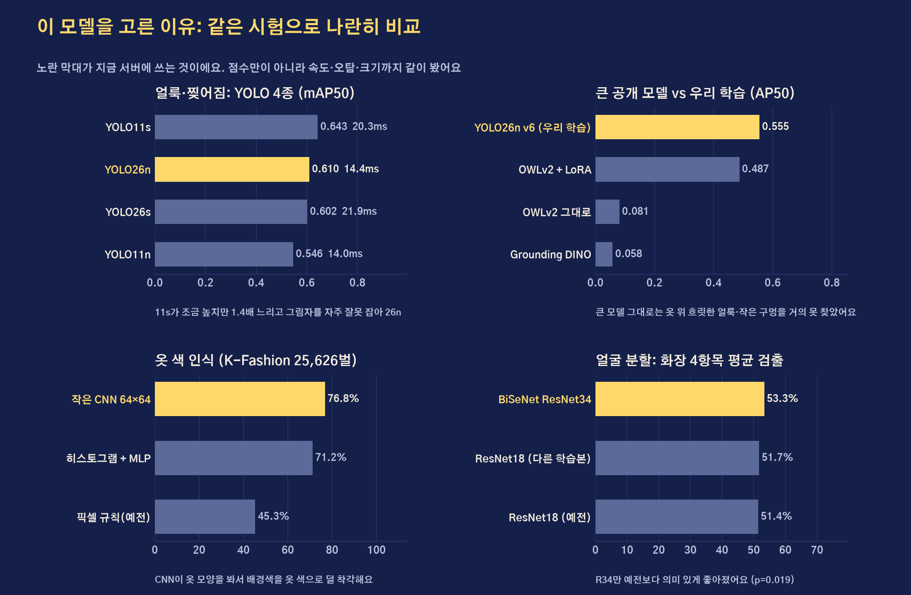
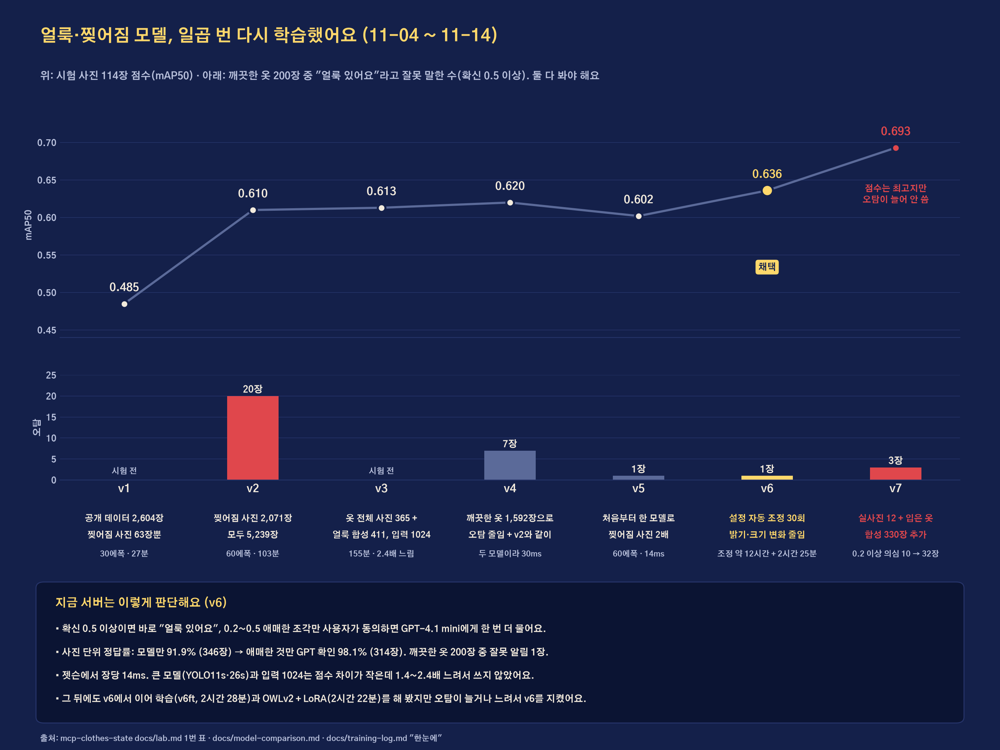
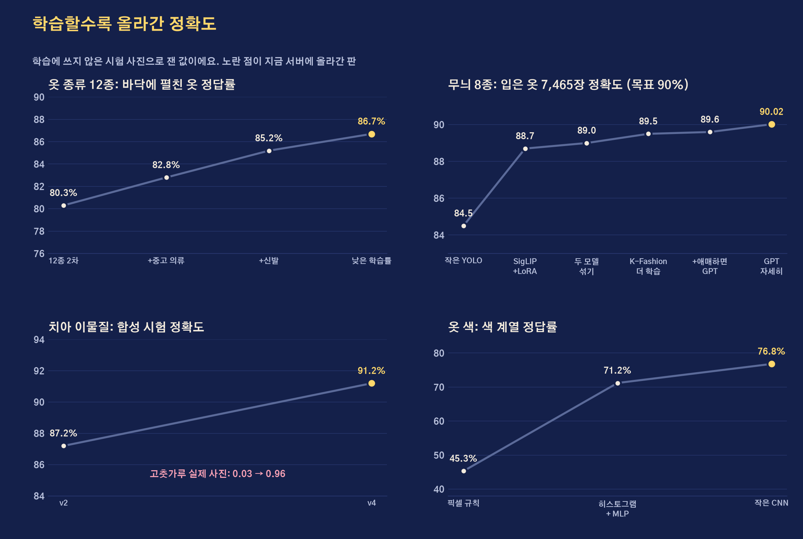
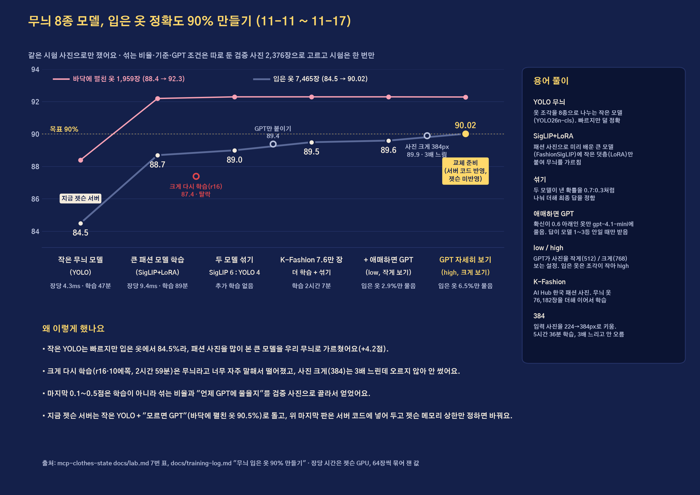
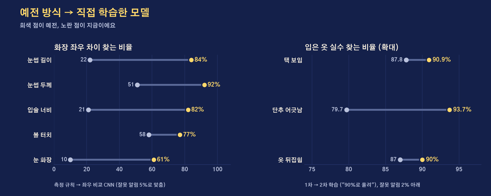

# 🧠 모델을 고른 이유와 학습 기록

[← 조직 소개(README)로 돌아가기](https://github.com/fashion-agent-team/.github/blob/main/profile/README.md)

## 🧪 이 모델을 고른 이유

> 처음 떠오른 모델을 그냥 쓰지 않았어요. **같은 시험 사진, 같은 채점 코드**로 후보를 나란히 재고 점수·속도·잘못 알림·크기·라이선스까지 본 뒤 골랐어요. 옷 쪽에서 56가지, 얼굴 쪽에서 53가지, 모두 **109가지 방식**을 비교했어요.

> 그림 아래 **용어 풀이**에 mAP50(결함 상자를 맞게 찾은 정도, 1에 가까울수록 좋음), 오탐, 몸통(백본), 앙상블, p값을 풀어 두었어요. 칸마다 속도·크기·잘못 알림을 같이 적었어요.

<table>
  <tr><th>무엇을</th><th>비교한 후보</th><th>고른 것과 이유</th></tr>
  <tr><td>얼룩·찢어짐</td><td>YOLO11n·11s·26n·26s, OWLv2, Grounding DINO</td><td><b>YOLO26n</b>: 11s와 점수는 비슷한데 1.4배 빠르고(젯슨 장당 14ms) 그림자를 덜 잘못 잡아요. 큰 공개 모델은 그대로 쓰면 AP50 0.08 이하라 우리 데이터로 학습했어요</td></tr>
  <tr><td>옷 사진 벡터 (같은 옷 찾기)</td><td>FashionSigLIP, SigLIP, SigLIP2, FashionCLIP, Jina CLIP, DINOv2, CLIP 등 <b>12개</b></td><td><b>Marqo FashionSigLIP</b>: 같은 옷을 가장 잘 찾았어요. DINOv2·CLIP B 계열은 26~45%에 그쳤어요</td></tr>
  <tr><td>옷 색</td><td>픽셀 규칙, 색 히스토그램 + MLP, 작은 CNN</td><td><b>작은 CNN(0.8MB)</b>: 색 계열 76.8%, 흰 옷 15% → 87%. 옷 모양을 봐서 배경색에 덜 속아요</td></tr>
  <tr><td>무늬</td><td>YOLO 분류, FashionSigLIP LoRA·분류 층만·입력 384, GPT low/high</td><td><b>LoRA + YOLO 섞기 + 애매할 때만 GPT</b>: 입은 옷 90.02%로 목표 달성 (교체 준비: 서버 코드 반영, 젯슨 미반영). 지금 젯슨은 YOLO 무늬 + 모르면 GPT</td></tr>
  <tr><td>얼굴 분할</td><td>BiSeNet R18 두 학습본·R34, SegFormer, FaRL, MediaPipe</td><td><b>BiSeNet ResNet34</b>: 유일하게 통계적으로 나아졌어요(p=0.019). SegFormer는 3.6배 크고 느리고, FaRL은 646MB라 탈락</td></tr>
  <tr><td>눈 화장 좌우 비교</td><td>밝기 규칙, 작은 CNN, 넓은 망, ImageNet ResNet18·EfficientNet·ConvNeXt 등 젯슨 GPU로 <b>396판</b></td><td><b>서버 모델 + ResNet18 3개 앙상블</b>: 실사진 검출 70.7% → 78.6%, 잘못 알림 4.1%. 같은 평가 사진에서 조합을 뒤지면 점수가 부풀어서, 미리 정한 규칙(하나씩 점수 상위 3개)으로 골랐어요</td></tr>
  <tr><td>치아</td><td>모델 4, 이어 학습 3, LoRA 4, 색 규칙 4, GPT</td><td><b>직접 학습한 v4 + 6번 평균</b>: 깨끗한 이 잘못 알림 1.1%. 얼굴·치아 사진은 GPT로 보내지 않기로 해서 GPT는 탈락</td></tr>
  <tr><td>날씨 데이터</td><td>Open-Meteo, 기상청 단기예보, OpenWeatherMap (5개 도시 × 3번)</td><td><b>Open-Meteo</b>: 응답 0.9초(기상청 3.5초, 가장 느릴 때 15초)에 키 없이 써요. 안 되면 MET Norway로 넘어가요</td></tr>
</table>

## 📈 학습할수록 올라간 정확도

> 한 번 학습하고 끝내지 않았어요. 틀린 사진을 보고 **데이터를 보태고, 다시 학습하고, 다시 쟀어요.** 점수가 올라도 깨끗한 옷을 잘못 알리면 쓰지 않았어요.

> **얼룩·찢어짐:** v1에서는 찢어짐 사진이 63장뿐이라 찢어짐을 거의 못 찾았어요. 데이터를 5,239장으로 늘리고(v2), 깨끗한 옷 1,592장으로 오탐을 줄이고(v4·v5), 설정을 30번 자동 조정해(v6, 약 12시간) 오탐 1장에 mAP50 0.636을 만들었어요. v7은 점수가 더 높았지만 깨끗한 옷을 의심하는 일이 3배라 쓰지 않았어요. 지금 서버는 v6 + "애매하면 GPT 확인"으로 사진 단위 정답률 98.1%예요.

> **옷 종류**는 공개 옷 사진 → 중고 의류 → 바닥에 놓인 신발을 차례로 보태고 학습률을 낮춰 다듬었어요(약 17시간). **같은 옷 찾기**는 글 설명 대신 옷 사진 벡터를 쓰자 36% → 78%로 올랐고 엉뚱한 옷에 합치는 착각은 39% → 1.4%로 줄었어요. **치아**의 "합성 시험"은 깨끗한 이 사진에 고춧가루·깨·밥알을 그려 넣은 시험이에요. **옷 색**의 예전 픽셀 규칙은 그림자·배경이 섞여 흰 옷을 15%만 맞혔어요.

> **무늬 모델은 이렇게 90%를 넘겼어요.** 빠른 작은 모델(YOLO)이 입은 옷에서 84.5%에 머물러, 패션 사진을 많이 본 큰 모델(FashionSigLIP)에 무늬를 가르쳤어요(88.7%). 그다음 두 모델의 답을 섞고, K-Fashion 7.6만 장을 더 배우고, 애매한 옷 6.5%만 GPT에게 크게 보여 물어 **90.02%**가 됐어요.
> 크게 다시 학습(87.4%)과 사진 크게(384px, 3배 느림)는 시험해 보고 뺐어요. 지금 젯슨 서버는 작은 모델 + "모르면 GPT"(바닥에 펼친 옷 90.5%)로 돌고, 마지막 판은 서버 코드에 넣어 둔 **교체 준비** 상태예요.

> **화장:** 재는 규칙으로는 눈썹 꼬리를 지워도 22%밖에 못 찾아서, 왼쪽·오른쪽 조각을 같은 작은 CNN에 넣어 비교하는 모델로 바꿨어요. "잘못 알림 5%로 맞춤"은 화장 안 한 얼굴 100장 중 5장만 "좌우가 달라요"라고 하도록 기준을 정하고 잰다는 뜻이에요. **눈 화장**은 망을 넓히고, 안경 사진을 건너뛰고, 젯슨에서 396판을 학습해 10% → 78.6%까지 올렸어요. 오른쪽 아래 그림은 눈금을 75~98로 확대했어요.

<b>숫자로 보는 학습 기록</b>

| 모델 | 다시 학습한 횟수 | 처음 → 지금 |
| --- | ---: | --- |
| 얼룩·찢어짐 | 7판 + 이어 학습·OWLv2 LoRA | mAP50 0.485 → **0.636**, 깨끗한 옷 200장 오탐 20장 → **1장** |
| 옷 종류 | 5종 → 12종, 6판 | 바닥에 펼친 옷 80.3% → **86.7%**, 바닥 신발 0.015 → **0.991** |
| 무늬 8종 | 7단계 (탈락 2판 포함) | 입은 옷 84.5% → **90.02%**(교체 준비), 바닥에 펼친 옷 88.4% → **92.3%** |
| 옷 색 | 3가지 방식 | 색 계열 45.3% → **76.8%**, 흰 옷 15% → **87%** |
| 같은 옷 찾기 | 사진 모델 12개 비교 + 보정 행렬 | 맞게 합침 36% → **78%**, 엉뚱한 옷에 합침 39% → **1.4%** |
| 입은 옷 실수(택·단추·뒤집힘) | 단추 모델 6판 (실제 사진으로 이어 학습) | 단추 79.7% → **93.7%** |
| 화장 좌우 비교 | 약 35가지 방식 | 눈썹 길이 22% → **84%**, 멀쩡한 사진 잘못 알림 63% → **31%** |
| 눈 화장 | 젯슨 GPU 396판 | 실사진 검출 약 10% → 50% → 61% → 72% → **78.6%** |
| 치아 이물질 | v1 → v4, LoRA·이어 학습 7가지 (시간이 남은 9판 2.5시간) | 합성 시험 87.2% → **91.2%**, 고춧가루 실사진 0.03 → **0.96** |

자세한 표: [clothes-state 실험 비교표](https://github.com/fashion-agent-team/mcp-clothes-state/blob/develop/docs/lab.md) · [학습 기록](https://github.com/fashion-agent-team/mcp-clothes-state/blob/develop/docs/training-log.md) · [face-check 실험 비교표](https://github.com/fashion-agent-team/mcp-face-check/blob/develop/docs/lab.md)

