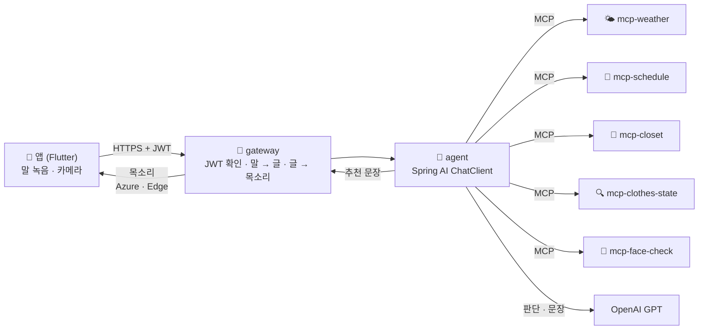

# 💻 기술 스택: 어디에 어떻게 썼나요

[← 조직 소개(README)로 돌아가기](https://github.com/fashion-agent-team/.github/blob/main/profile/README.md)

### 🧭 "오늘 뭐 입지?" 한마디가 지나가는 길

1. **앱**이 말을 녹음해 gateway로 보내요. 카메라를 쓸 때는 ML Kit가 폰 안에서 구도를 먼저 잡아 줘요
2. **gateway**가 JWT를 확인하고, 말을 글로 바꾼 뒤 agent에 넘겨요
3. **agent**가 의도를 나누고, 필요한 MCP 서버(날씨·일정·옷장·옷 상태·얼굴)에서 데이터만 받아 와요
4. 모은 데이터로 **GPT**가 판단하고 추천 문장을 만들어요
5. gateway가 문장을 **Azure Speech** 목소리로 바꿔 앱에 돌려주고, 앱이 읽어 줘요

### 🔧 어디에 어떻게 썼나요

<b>📱 App: Flutter · ML Kit · Firebase</b>

 

| 기술 | 어디에 | 어떻게 |
| --- | --- | --- |
| **Flutter** (Dart 3) | 앱 전체 | iOS·Android를 한 코드로 만들어요. 화면을 거의 보지 않는 사용자를 생각해 모든 흐름을 말과 소리, 진동으로 이어요 |
| **ML Kit** 얼굴·포즈·물체 인식 | 카메라 구도 안내, 자동 촬영 | 폰 안에서 실시간으로 얼굴·몸·옷을 잡아 "조금 왼쪽으로" 같은 말과 소리로 구도를 맞춰요. 멈춘 순간 자동으로 찍어서, 셔터 버튼을 찾을 필요가 없어요 |
| **speech_to_text · record** | 말 걸기 | 이름을 불러 말을 걸면 녹음해 gateway로 보내요 |
| **flutter_tts · audioplayers** | 읽어 주기 | 서버 목소리(Azure·Edge)를 재생하고, 서버가 안 되면 폰 TTS로 대신 읽어요 |
| **Firebase Auth · Google Sign-In** | 로그인 | 구글로 로그인하면 Firebase 토큰을 gateway가 확인해 우리 JWT로 바꿔 줘요 |
| **flutter_secure_storage** | 토큰 보관 | JWT와 갱신 토큰을 폰의 안전한 저장소에 둬요 |
| **flutter_local_notifications** | 일정 알림 | 일정마다 정한 시각에 폰 알림을 띄워요 |
| **geolocator** | 내 위치 날씨 | 지금 위치로 날씨를 물어요 |

<b>🚪 gateway: Spring Cloud Gateway · JWT · 음성</b>

 

| 기술 | 어디에 | 어떻게 |
| --- | --- | --- |
| **Spring Cloud Gateway** (Web MVC, 가상 스레드) | 들어오는 문 | 앱 요청을 한곳에서 받아 agent로 보내고, 사용자별 사용량을 제한해요. 가상 스레드라 음성처럼 오래 걸리는 요청이 쌓여도 버텨요 |
| **Nimbus JOSE (JWT)** | 인증 | Firebase 토큰을 확인한 뒤 우리 서비스용 JWT를 발급해요. 뒤쪽 서비스는 JWT의 `sub`(= `user_id`)만 보고 사람을 구분해요 |
| **JdbcClient + Flyway** | 회원정보 (account 스키마) | `users`·`profiles`·`user_identities`·`push_tokens`·`refresh_tokens`를 마이그레이션으로 관리해요 |
| **OpenAI gpt-4o-mini-transcribe** | 말 → 글 | 녹음한 말을 글로 받아 적어요 |
| **Azure Speech · edge-tts** | 글 → 목소리 | Azure 목소리 4가지(유진·지민·서현·순복)와 Edge 목소리 3가지 중 사용자가 고르고, Azure가 막히면 edge-tts 사이드카로 넘겨요 |

<b>🧠 agent: Spring AI · MCP · GPT · Redis</b>

 

| 기술 | 어디에 | 어떻게 |
| --- | --- | --- |
| **Spring AI ChatClient** | 대화 두뇌 | 말을 의도로 나눠요. 옷 추천·옷 확인·날씨·얼굴·옷장은 정해진 순서(코드)로 도구를 부르고, 일정 넣기·지우기처럼 자유로운 말만 GPT가 도구를 골라요 |
| **Spring AI MCP Client** | 서비스 연결 | MCP 서버 5개를 도구로 붙여요. 서버가 다른 젯슨으로 옮겨가도 주소만 바꾸면 돼요 |
| **OpenAI GPT** | 판단과 문장 | 날씨·일정·옷장·옷 상태를 모아 "오늘 이 옷이 맞는지" 판단하고, 색을 느낌으로 풀어 말해요 |
| **Redis** | 대화 기억 | 대화 세션(30분)을 저장해서 "그거 말고 다른 거"처럼 앞 말을 이어받아요 |

<b>🔌 MCP 서버: Spring AI MCP Server</b>

 

모든 MCP 서버는 **Spring Boot 4 + Spring AI MCP Server(Web MVC)** 로 만들었고, 판단 없이 **데이터만** 돌려줘요.

| 서버 | 핵심 기술 | 어떻게 |
| --- | --- | --- |
| 🌤 **mcp-weather** | Open-Meteo, MET Norway, Caffeine | 오늘·날짜별 기온·체감·일교차·강수를 줘요. Open-Meteo가 끊기면 두 번 더 묻고, 그래도 안 되면 MET Norway로 넘겨요. 같은 질문은 Caffeine 캐시로 바로 답해요 |
| 📅 **mcp-schedule** | Spring Data JPA, Flyway, 카카오 로컬 | 일정에 자리 종류(면접·결혼식 등)와 장소 종류를 붙여요. 장소는 카카오 로컬로 찾아 `places`에 한 번만 저장해요. 격식 있는 일정은 드라이클리닝을 미리 알려 줘요 |
| 🔍 **mcp-clothes-state** | ONNX Runtime, YOLO26n, 색 CNN, FashionSigLIP + LoRA | 옷 한 벌마다 종류 12종·색 20가지·무늬 8종·얼룩·찢어짐을 찾아요. 모델은 Java에서 ONNX Runtime으로 바로 돌려서 파이썬 서버가 따로 필요 없어요. 애매할 때만 옷 부분을 잘라 GPT에 한 번 더 물어요 |
| 💄 **mcp-face-check** | ONNX Runtime, BiSeNet, ResNet18, MobileNetV3 | BiSeNet으로 눈썹·입술·볼을 나누고, 직접 학습한 좌우 비교 모델로 화장 대칭을 봐요. 치아는 MobileNetV3 분류 모델로 봐요. 얼굴 사진은 외부로 보내지 않아요 |
| 👕 **mcp-closet** | Spring AI VectorStore, pgvector, multilingual-e5-small, DJL 토크나이저 | 옷과 코디 지식을 벡터로 저장하고 상황 문장으로 찾아요(RAG). 글 임베딩(e5)은 ONNX로 서버 안에서 직접 만들어서 외부 임베딩 API가 필요 없어요 |

<b>🧬 모델 · 벡터: YOLO · SigLIP · e5 · pgvector</b>

 

| 기술 | 어디에 | 어떻게 |
| --- | --- | --- |
| **YOLO26n** (Ultralytics, 직접 학습) | 얼룩·찢어짐, 옷 종류, 무늬 | 젯슨·맥북에서 PyTorch로 학습하고 ONNX로 내보내 서버에 넣었어요. 결과는 [🧠 직접 학습한 모델](https://github.com/fashion-agent-team/.github/blob/main/profile/README.md#-직접-학습한-모델)에 있어요 |
| **FashionSigLIP** (768차원) | 같은 옷 찾기, 무늬 보조 | 옷 사진을 벡터로 바꿔, 전에 본 옷과 같은지 거리(기준 0.60)로 판단해요 |
| **SigLIP2 So400m** | 옷 종류 보조 | 종류가 애매할 때만 큰 모델에 다시 물어서 젯슨 부담을 줄여요 |
| **multilingual-e5-small** (384차원) | 옷장·코디 지식 검색 | "내일 면접" 같은 한국어 상황 문장을 벡터로 바꿔요 |
| **pgvector** (PostgreSQL 17) | 벡터 저장 | 한 사람의 옷(100벌 안팎)은 정확한 거리로 훑고, 공용 코디 지식(`style_docs`)만 HNSW 인덱스를 써요 |

<b>🖥 Infra: Jetson · Docker · Tailscale</b>

 

| 기술 | 어디에 | 어떻게 |
| --- | --- | --- |
| **Jetson Orin Nano 8GB × 2** | 서버 전체 | 앱 서버(gateway·agent·일정·옷장·DB)와 모델 서버(옷 상태·얼굴·날씨, 학습)로 나눴어요. 8GB 한 대에 다 안 들어가서 나눴어요 |
| **Docker Compose** | 상시 배포 | 레포마다 Dockerfile을 두고, 각 젯슨에서 arm64 이미지를 직접 빌드해 띄워요 |
| **Tailscale (사설망 · Funnel)** | 젯슨 연결, 외부 공개 | 두 젯슨을 사설망으로 잇고, Funnel로 공유기 설정 없이 HTTPS 주소를 열어요 |
| **Nginx** | 앞단 | `simcheong.java21.net` → Funnel → Nginx → gateway 순서로 받아요 |
| **GitHub Actions** | PR 검사 | 모든 레포에서 PR마다 빌드·테스트를 돌려요 |

### 💡 이렇게 고른 이유

- **MCP로 나눈 이유**: 날씨·일정·옷·얼굴을 각자 맡아 따로 만들고, agent는 도구로만 붙였어요. 서버를 다른 젯슨으로 옮겨도 agent는 주소만 바꾸면 됐어요
- **Java + ONNX Runtime**: 학습은 파이썬(PyTorch)으로 하고, 서비스는 Spring 하나로 맞췄어요. 모델을 ONNX로 내보내 Java 서버 안에서 바로 돌려요
- **사진은 먼저 우리 모델이**: 옷과 얼굴 사진은 직접 학습한 모델이 먼저 보고, GPT는 그 결과로 판단해요. 옷이 애매할 때만 옷 부분을 잘라 GPT에 물어보고, 얼굴·치아 사진은 외부 AI로 보내지 않아요
- **작은 장비에 맞추기**: 젯슨 8GB에 맞게 작은 모델(YOLO26n, e5-small)을 기본으로 쓰고, 큰 모델(SigLIP2 So400m)은 애매할 때만 불러요
